# MacStats stability + tour review, round 1, reviewer A (2026-10-06)

**Overall: 7.3/10.** This is a great app with a few noticeable issues. Most of the new work is close to the "basically perfect" band:

- **Lists stay put while you use them.** In a headless live run, no visible row moved while the pointer was in the list or a context menu was open (0 shifts over 16 frozen scans). The expanded app never changed position (0 index changes in 90 s + 60 s + 45 s).
- **The tour spotlight is exactly centred.** The gap is 3.0 pt on all four sides of every step, in light and dark. The corners are concentric: card 8 pt, cutout 11 pt, panel 16 pt.

Several things keep the overall score below 8:

- **A resource bug (High, existed before this branch).** The installed MacStats has been running its "panel open" refresh loop for about 2 hours while its panel was not on screen. That costs about 25–30 % of one core. HEAD switches between open and closed modes the same way, so the bug is probably still there.
- **The quit hint and footnotes are hard to read.** Contrast is about 2:1.
- **App rows only respond to the mouse.** You can't reach them with the keyboard or VoiceOver.
- **The tour invites a click it blocks.** The copy says "Click the card", but the overlay swallows that click.
- **The CPU card is lively.** Its number changes about once a second.

**Standard:** Apple's Battery and Control Center menu-bar panels, Activity Monitor-quality readings, and Apple-quality coach marks (the bubbles that point at parts of the screen). **Method:** both screenshots and code reading. Real SwiftUI views were rendered in an off-screen probe in light and dark. A headless live-flow simulation of about 3 minutes ran the real `MacStatsCore` scan and `MetricsStore`, and the repo's stability and cost probes were re-run. **Reviewer:** independent subagent (reviewer A).

## Calibration

- **Project type & platform.** A native macOS 26 menu-bar system monitor: a SwiftUI `MenuBarExtra(.window)` popover, fixed at 320×404 pt. The surfaces are:
  - overview cards (CPU, Memory, Network, Battery) with sparklines, plus a Trash row and a footer (Quit, `?`, gear)
  - the per-app breakdown, where an app can be expanded into its processes, with right-click Quit / Force Quit
  - the Battery drill-in
  - Settings
  - the first-run welcome, a guided tour, and a "Take the Tour" chip for existing users
- **Audience.** Everyday Mac users, including non-technical ones.
- **Maturity.** Shipping (v1.x).
- **Reference for a 10.** Apple's Battery / Control Center panels, Activity Monitor-quality readings, Apple-quality coach marks.
- **Platform conventions that apply.**
  - Light and dark appearance.
  - Continuous (squircle) corners with concentric radii.
  - Esc and Return behaviour.
  - VoiceOver and keyboard access.
  - Text contrast of at least 4.5:1.
  - A menu-bar extra must cost nothing while closed.
- **Anchors.**
  - **3:** numbers flicker and rows re-sort every tick, so you can't click or expand; the tour is misaligned or traps you; jargon everywhere.
  - **6:** mostly steady, but rows still sometimes move under the pointer or an expanded app collapses; the tour works but the highlight is a few points off-centre or the copy is wordy; some controls are hard to discover.
  - **9:** values are steady enough to read yet current within a few seconds; rows never move out from under the pointer; an expanded app never vanishes; a first-time user understands every card and how to drill in within about 30 s; every tour highlight is exactly centred with concentric corners; the tour can be skipped at any time and replayed; text is plain and short; MacStats's own CPU and RAM are no worse than the baseline.

**Terms used below:**

- **Breakdown:** the per-app list you get by clicking the CPU, Memory or Battery card.
- **Scan:** one read of every process for that list (every 2 s).
- **Expanded / pinned app:** an app row clicked open to show its processes. It keeps its position.
- **Frozen:** the row order is held while the pointer is over the list or a context menu is open, and for about 1 s after.
- **Held value:** the printed number keeps its old value until the reading moves clearly away from it.
- **Flip-back:** a printed value or order that goes A → B → A on consecutive updates.
- **pp:** percentage points of the whole Mac (100 % = all cores).
- **Cutout:** the clear squircle hole in the tour's dimmed overlay around the highlighted element.

## Scoreboard

| Area | Score | Verdict (one line) |
|---|---|---|
| Stability of numbers & lists | 8.0 | Rows never move under the pointer and the pinned app never moves (both measured). The CPU card still changes about once a second. |
| Interaction reliability (expand/collapse, right-click, back, scroll) | 7.5 | Expand, freeze, pin and Esc-back all work. Rows are mouse-only, with no keyboard or VoiceOver path. |
| Intuitiveness & discoverability | 7.5 | The welcome, tour and chevrons teach the drill-in well. The quit hint is faint and shows on only 3 drill-ins. |
| Text / copy clarity | 7.5 | Short, plain tour copy. Some leftover jargon ("pressure normal", "Wired", "Exited processes") and a straight apostrophe. |
| Visual layout, alignment & centering | 8.0 | Exact, concentric squircles everywhere. The footnotes are about 2:1 contrast. |
| Intro & tour (incl. spotlight centering) | 8.5 | Exactly centred (3.0 pt each side), skippable, replayable, resumable, handles Macs with no battery. One copy/interaction mismatch. |
| Code quality of the new code | 8.0 | Pure, tested core logic (338 tests pass) with clear docs. Open/closed state still hangs only on `onAppear`/`onDisappear`. |
| Resource cost | 5.5 | The new code adds nothing while closed and halves the breakdown scan cost. A refresh loop stuck "open" while hidden was observed at 25–30 % of a core. |

---

## Stability of numbers & lists — 8.0/10

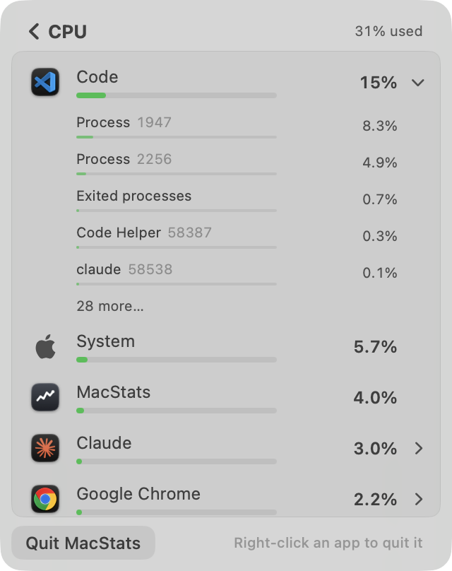

**Evidence (live-flow probe, real `BreakdownScanner` + `MetricsStore`).** The probe ran at the app's cadence: first scan, +0.5 s, then every 2 s, with overview ticks every 0.5 s. It ran during the owner's normal work, with the whole Mac at about 12 % CPU.

- In the CPU phase (90 s), the most process-heavy app (VS Code, 33 processes) was pinned as if expanded.
- The pointer was simulated inside the list at 20–30 s, 30.6–40 s (re-entering 0.6 s after leaving, which tests the 1 s unfreeze delay) and 70–80 s.
- A context menu was simulated as open at 50–54 s.
- A visible row "shift" means that, between two scans, a position in the first 14 visible rows shows a different row. The rows are flattened the same way `BreakdownList.rows` does it.

| Measure | CPU (90 s) | Memory (60 s) | Battery/energy (45 s) |
|---|---|---|---|
| Visible-row shifts while the pointer is in the list or a menu is open | **0** (16 frozen scans; 0 within 1.5 s of re-entry; 0 during the menu) | n/a | n/a |
| Pinned (expanded) app index changes / app lost | **0 / 0** | 0 / 0 | 0 / 0 |
| Top-8 order changes / min (pointer outside) | 5.4 (repo probe re-run: 8.2) | 0.0 | 0.0 |
| Top-8 order flip-backs (A→B→A) / min | 0.0 | 0.0 | 0.0 |
| Visible-row shifts / min (pointer outside) | 19.3 | 2.1 | 0.0 |
| Row text changes / min / row (top 8) | 8.3 (flip-backs 8.7/min over all 8 rows, about 1/min/row) | 0.7 | 2.7 |
| Expanded app's first 5 children: order changes / min | 2.7 (repo probe: child **set** changes 7.3/min) | 1.0 | 0.0 |
| Child text changes / min (5 rows) | 30.7 (flip-backs 2.0) | 2.0 | 6.7 (flip-backs 4.0) |
| Held row text vs exact value, in printed steps | p50 0.3, p95 2.2, max 8.0 (max relative error 11 %) | p95 0.5 | p95 0.5 |
| Header "N% used" changes / min | 18 (flip-backs 2) | | |

Overview cards (0.5 s ticks, 90 s):

| Measure | Value |
|---|---|
| CPU card text changes / min | 55.3 (repo probe re-run: 48.7) |
| CPU card flip-backs / min | 5.3 |
| CPU card held − exact | p50 0.27 pp, p95 0.66 pp, max 0.73 pp; never 1 pp or more off |
| Network ↓ text changes / min | 20.0 (flip-backs 3.3); p95 relative error 3 % |
| Memory card changes / min | 10.0 (repo probe: 7.3) |

**Works well:**

- While the pointer is in the list, or a context menu is open, nothing in view moves. That also holds for the first scan after re-entering within the unfreeze delay.
- The expanded app keeps its place for the whole run.
- Row order changes are rare (5–8 a minute, never an A→B→A bounce). When an order does change, it slides (`.animation(..., value: breakdownOrderRevision)`).
- Memory and energy lists are almost perfectly still.
- The display holds keep the card at most 0.73 pp from the exact value, so it stays current.
- Bars follow exact values while the text is held, which is a good split.

**Issues:**

| # | Severity | Where | Problem | Why it matters | Suggested fix |
|---|---|---|---|---|---|
| S1 | Medium | Overview CPU card (`MetricsStore.swift:170`, step 1, band 0.75) | The big CPU number changes 49–55 times a minute and bounces back about 5 times a minute. | It is readable, but busier than Apple's panels or Activity Monitor (5 s default). "Steady enough to read" is borderline. | Widen the band to about 1.0–1.25 pp, or change the card text at most once a second. Error stays at or below 1.25 pp. |
| S2 | Low | Expanded app's children when the pointer is outside (`MetricsStore.setBreakdown`, child `stableRanking`) | The set of the first 5 child rows changes 7.3 times a minute. "Exited processes" comes and goes, and short-lived helpers enter the top 5. | An expanded list visibly churns while you move toward it. Once the pointer is inside, it freezes. | Hide "Exited processes" below about 0.1 %, or use a stronger hysteresis for children. |
| S3 | Low | CPU row text (`MetricsStore.swift:269`, `relBand` 0.10) | A held row can differ from its exact value by up to 10 % (measured 11 %): for example, "50%" while the bar shows 55 %. | Text and bar disagree a little on busy apps, which is a small accuracy trade-off for an app audited to Activity Monitor parity. | Cap the relative band, for example at min(10 %, 2 pp). |
| S4 | Low | `StableRanking.swift:46-49` (frozen order) | While frozen, a newly heavy app joins at the bottom. If the pointer stays in the list for a long time, a sudden 80 % app can sit off-screen. | It is an edge case, but the point of the list is to find the busy app. | Let a key with a value 2× or more of the current top row bypass the freeze only when it is below the fold, or show a subtle "re-sorted" cue on exit. |
| S5 | Low | CPU header vs card | The card uses a 2 s window and the breakdown header a 4 s window, so "26%" can become "31% used" one click later. | Small, but noticeable when you drill in. | Accept, or show the card's value in the header until the 4 s window fills. |

**Why 8.0:** the two must-haves for a 9 hold, and I measured them directly: nothing moves under the pointer, and an expanded app never vanishes. What keeps this at 8 rather than 9 is S1 (a CPU number that ticks about every second) and the child churn in S2.

---

## Interaction reliability — 7.5/10

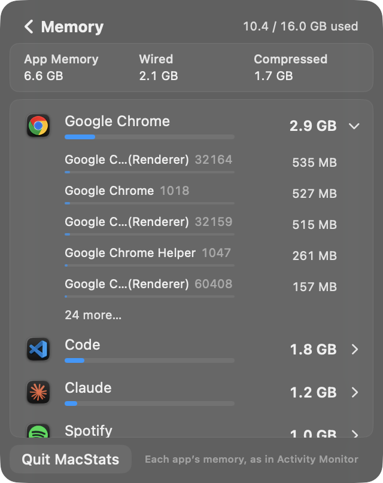

**Works well:**

- A synthetic click on the first app row expanded it: Code (33 processes) in CPU, Chrome (29) in Memory. The chevron rotated, 5 children plus "28 more…" appeared, and the rest of the list moved down cleanly (images above and in the Stability section).
- Esc goes back from the breakdown and from Settings (`.keyboardShortcut(.cancelAction)`).
- The context-menu freeze is wired to `NSMenu.didBeginTracking` / `didEndTracking` (`BreakdownView.swift:122-127`). In the simulation it held the order (0 shifts during the menu).
- When the expanded app quits, the row collapses (`BreakdownView.swift:129-134`).
- "More…" pages in 25 rows at a time.

**Issues:**

| # | Severity | Where | Problem | Why it matters | Suggested fix |
|---|---|---|---|---|---|
| I1 | Medium | `BreakdownView.swift:199` (`.onTapGesture` on `AppRow`) | Rows are not buttons. They have no keyboard focus, no VoiceOver "button" trait, and no accessibility action to expand. Quit is reachable only via `.contextMenu`. | Apple panels are fully keyboard- and VoiceOver-operable. Here a core task (find the app, quit it) is mouse-only. | Wrap the row in a `Button` with `.buttonStyle(.plain)`, or add `.accessibilityAddTraits(.isButton)` plus `.accessibilityAction(named: "Show processes")` and `.accessibilityAction(named: "Quit")`. |
| I2 | Low (plausible) | `BreakdownView.swift:107` (`.onHover` on the list) | After clicking a card, the pointer is already over the area where the list appears. SwiftUI may not send `onHover(true)` until the mouse moves, so the first scan or two can reorder under a still pointer. | It could break "never moves under the pointer" right after drilling in. | Freeze for the first 2–3 s after `beginBreakdown`, or seed `pointerInside` from `NSEvent.mouseLocation`. |
| I3 | Low | Context menus | I could not open or capture real context menus headlessly. The freeze logic was checked in code and simulation only. | Not scored as a defect. | A human should right-click a busy row, wait 5 s, and choose Quit. |

**Why 7.5:** everything I could exercise works and is protected against reordering. I1 is a real gap against the Apple standard for a primary flow.

---

## Intuitiveness & discoverability — 7.5/10

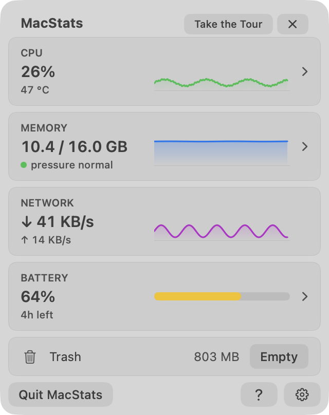

**Works well:**

- First launch opens the panel for a new user and shows a welcome that names the icon. It explains the two upcoming permission prompts before they appear, which is good practice.
- Cards that drill in have chevrons; Network and Trash don't, and keep the same spacing.
- Existing users get a small, dismissable "Take the Tour" chip on 3 opens.
- `?` in the footer and Settings → Help → Take the Tour make the tour easy to find again.
- App rows have tooltips ("Click to show its N processes · Right-click to quit").

**Issues:**

| # | Severity | Where | Problem | Why it matters | Suggested fix |
|---|---|---|---|---|---|
| D1 | Medium | `BreakdownView.swift:110-111`, `Tour.swift:177` | The only on-screen hint that right-click quits an app ("Right-click an app to quit it") is `.tertiary` `caption2`, about 2:1 contrast (see Visual), and appears on only the first 3 drill-ins. After that, Quit is discoverable only via a tooltip. | Quitting the culprit is the main reason a non-technical user drills in. | Use `.secondary`, keep the hint until the user has used the menu once, or add a visible hover affordance (an "…" button on the hovered row that opens the same menu). |
| D2 | Low | Network card | It is the only data card without a drill-in. Its tooltip explains the arrows, but nothing says per-app network isn't available. | A user may click it expecting a breakdown. | Leave it, or let the tour say "no per-app view". |

**Why 7.5:** the welcome and tour make the overview and the drill-in learnable within about 30 s. Quitting an app is the weak spot.

---

## Text / copy clarity — 7.5/10

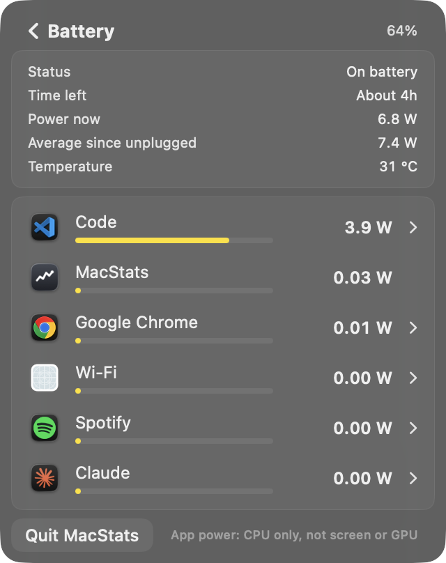

**Works well:**

- Tour titles are 4 words or fewer and bodies 20 words or fewer, enforced by `TourCatalogLintTests`.
- Typographic ’, Title Case buttons, no live numbers in the tour.
- Battery labels are plain ("Power now", "Average since unplugged", "About 4h").
- The CPU footnote explains the scale ("Share of the whole Mac (all 8 cores)").
- Memory tooltips were rewritten in plain words.

**Issues:**

| # | Severity | Where | Problem | Why it matters | Suggested fix |
|---|---|---|---|---|---|
| T1 | Low | `OverviewView.swift:116-118` | "pressure normal" / "pressure high" (lower case, unexplained jargon) under the memory value. | A non-technical user doesn't know "pressure". The tour does explain the dot colour. | "Memory: OK" / "Running low", or keep the term but add a `.help`. |
| T2 | Low | Memory parts card, breakdown rows | "Wired", "Compressed", "Exited processes", "Other processes" are Activity Monitor terms. They have good tooltips, but tooltips are slow to discover. | Fine for power users; a little opaque for the target audience. | Acceptable; perhaps "Ended processes". |
| T3 | Low | `SettingsView.swift:65` | "what's" uses a straight apostrophe, while every other string uses ’. | Inconsistent typography. | Use ’. |
| T4 | Low | `Tour.swift:40` | "Click the card to see which apps" is slightly clipped. | Minor clarity. | "…to see which apps use it." |

**Why 7.5:** the copy is short and mostly plain, with only a few jargon leftovers.

---

## Visual layout, alignment & centering — 8.0/10

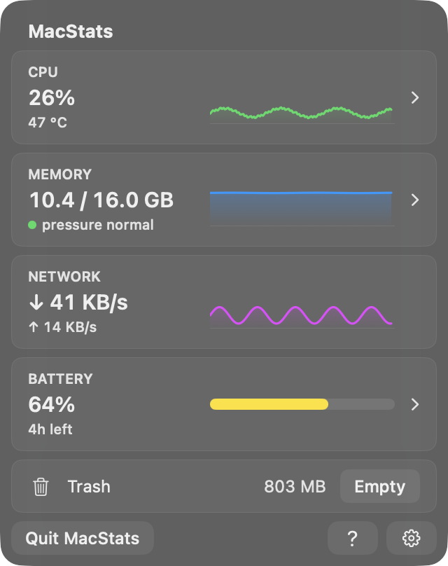
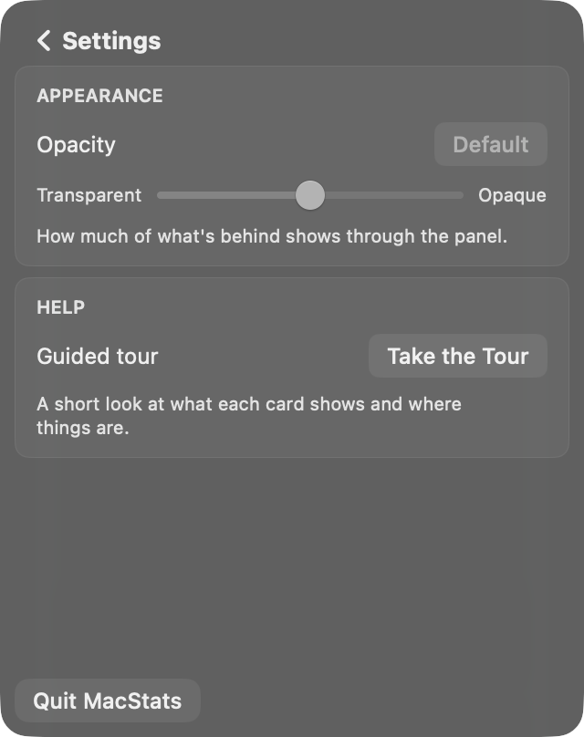
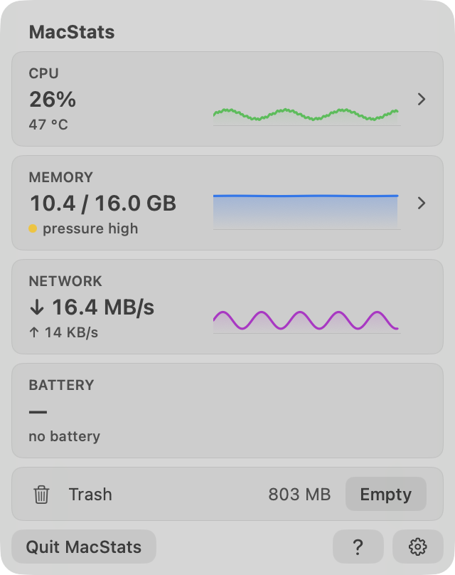

**Works well:**

- All surfaces use continuous corners with concentric radii: panel 16, cards 8, row highlights 4, and footer `?`/gear and Quit at 8.
- The 6 pt card rhythm and 12 pt content inset are consistent.
- The value column is fixed so graphs line up.
- Light and dark both look correct.
- Edge states render cleanly: MB/s, a yellow pressure dot, no battery, "Measuring…", long process names truncated in the middle.

**Issues:**

| # | Severity | Where | Problem | Why it matters | Suggested fix |
|---|---|---|---|---|---|
| V1 | Medium | Breakdown footnote / quit hint (`BreakdownView.swift:111`, `.tertiary` `caption2`) | Measured contrast is about 1.8:1 in light and 2.2:1 in dark. The same pixel method gives about 4.3:1 for the overview's secondary text. | It falls well under 4.5:1 for the one line that teaches Quit (D1). | Use `.secondary`. |
| V2 | Low | Battery card on a Mac without a battery | It shows a dead card ("—", "no battery") taking a full row. | Apple hides absent hardware. | Hide the card, or collapse it to one line. |
| V3 | Low | Settings | About 45 % of the panel is empty below the two cards. | It looks unfinished next to the dense overview. | Fine until more settings arrive. |

**Why 8.0:** the layout is precise and native-looking. V1 is the only real legibility issue.

---

## Intro & tour — 8.5/10

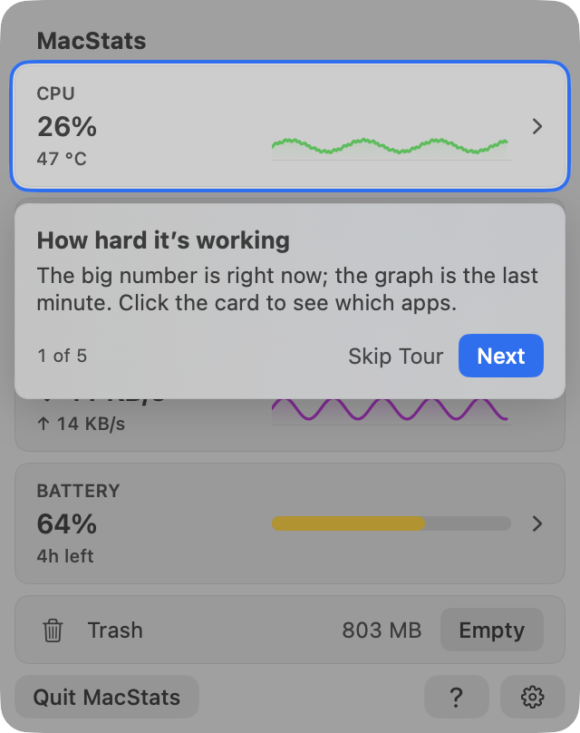
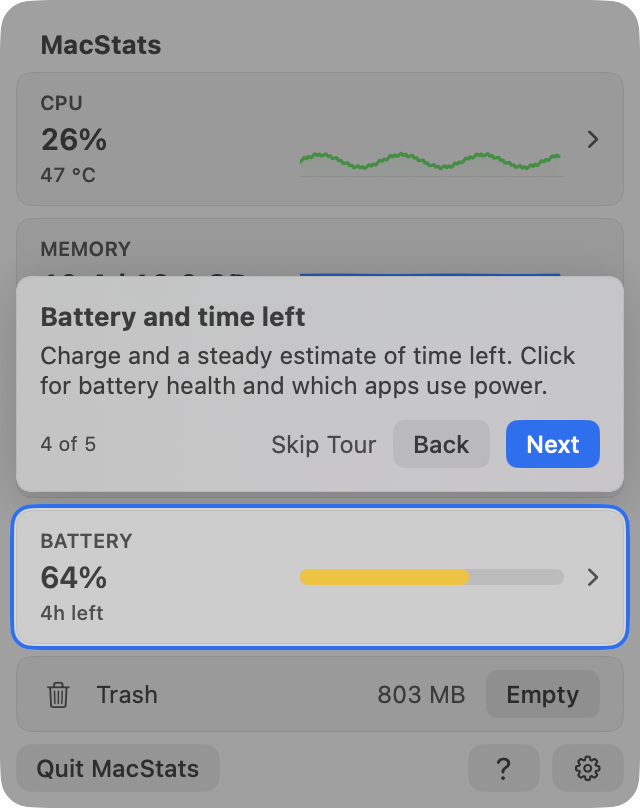
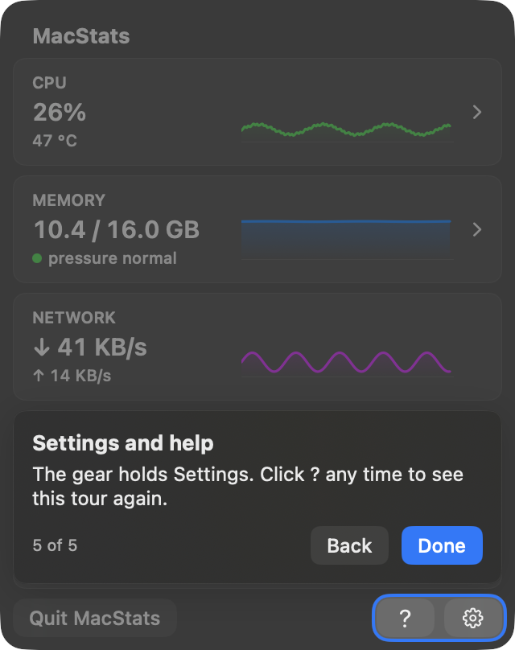
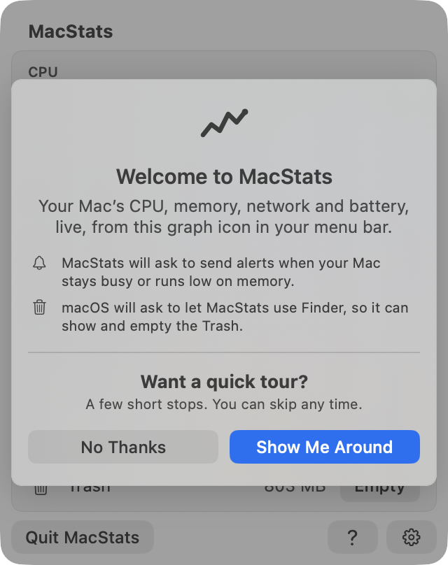
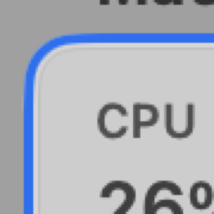 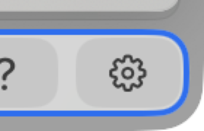

**Spotlight centering, measured two ways.**

1. **Geometry.** I took the anchor rect the overlay resolves and fed it to `TourLayout.cutout`.
2. **Pixels.** I compared a capture with the tour against the same window without it, at @2x. Walking outward from each card edge along its centre row and column, I counted unchanged pixels (the gap) and then accent pixels (the ring). The dim starts after the ring.

| Step | Target rect (pt) | Cutout rect (pt) | Insets L / R / T / B (pt), geometry | Pixels @2x gap+ring (each side) | Radius |
|---|---|---|---|---|---|
| 1 CPU (light, dark) | 8,36 304×67 | 5,33 310×73 | **3.00 / 3.00 / 3.00 / 3.00** | 2+4 = 3.0 pt on all four | 11 (card 8 + 3) |
| 2 Memory | 8,109 304×67 | 5,106 310×73 | 3.00 / 3.00 / 3.00 / 3.00 | 3.0 pt on all four | 11 |
| 3 Network | 8,182 304×67 | 5,179 310×73 | 3.00 / 3.00 / 3.00 / 3.00 | 3.0 pt on all four | 11 |
| 4 Battery | 8,255 304×67 | 5,252 310×73 | 3.00 / 3.00 / 3.00 / 3.00 | 3.0 pt on all four | 11 |
| 5 Footer `?`+gear | 234,372 78×24 | 231,369 84×30 | 3.00 / 3.00 / 3.00 / 3.00 | 3.0 pt on all four | 11 (5 pt from the panel edge: 16 − 5 = 11, concentric) |
| No-battery footer ("4 of 4") | same as 5 | same | 3.00 each | 3.0 pt each | 11 |

The clear gap is 1 pt and the ring is 2 pt on every side, in both appearances. The zooms show concentric continuous corners.

**Works well:**

- **Skippable at any moment:** Skip Tour on steps 1–4, Esc, and No Thanks on the welcome.
- **Back/Next** with ←/→, and Return for the default button.
- **Replayable** from `?`, Settings, and the chip.
- **Survives a panel close:** the first close pauses and the tour resumes at that step; the second close ends it.
- **No battery handled:** the Battery step is skipped and the counter reads "4 of 4".
- **Respects accessibility settings:** VoiceOver announcements, Reduce Motion cross-fades, Reduce Transparency gives a solid surface, Increase Contrast thickens the ring.
- **Stable callout:** it keeps the cards' width and inset, and its height is fixed by reserving 2 lines, so it never jumps.
- **Cheap:** the tour costs nothing when off, because anchors report only while it is active.

**Issues:**

| # | Severity | Where | Problem | Why it matters | Suggested fix |
|---|---|---|---|---|---|
| R1 | Medium | `Tour.swift:40,46` vs `TourOverlay.swift:127-131` | Steps 1 and 4 say "Click the card…/Click for battery health…", but the dim (including the hole) swallows every click, so clicking the highlighted card does nothing. | A first-time user does what the bubble says and nothing happens. That is a small trust hit, and not Apple coach-mark behaviour. | Either let a click in the cutout end the tour and perform the drill-in, or change the copy to "Later, click the card…". |
| R2 | Low | `MacStatsMain.swift:18-21` | The first-run auto-open depends on a fixed `asyncAfter(2.5 s)`, guessed to come after the hover hook has found the status button. | If the hook is slower (a busy login), the welcome waits for the first manual click. That is harmless but nondeterministic. | Have `StatusItemHover` call back when it finds the button. |
| R3 | Low | Step 1 / step 4 callouts | The translucent callout covers half of the next card's big number, so a half-cut "↓ 41 KB/s" peeks out under it. | Slight visual noise. | Acceptable; or stop the dimmed content from showing through the callout's lower edge. |
| R4 | Not scored | `AppDelegate.applicationShouldHandleReopen` → `performClick` | Untested when the status item is hidden (notch or menu-bar overflow), which is exactly the case it is meant for. On this Mac the installed MacStats status item window is currently off-screen. | Might open nothing, or open off-screen. | A human should check with the icon hidden. |

**Why 8.5:** centering is perfect, which is the 9 bar. The tour can be skipped, replayed and resumed, and its copy is short. R1 is the one thing an Apple coach mark would not do.

---

## Code quality of the new code — 8.0/10

**Works well:**

- The logic is split into pure, documented functions in `MacStatsCore`:
  - `stableRanking`: the two-reading lead, pinned keys, freeze, memory group rows last
  - `heldValue` / `heldMemory` / `heldRate` / `heldTimeLeft` / `heldTimeToFull`, with stated error bounds
  - `TourState` / `TourRules` / `TourLayout`, with pixel snapping per edge
  - the `BreakdownScanner` trailing window, keyed by pid + start time so a reused pid isn't a new row
- Each has tests: `StableRankingTests`, `DisplayHoldTests`, `TourStateTests`, `TourLayoutTests`, `TourRulesTests`, `TourCatalogLintTests`, `MetricsStoreBreakdownTests`, `BreakdownWindowTests`. `./Scripts/test.sh` ran **338 tests in 45 suites, all passing**.
- The view layer stays thin. `TourController` is observed only by `RootView`, so tour steps don't re-render the cards.
- Comments explain *why*, citing measurements.

**Issues:**

| # | Severity | Where | Problem | Why it matters | Suggested fix |
|---|---|---|---|---|---|
| C1 | Medium | `RootView.swift:52-60`, `AppModel.setVisibility` (`MacStatsApp.swift:128-153`) | Open/closed state (0.5 s ticks, publish pause, tour pause/resume) is driven only by SwiftUI `onAppear`/`onDisappear` on the `MenuBarExtra` content. See Resource cost: the installed build is stuck in "open" with the panel off screen. The new tour lifecycle (`tour.panelOpened` / `panelClosed`) inherits the same single point of failure. | Missed disappear events cost CPU, and would also leave the tour "active". | Also drive visibility from the panel `NSWindow`: `didChangeOcclusionState` (already observed in `GlassTintHook.HookView`), `orderOut`/`willClose`, or a `tick()` guard on `window.isVisible`. |
| C2 | Low | `MetricsStore.swift` (now 380 lines) | It holds sampling, publish-pause, card holds, and all breakdown display state (order, child order, holds, freeze, pin, energy scale). | It is getting broad. The breakdown display state is a natural value type to extract (for example `BreakdownDisplay`), which would also simplify tests. | Extract it. |
| C3 | Low | `TourOverlay.swift:173-184` | Zero-size, `opacity(0)` buttons carry the arrow-key and Esc shortcuts. | It works and is commented, but it is a hack that can break with SwiftUI changes. | `onKeyPress` (macOS 14+). |
| C4 | Low | `BreakdownView.swift:347`, `BatteryDetailsCard.swift:86` | Two near-identical "help only when non-nil" extensions (`tooltip`, `rowHelp`). | Duplication. | One shared `View.help(_: String?)`. |

**Why 8.0:** this is clean, tested, well-reasoned code. C1 is the one structural weakness, and the bug it allows exists in the wild.

---

## Resource cost — 5.5/10

**Evidence:**

| Measure | Value |
|---|---|
| Breakdown scan (repo probe, re-run) | 10.6 ms mean per scan at 0.51 scans/s = **5.4 ms/s**, off the main thread; `setBreakdown` 0.38 ms per scan on main |
| Live probe process (scans + store, no UI) | 0.5–0.6 % of one core with a breakdown open |
| Tour cost probe (repo `tour-render/run.sh --cost`, overview window ticking at 0.5 s) | **13.2 %** of one core with the tour off, **14.6 %** on step 1 |
| Work while the panel is closed | Code reading shows nothing new: no timers, observers or anchors. The scan, ranking and holds exist only between `enterBreakdown` and `exitBreakdown`. |
| Installed `~/Applications/MacStats.app` (v1.1.0, built 17:49, **before** this branch's first commit) | pid 55352: **25:20 of CPU over 1:39 elapsed (about 25.6 %), then about 28 % over the next 14 min** (`top` 25–26.5 %). The window list shows its 320×404 panel `onscreen: false`. A 3 s `sample` shows `AppModel.tick()` / `scheduleNextTick()`, `SparklineShape.path` / `monotoneCubicSegments`, and AppKit display-cycle layout on the main thread. In other words, the 0.5 s open-panel loop and its sparkline slide animations are running with the panel hidden. The same process also shows up in the probe's own CPU breakdown at 4.0 % of the Mac. |

**Issues:**

| # | Severity | Where | Problem | Why it matters | Suggested fix |
|---|---|---|---|---|---|
| X1 | **High**: confirmed on the installed build; plausible on HEAD, which uses the same visibility code | `RootView.swift:52-60` + `AppModel.setVisibility` | The app can stay in "popover open" mode (0.5 s ticks + continuous sparkline animation) while the panel is not on screen. It burned about 25–30 % of one core for about 2 hours on this Mac. | A menu-bar monitor that quietly uses a quarter of a core is the opposite of its job. It also skews every reading. | See C1: tie `setVisibility(.idle)` to the panel window really leaving the screen, and make `tick()` bail if the window isn't visible. Then reproduce: open the panel, switch Spaces, lock the screen or let the display sleep, and hide the icon via menu-bar overflow, checking `ps -o pcpu` after each. |
| X2 | Medium (existed before this branch) | `Sparkline.swift:54-59` | With the panel open, the overview costs about 13 % of a core in the probe window: three sparklines slide linearly for 0.5 s every 0.5 s, so they animate continuously. | It is high for a glanceable panel. Apple's panels idle near 0. | Slide with a cheaper `drawingGroup`, or slide every 1 s. Measure with `run.sh --cost`. |
| X3 | Low | Tour | Adds about 1.4 pp only while the tour is on screen. | Negligible. | — |

**Why 5.5:** judged on its own, the new code meets the bar. It adds no idle cost, scans cost about half what they did, and the tour is free when off. But the area is MacStats's own CPU, and I observed a High issue live on this Mac. Its root cause sits in the same lifecycle code HEAD still uses.

---

## Cross-cutting issues

- **Lifecycle.** Visibility, publish pausing and the tour pause all hang on `onAppear`/`onDisappear` (C1/X1). This is the most important thing to harden.
- **Secondary text contrast.** `.tertiary` is used for footnotes and the quit hint (V1/D1); `.secondary` is used everywhere else. Make that one consistent choice.
- **Accessibility parity.** The tour is very accessible (announcements, Reduce Motion, Increase Contrast, keyboard), but the breakdown rows it teaches users to click are not (I1).

## Top fixes (ranked by impact ÷ effort)

1. **Make the open/closed switch robust** (X1/C1, High). Drive `setVisibility(.idle)` from the panel window's occlusion or close, plus a `tick()` guard on window visibility (`RootView.swift:52-60`, `MacStatsApp.swift:128-176`). Then confirm the installed app idles near 0 % after hiding the panel in every way.
2. **Raise footnote and quit-hint contrast** (V1/D1). In `BreakdownView.swift:111`, change `.tertiary` → `.secondary`, and keep "Right-click an app to quit it" until the context menu has been used once (`Tour.swift:177`).
3. **Fix the tour's "Click the card" mismatch** (R1). Let a click inside the cutout end the tour and drill in, or reword steps 1 and 4 (`Tour.swift:40,46`; `TourOverlay.swift:127-131`).
4. **Make app rows real buttons with accessibility actions** (I1, `BreakdownView.swift:199`).
5. **Calm the CPU card** (S1). Use band about 1.0–1.25 pp, or at most one text change a second (`MetricsStore.swift:170`). Today it is 49–55 changes a minute with about 5 flip-backs.
6. Low: hide "Exited processes" below about 0.1 % and/or use stronger child hysteresis (S2); plain wording for "pressure normal" (T1); ’ in `SettingsView.swift:65` (T3); a callback instead of the 2.5 s timer (R2).

## Method & limits

**Screenshots.** A SwiftPM probe in the session scratchpad (not committed) compiled the real `Sources/MacStatsApp/*.swift` (minus `MacStatsMain.swift`) with `MacStatsCore` and `CAppleSensors`. It rendered the real `OverviewView` + `.tourHost` + `PanelBackdrop`, `BreakdownView`, `SettingsView`, `TourCallout` and `WelcomeCard`:

- borderless windows at `CGWindowLevelForKey(.desktopWindow)+1`, `orderBack`, never activated
- an `NSVisualEffectView(.popover)` squircle background
- captured with `CGWindowListCreateImage(.optionIncludingWindow, [.boundsIgnoreFraming, .bestResolution])`
- light and dark via `NSApp.appearance`

The data sources were:

- **Overview:** synthetic but realistic data in a real `MetricsStore`.
- **Breakdowns:** **real** process scans (`BreakdownScanner`, 3 scans 0.5 s and 2 s apart).
- **Expanding:** a synthetic mouse-down/up on the row (`NSApp.postEvent` + `nextEvent` + `hitTest(...).mouseDown/mouseUp`).

Tour state used throwaway `UserDefaults` suites, which were deleted afterwards along with their plists. All windows were closed. The pixel and geometry inset numbers are in the Intro & tour table.

**Live flow.** A headless probe (scratchpad, `swiftc` with `Sources/MacStatsCore`) ran the real scan path and `MetricsStore` at the app's cadence: CPU 90 s, Memory 60 s, Energy 45 s. It simulated pointer in/out (including re-entry 0.6 s after leaving), a context menu, and an expanded (pinned) app, and counted what a user would see: flattened visible rows, printed texts, and card texts. I also re-ran the repo's probes:

- `docs/research/2026-10-06-probes/stability/run.sh 90 Code`: results in the Stability section, consistent with mine.
- `tour-render/run.sh --cost`: results in Resource cost.

**Does the repo's stability probe measure the right thing?** Mostly yes, with gaps:

- It counts top-8 slot and text changes and the frozen window correctly.
- It does not cover Memory or Energy breakdowns, flip-backs, the expanded app's flattened rows (child rows can shift what is under the pointer), the context-menu freeze, re-entry within the unfreeze delay, or how far the held values lag the exact ones.
- Its `target_moves` is 0 by construction (the target is pinned).

My probe adds all of those. On this run the repo probe's own `target_child_set_changes` (7.3/min) exceeds its README's ≤ 2 target.

**Not checked:**

- **Panel background:** the real `MenuBarExtraWindow` Liquid Glass panel and `PanelShape`. Screenshots use `NSVisualEffectView`, so absolute contrast can differ slightly.
- **Pointer-driven states:** real hover highlights, real context menus, tooltips, and real `onHover` delivery (I2). Moving the mouse was off-limits.
- **First-launch flow:** the first-launch auto-open and relaunch-to-open (`performClick`), especially with the status icon hidden (R4).
- **Accessibility tools:** VoiceOver output.
- **Resource cost:** HEAD's resource behaviour in a real menu-bar session. I measured probes plus the installed pre-branch build, and did not install HEAD, per the rules.

**A human should check:**

1. Open the panel, then switch Spaces, lock the screen, or let the display sleep. Afterwards, check `ps -o pcpu -p $(pgrep -x MacStats)` stays near 0.
2. Right-click a busy row, wait 5 s, and choose Quit.
3. Run the tour with VoiceOver on.
4. Hide the menu-bar icon and relaunch MacStats from Spotlight.

The installed MacStats (pid 55352) was left running as found. I only read it with `ps`, `top`, `sample` and the window list.
