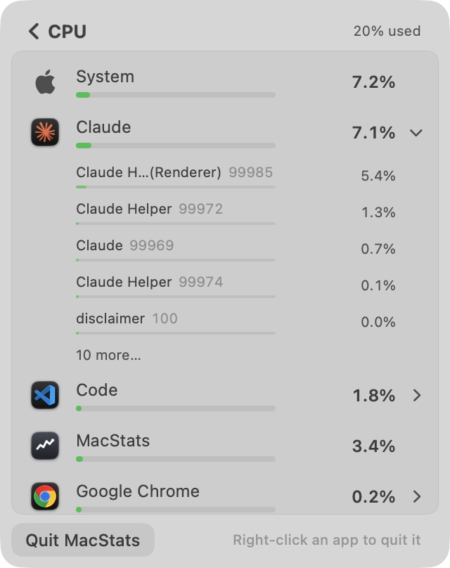
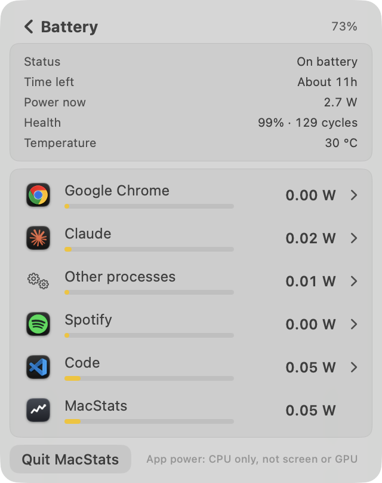
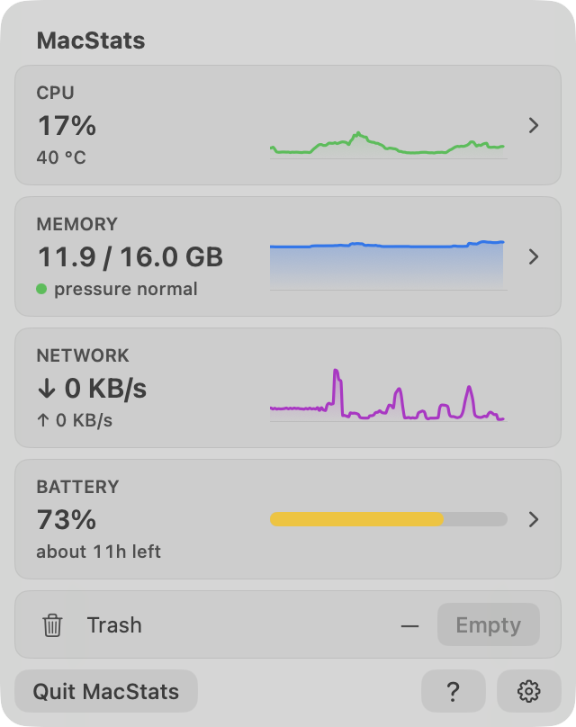
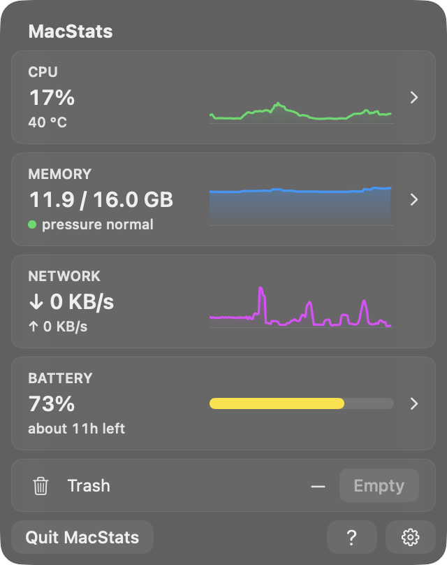
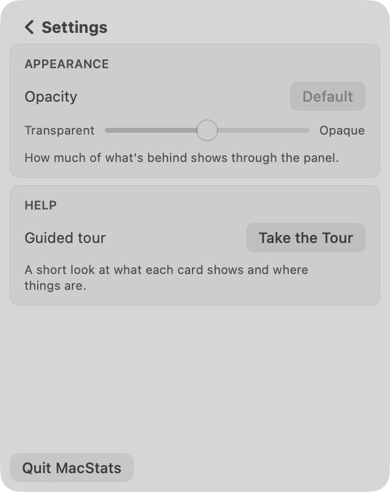
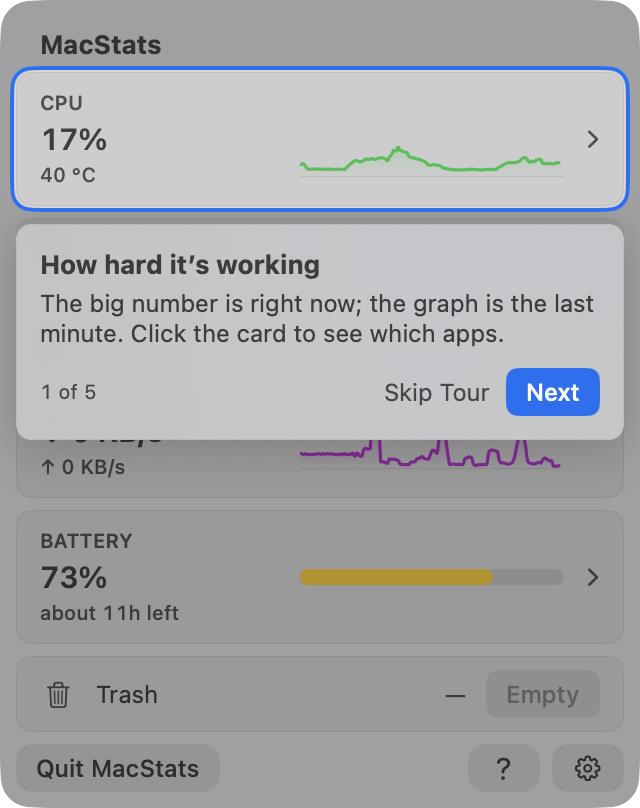
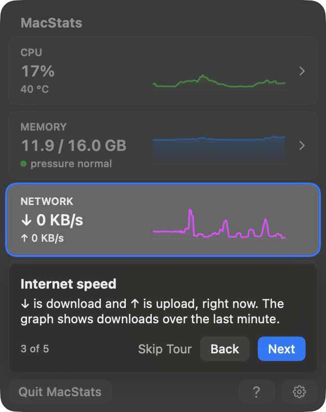
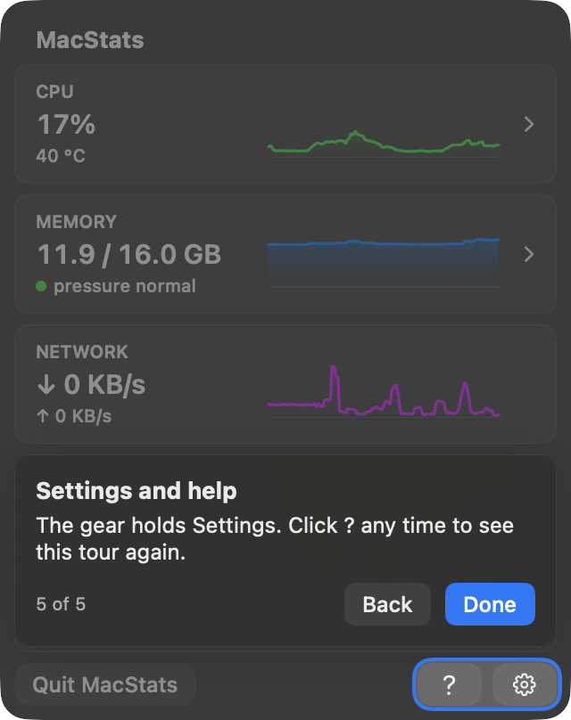
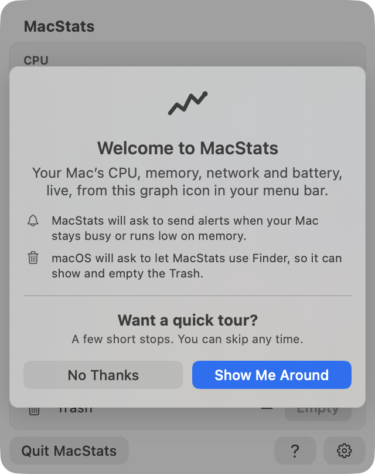
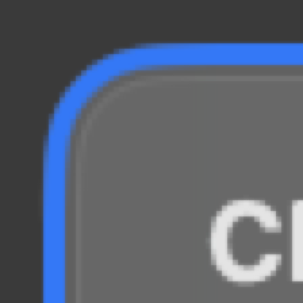

# MacStats stability + guided tour review: round 1, reviewer B (2026-10-06)

**Overall: 7.3/10.** This is a great app with noticeable issues, and it is clearly better than the
baseline. The guided tour is close to Apple quality. Every spotlight measures exactly 3.0 pt on all four
sides, in light and dark, with concentric continuous corners. The welcome card is centred to the half
point, and the tour can always be skipped and replayed. The stability work cut churn sharply compared
with the baseline (1ed61cf): top-8 reorders went from 60 to 8 a minute and expanded-app jumps from
32 a minute to 0. The Memory breakdown is now perfectly still.

Two things keep the primary flow out of the 8–10 band:
- **The ranked lists are often visibly out of order.** The new hysteresis causes this. The Battery
  breakdown was mis-sorted in 84 % of scans (a 0.17 W app below 0.00 W apps). The CPU breakdown was
  mis-sorted in 44 % of scans (a 4.3 % app below a 0.4 % app).
- **The expanded app's own process rows still come and go about every 2–5 s.** The row under a
  resting pointer changed once in 20 s.

The Resource cost section also carries an observation to verify, though this branch did not cause it.
The installed (older) MacStats has been using about 30 % of one core with its panel closed.

**Standard:** Apple's Battery and Control Center menu-bar panels, Activity Monitor-quality readings,
and Apple-quality coach marks · **Method:** both. That means off-screen renders of the real SwiftUI
views (light and dark), headless live-flow simulation of the real `MetricsStore` and
`BreakdownScanner` (60–70 s per breakdown, three runs), cost probes, and reading the code in
`Sources/` · **Reviewer:** independent subagent B (did not read reviewer A, the plans, the research
conclusions or the commit messages).

## Calibration
- **Type and platform:** a native macOS 26 menu-bar app: a SwiftUI `MenuBarExtra(.window)` popover
  with a fixed 320×404 pt panel.
- **Audience:** everyday Mac users, including non-technical ones. They glance at the panel for a few
  seconds, and sometimes drill in to find and quit a heavy app.
- **Maturity:** a shipping app (v1.x, public GitHub releases).
- **What a 10 looks like:** Apple's Battery and Control Center panels for look and calm, Activity
  Monitor for the readings, Apple's coach marks for the tour.
- **Platform conventions:** light and dark appearance, continuous concentric corners, Esc and Return,
  right-click context menus, VoiceOver, Reduce Motion and Reduce Transparency.
- **3** = numbers flicker and rows re-sort every tick, so you can't click or expand; or the tour is
  misaligned or traps you; or there is jargon everywhere.
- **6** = mostly steady, but rows still sometimes move under the pointer or an expanded app
  collapses; the tour works but the highlight is a few points off-centre or the copy is wordy; some
  controls are hard to discover.
- **9** = values are steady enough to read and still current within a few seconds. Rows never move
  out from under the pointer, and an expanded app never vanishes. A first-time user understands every
  card and how to drill in within about 30 s. Every tour highlight is exactly centred with concentric
  corners, the tour is skippable and replayable, and the text is plain and short. MacStats uses no
  more CPU or RAM than the baseline.

**Terms used below:**
- **pp:** percentage points of the whole Mac's CPU (8 cores here), the scale the CPU rows print.
- **Hysteresis:** a row only overtakes the row above it when it leads by a margin on two readings in a
  row (`stableRanking`, `Sources/MacStatsCore/StableRanking.swift`).
- **Hold:** a printed number keeps its old value until the reading moves clearly away from it
  (`Sources/MacStatsCore/DisplayHold.swift`).
- **Frozen:** the breakdown's row order doesn't change while the pointer is over the list or a context
  menu is open.
- **Pinned:** the expanded app keeps its row index while the other rows reorder.
- **Inversion:** a row printed clearly lower than a row below it, by more than max(2 printed steps,
  25 %).

## Scoreboard
| Area | Score | Verdict (one line) |
|---|---|---|
| Stability of numbers & lists | **6.4** | Big gain over the baseline and Memory is perfect. CPU and Battery lists are often visibly mis-sorted, and the expanded app's child rows still churn. |
| Interaction reliability | **7.2** | Expand works, the expanded app keeps its place and never vanished, and Esc goes back. Edge cases: unfreezing after a menu closes, rows unreachable by keyboard or VoiceOver, silent collapse. |
| Intuitiveness & discoverability | **7.6** | Chevrons, tooltips, the right-click hint and the tour cover the basics. "pressure normal", an unlabelled "40 °C" and raw pids are opaque to non-technical users. |
| Text / copy clarity | **7.6** | Short, plain, consistent Title Case. A few loose phrases ("Internet speed", "see which apps") and jargon in the meta lines. |
| Visual layout, alignment & centering | **8.6** | Aligned, concentric squircles everywhere, correct in light and dark. Only nitpicks. |
| Intro & tour (incl. spotlight centering) | **8.8** | Spotlight is 3.0/3.0/3.0/3.0 pt and concentric in both appearances, and the welcome card is centred to 0.5 pt. It is skippable, resumable and replayable. It only describes drilling in rather than showing it. |
| Code quality of the new code | **7.4** | Pure logic in Core with good tests (338 pass). The ranking algorithm has a blocking flaw and the energy margin is mis-tuned, so lists sit out of order. |
| Resource cost | **7.4** | The new code costs less than the baseline, and the tour costs about 1 pp only while it is shown. The installed older build burns about 30 % of a core with the panel closed (pre-existing; verify on HEAD). |

---

## Stability of numbers & lists: 6.4/10

**What I measured.** I wrote my own probe (`r1-B/probe-src/reviewB-main.swift`). It ran the real
`MetricsStore` and `BreakdownScanner` on this Mac's live processes, at the app's cadence:
- overview ticks every 0.5 s;
- breakdown scans at 0 s, at +0.5 s, then every 2 s;
- one app expanded (pinned): the app with the most processes, which was VS Code;
- the pointer resting in the list for 20 s, from 40 % into each run.

It counted what a user would see change, both in the expanded-app layout (`BreakdownList.rows`, the
real flattening code) and in a second run with nothing expanded. I also ran the existing probe
(`docs/research/2026-10-06-probes/stability/`) on HEAD and on the baseline 1ed61cf. Raw output:
`r1-B/probe-run-pinned.txt`, `r1-B/probe-run-unpinned-inversions.txt` and
`r1-B/existing-probe-*.txt`.

**Does the existing probe measure the right thing?** Mostly, with three gaps:
- It checks only top-8 *app* slots, and it ignores a slot change when the old app has vanished
  (`frozen_slot_changes` counts only `present.contains(old)`). So a child process exiting under a
  resting pointer, which a user does see, counts as 0.
- It measures only the CPU breakdown. Memory and Battery are not covered.
- It never checks whether the list is actually sorted.

My probe adds child rows, the "Exited processes" row, inversions, Memory and Battery.

| Measure (live, 8-core M3, whole-Mac CPU about 10–18 %) | Baseline 1ed61cf | HEAD |
|---|---|---|
| CPU breakdown top-8 order changes / min, pointer outside | 60.0 | 8.3 (existing probe); 9.4 pinned / 12.2 unpinned (mine) |
| Expanded app index changes / min | 32.4 | **0** (0 in 3 pinned runs) |
| Expanded app vanished while running | – | **0** |
| CPU row text changes / min, top 8 together | 408.6 | 73–131 (≈ one change per row every 4–6 s); flip-backs A→B→A: 1–3 per minute |
| CPU card text changes / min | 98 | 37 (existing probe) to 61 (mine): about one change per second, almost no flip-backs; never ≥ 2 pp from the raw reading (0 of 380 ticks) |
| Memory breakdown order changes / min | – | **0.0**, text 7–10 / min, 0 inversions |
| Row under a resting pointer changed (20 s, ~9 scans) | 98 slot changes | CPU 1 (child slot) + 1 (row 6); Battery 1; Memory 0 |
| Expanded app's top-5 child set changes / min | 55 | CPU 12.1, Battery 26.1; the "Exited processes" row appeared or disappeared 4–9 times in about 35 s |
| **Scans with a visibly mis-sorted top 8** (a row lower than one below it by more than max(2 printed steps, 25 %)) | – | **CPU 8/18 (44 %)**, **Battery 16/19 (84 %)**, Memory 0/19 |

**Works well:**
- The overview cards are held exactly as intended: the CPU card is never more than 0.75 pp from the
  raw reading, and values almost never flip back and forth.
- Memory (the card, the parts card and the list) is rock-steady and correctly ordered.
- The expanded app keeps its index in every run.
- When the pointer rests in the list, app rows do not reorder.
- The CPU breakdown's number of reorders is now near Activity Monitor's pace.

**Issues:**
| # | Sev | Where | Problem | Why it matters | Suggested fix |
|---|---|---|---|---|---|
| S1 | **High** (secondary screen) | Battery drill-in. `RankHysteresis.energy` (`Sources/MacStatsCore/StableRanking.swift:17`) | The absolute margin of 0.05 W is as big as most apps' whole value (0.00–0.2 W when idle on battery), so rows almost never re-rank. 84 % of scans were visibly mis-sorted, e.g. `[0.14, 0.01, 0.00, 0.05, 0.04, 0.17 W]`. The capture shows Chrome 0.00 W at the top and Code/MacStats 0.05 W at the bottom. | The screen exists to answer "which apps use power". When the list is unsorted it answers that wrongly. | Scale the margin to the values. For example `abs: 0.005` W plus the relative margin, or make the absolute margin about 1 printed step (0.01 W). Add an invariant test: after N scans with steady inputs the order is sorted. |
| S2 | Medium | `stableRanking`'s insertion pass (`StableRanking.swift:72-80`) | A row stops climbing at the first neighbour it can't beat with margin, so a middle row blocks a clear leader. Example: `[2.9, 3.3, 0.4, 2.3, 4.3 %]`, where 4.3 % stays below 0.4 % because 2.3 % stops it. 44 % of CPU scans showed a visible inversion. | A user reads a ranked list top-down. Mis-ordering by 10× looks broken, even if it lasts only a scan or two. | When a row can't pass its immediate neighbour, still let it pass any row it beats by the margin (compare against every row above, or sort by a hysteresis-adjusted key: the previous rank's value ± margin). Keep the "2 readings" rule for close pairs only. |
| S3 | Medium | Expanded app's child rows (`MetricsStore.setBreakdown` → children `stableRanking`, `MetricsStore.swift:292`; the "Exited processes" row) | Child rows still enter, leave and reorder: the top-5 set changed 12–26 times a minute, and the Exited row toggled about every 4–8 s. While the pointer rests in the list, a child process exiting still shifts the rows below it (1 of 9 frozen scans moved the row under the pointer). | This is the case the brief singles out: a row moving out from under the pointer in the expanded app. | Keep the Exited row present (at 0 %) for the session once it has appeared. While frozen, keep a vanished child as a dimmed "ended" placeholder until unfreeze, instead of removing it. Apply a stronger set hysteresis to the visible top 5. |
| S4 | Low | Card and row holds | The CPU card still changes about once a second at 0.5 s ticks, and each CPU row about every 4–6 s. That is readable, but busier than Apple's panels. | Calmness. | Optional: show the CPU card at 1 s granularity, or raise `band` to 1.0. |

**Why 6.4:** this matches the 6 anchor: "mostly steady but rows still occasionally move under the
pointer". The expanded app never vanished and the hover freeze works for app rows, which lifts it a
little above 6. But two of the three ranked lists are frequently mis-sorted, and that counts as a
High issue on the Battery screen. That keeps the area out of the 7–8 range, even though the
improvement over the baseline is large.

## Interaction reliability: 7.2/10

**Evidence:**
- A synthetic click on the Claude row of the real `BreakdownView` expanded it:
  chevron ⌄, five process rows, then "10 more…" (`breakdown-cpu-expanded-*.png`). On Memory, the
  Google Chrome row expanded the same way (`breakdown-memory-expanded-light.png`).
- I checked by reading the code:
  - Esc and the chevron go back (`BreakdownView.swift:84-92`).
  - The list freezes while the pointer is inside it (`:107`) and while any `NSMenu` is tracking
    (`:122-127`).
  - The expanded app is pinned (`:128`), and it collapses when the app quits (`:129-134`).
  - Quit and Force Quit check that the pid still belongs to the same process before signalling
    (`ProcessActions.swift:34-37`).
- I did not open context menus (they would appear on the owner's screen), so right-click was judged
  from code only.

**Issues:**
| # | Sev | Where | Problem | Suggested fix |
|---|---|---|---|---|
| I1 | Medium | App and process rows (`BreakdownView.swift:199`, `.onTapGesture`) | Rows are not buttons, so they can't be expanded with the keyboard or VoiceOver, and they have no accessibility action or "expanded" trait. Quit is reachable only through the context menu. | Wrap the row in a `Button` (plain style) or add `.accessibilityAddTraits(.isButton)`, `.accessibilityAction(named: "Expand")` and `.accessibilityValue(expanded ? "expanded" : "collapsed")`. |
| I2 | Low | Freeze bookkeeping (`MetricsStore.swift:329-342` with `.onHover` at `BreakdownView.swift:107`) | When a context menu opens, the list receives hover-exit. When the menu closes, `menuFrozen` is cleared and the unfreeze timer starts, even though the pointer is still over the list. SwiftUI will not report hover-enter again until the mouse moves, so the list can re-sort under a still pointer about 1 s after a menu closes. | On `didEndTracking`, check `NSEvent.mouseLocation` against the list's frame (or re-query hover) before clearing the freeze. |
| I3 | Low | `BreakdownList.rows` (`BreakdownView.swift:333`) | If an expanded app drops to one process, its children and chevron vanish silently, but `expanded` stays set. If it gains processes again it re-expands by itself. | Clear `expanded` when the app's `processes.count <= 1`. |
| I4 | Low | While frozen (`StableRanking.swift:46-49`) | New apps are added at the bottom while the pointer is in the list. An app that suddenly becomes heavy can sit below the fold until the pointer leaves. | Acceptable trade-off. Optionally let a row whose value is more than 2× the top row break the freeze, entering at the top with an animation. |

**Why 7.2:** the core flows (expand, back, a pinned expanded app, and quitting the right process) are
solid and safe. The issues are accessibility and edge-case timing, none of them in the main mouse
path.

## Intuitiveness & discoverability: 7.6/10

**Works well:**
- Tappable cards have a chevron; Network has none and has a tooltip instead.
- App rows with several processes show a disclosure chevron.
- On the first three drill-ins, the footnote is replaced by "Right-click an app to quit it".
- Every app row's tooltip explains clicking and right-clicking.
- The `?` button, the chip and the Settings → Help card all lead to the tour, which explains
  "Click the card".

**Issues:**
| # | Sev | Where | Problem | Suggested fix |
|---|---|---|---|---|
| D1 | Medium | Memory card meta (`OverviewView.swift:114-121`) | "pressure normal" is an Activity Monitor term. A non-technical user doesn't know what memory "pressure" is. The tour explains the dot, not the word. | "Memory: OK" / "running low" / "very low", or add a `.help` on the line: "How hard macOS is working to fit everything in memory". |
| D2 | Low | CPU card meta (`OverviewView.swift:110-113`) | "40 °C" has no label, and nothing (tour or tooltip) says what it is. | Add a tooltip ("CPU temperature"), or show "40 °C chip". |
| D3 | Low | Process rows (`BreakdownView.swift:437-439`) | Raw pids ("99985") are noise for non-technical users. | Show pids only in the context-menu header or tooltip, where they already appear. |
| D4 | Low | Battery list | A list of "0.00 W" rows when the Mac is idle reads as "nothing" and doesn't say which app matters. | Hide rows under 0.01 W behind "N apps using almost nothing". |

**Why 7.6:** a first-time user does find the cards, the drill-in and quitting within about 30 s,
because of the tour and the hint. A few meta lines stay opaque.

## Text / copy clarity: 7.6/10

**Works well:**
- Tour bodies are 1–2 short sentences with no live numbers, consistent Title Case buttons and
  typographic apostrophes (`Tour.swift:38-73`).
- The footnotes say what each number is measured against, and the Force Quit confirmation says what
  will be lost.

**Issues:**
| # | Sev | Where | Problem | Suggested fix |
|---|---|---|---|---|
| T1 | Low | Tour step 3 title (`Tour.swift:43`) | "Internet speed" suggests the speed of the connection. The card shows current traffic, including local network traffic. | "Network activity" or "Data in and out". |
| T2 | Low | Tour step 1 (`Tour.swift:40`) | "Click the card to see which apps." is clipped. | "Click the card to see which apps are using it." (fits in 2 lines; verify with the fit check) |
| T3 | Low | Settings caption (`SettingsView.swift:65`) | A straight apostrophe in "what's", while the rest of the app uses ’. | Use `\u{2019}`. |
| T4 | Low | Tour step 1 title | "How hard it’s working" never names the CPU, which is the card's label. | "CPU: how hard it’s working". |

## Visual layout, alignment & centering: 8.6/10

**Checked:**
- overview, CPU / Memory / Battery breakdowns (including an expanded app), Settings, the chip, the
  welcome card and all five tour steps, in light and dark;
- card insets of 8 pt, card radius 8 concentric with the 16 pt panel, and row highlights of 4 pt;
- the header chip sitting as an overlay on the title's baseline, so the title never moves;
- the callout at card width and inset, never overlapping the hole;
- the value column fixed at 120 pt, so graphs line up.

Nothing is clipped apart from the list scrolling inside its card. The chip `Take the Tour  ✕`
(`chip-light.png`) fits the header cleanly.

**Issues (Low only):**
- Settings is about half empty (`settings-light.png`). That is fine for now, but it looks sparse.
- The callout's Skip Tour is plain text beside bordered Back and Next. This is a common Apple pattern,
  noted only for consistency.
- The mis-sorted lists (S1 and S2) are the main visual flaw on the drill-ins, but they are scored
  under Stability.

## Intro & tour (incl. spotlight centering): 8.8/10

**Spotlight centering, measured three ways:**
1. **Geometry** (the anchor rect the overlay reads, against `TourLayout.cutout`): insets
   L/R/T/B = **3.0 / 3.0 / 3.0 / 3.0 pt** on every step. The cutout radius is 11 = 8 + 3, so it is
   concentric.
2. **Pixels, edge midpoints** (tour capture against the same window without the tour, walking out
   from the card's edge; `probe-src/measure-insets.swift`). On all five steps, in light **and** dark:
   **L = R = T = B = 3.0 pt**, made of a 1.0 pt clear gap plus the 2.0 pt accent ring.
3. **Corners**: on a solid panel, light mode, the corner diagonals read **2.8 / 2.8 / 2.8 / 2.8 pt**
   (3 pt within one pixel). The 6× crops of the top-left and bottom-right corners in dark show
   parallel, concentric continuous curves.

| Step | Target (pt) | Cutout (pt) | Insets L / R / T / B (pt), light and dark |
|---|---|---|---|
| CPU | 8, 36, 304×67 | 5, 33, 310×73, r 11 | 3.0 / 3.0 / 3.0 / 3.0 |
| Memory | 8, 109, 304×67 | 5, 106, 310×73 | 3.0 / 3.0 / 3.0 / 3.0 |
| Network | 8, 182, 304×67 | 5, 179, 310×73 | 3.0 / 3.0 / 3.0 / 3.0 |
| Battery | 8, 255, 304×67 | 5, 252, 310×73 | 3.0 / 3.0 / 3.0 / 3.0 |
| Footer (? + gear) | 234, 372, 78×24 | 231, 369, 84×30 | 3.0 / 3.0 / 3.0 / 3.0 |

**Welcome card:** 8.0 pt from the left and right, and 56.5 pt from both top and bottom (hairline
pixel rows 113 and 694 of 808 px). It is exactly centred.

**Behaviour (from code):**
- **Skip:** the Skip Tour button on every step but the last, Esc on every step, and No Thanks or Esc on the welcome card.
- **Interruptions:** the first panel close pauses the tour and resumes it on that step; the second
  close ends it.
- **Replay:** the `?` button, Settings → Take the Tour, or the existing-user chip (three opens, or
  until dismissed).
- **No battery:** the Battery step is skipped and the steps renumber ("4 of 4").
- **Accessibility:** each step is announced to VoiceOver; Reduce Motion cross-fades between steps;
  Reduce Transparency gives a solid surface; Increase Contrast uses a 3 pt ring.
- **Cost:** anchors report only while the tour is active (`TourOverlay.swift:53-61`), and there are
  no timers.

**Issues:**
| # | Sev | Where | Problem | Suggested fix |
|---|---|---|---|---|
| R1 | Low | Tour scope | The tour *describes* drilling in but never shows a breakdown, an expandable row or the right-click quit. Those rely on the hint and tooltips. | An optional last stop ("Try it: click CPU") that ends the tour and opens the CPU breakdown with the hint, or one breakdown step. |
| R2 | Low | Ring | Only 1 pt of clear space between the card and the 2 pt ring. It is even, but tight, and in light mode the ring almost merges with the card's hairline. | Try `cutoutInset` 4 (a 2 pt gap). Half the 6 pt card gap would then be exceeded by 1 pt, so the ring would also need to stay within the gap. |
| R3 | Low | Light-mode dim (`TourOverlay.swift:128`) | A 0.25 black dim is subtle against the light glass. The un-highlighted cards stay fairly readable, so focus comes mostly from the ring. | 0.30–0.32 in light. |
| R4 | Low | First launch (`MacStatsMain.swift:19-21`) | The panel opens by itself 2.5 s after the first launch. That is intended, but it can surprise someone who has already moved on. | Acceptable. Consider waiting for the first pointer hover over the menu bar. |

**Why 8.8:** centering and concentric corners meet the 9–10 anchor exactly in both appearances, and
the flow is safe and recoverable. Only Low issues remain, and the tour teaches by description rather
than by doing.

## Code quality of the new code: 7.4/10

**Works well:**
- The decisions live in pure, tested Core types: `TourState`, `TourRules`, `TourCatalog` (with a copy
  lint test), `TourLayout` (pixel snapping per edge), `stableRanking`, and the `held*` functions.
- The app side (`TourController`, `TourOverlay`) is thin, documented and observed only by `RootView`,
  so a step never re-renders the cards.
- Breakdown scans run off the main thread, and stale scans are dropped by generation.
- `./Scripts/test.sh`: **338 tests in 45 suites pass**.

**Issues:**
| # | Sev | Where | Problem | Suggested fix |
|---|---|---|---|---|
| C1 | Medium | `StableRanking.swift:67-80` | The hysteresis relation isn't transitive, and the single insertion pass stops at the first neighbour it can't beat (see S2). The tests check margins pair by pair but never that the list converges to sorted. | Add a convergence property test: steady inputs give a sorted list (within margin) within 2 scans. Fix the pass. |
| C2 | Medium | `StableRanking.swift:15-17` | The absolute margins are in metric units and not scaled to typical values: energy 0.05 W is greater than or equal to most rows (see S1); CPU 0.3 pp is 2.4 % of one core on 8 cores. | Tie the margins to `breakdownValueStep` (for example 2 printed steps) plus the relative margin. |
| C3 | Low | `MetricsStore.swift:57-76, 256-325` | `MetricsStore` now also owns the breakdown's display state (order, child order, holds, freeze, pin, energy scale). It works, but the store is becoming a catch-all. | Extract a `BreakdownPresenter` value type that is fed scans and returns rows and shown values. That is easy to test, and the store just publishes it. |
| C4 | Low | `heldValue` with `breakdownValueStep` (`DisplayHold.swift:12-19`, `BreakdownFormat.swift:21-30`) | The step is chosen from the *new* value, so a row hovering around 9.95 % switches between "9.9%" and "10%" format steps without the hold applying evenly. | Choose the step from `shown` when there is one. |
| C5 | Low | `TourOverlay.swift:173-183` | Keyboard shortcuts come from zero-size, transparent buttons. It works and is documented, but it is fragile. | `.onKeyPress` (macOS 14+) on the overlay. |

## Resource cost: 7.4/10

Evidence: `r1-B/cost.txt`, `r1-B/existing-probe-*.txt`.

- **Breakdown scan cost:** 6.8 ms of work per second on HEAD against 12.2 ms per second on the
  baseline, because scans now run every 2 s instead of every 1 s. The probe process used 0.64 % of a
  core on HEAD against 0.95 % on the baseline. Each scan takes about 13 ms (mean 12.98 ms, max 18.4).
- **Open overview** (the real `OverviewView`, live 0.5 s ticks, glass window): 10.2 % of one core on
  HEAD against **11.2 % on the baseline**. The RootView-like composition measured 9.4 % with the tour
  off and **10.6 % on tour step 1**, so the tour costs about 1 pp, and only while it is on screen.
- **Panel closed:** no new timers. `TourController` has none (`TourController.swift:9-10`), and the
  only addition is a one-shot 2.5 s open for new users. A hidden window with no ticks costs 0.1 %.

**Issues:**
| # | Sev | Where | Problem | Suggested fix |
|---|---|---|---|---|
| K1 | **High, needs verification on HEAD** (pre-existing, not this branch) | Popover lifecycle (`RootView.swift:52-60` → `AppModel.setVisibility`) | The installed `~/Applications/MacStats.app` (v1.1.0, built 17:49, **older than the 1ed61cf baseline**) ran at **25–34 % of one core** for over 25 minutes. Over that time `CGWindowList` reported its 320×404 panel window as not on screen (19:25 and 19:52). A 3 s `sample` showed `AppModel.tick` / `scheduleNextTick` (the 0.5 s *open* timer) and continuous `SparklineShape.path` and Core Animation flushes. Either the panel was open somewhere not reported as on screen, or `onDisappear` did not fire and visibility stayed `.popoverOpen`. That would be a large battery drain for a monitor. | Install HEAD, open and close the panel several ways (click the icon, click elsewhere, Esc, switch Space, sleep) and watch `top`. If it reproduces, drive visibility from the panel window's `NSWindow.didChangeOcclusionState` / `orderOut` instead of only `onAppear` / `onDisappear`. |
| K2 | Low | Open popover | Even when correct, the open overview costs about 10 % of a core. That is mostly the continuous 0.5 s linear sparkline slide, which repaints at display rate the whole time the panel is open. It is pre-existing and above Apple's static panels. | Optional: slide every 1 s, or skip the slide when Reduce Motion is on. |

**Why 7.4:** the branch itself meets "no worse than the baseline" and is actually cheaper. The score
is held back by the unresolved live observation K1, which affects the shipping app's real-world cost.

---

## Cross-cutting issues
- The same root cause shows up in Stability, Interaction and Code: the hysteresis tuning and the
  algorithm favour stillness over correct order. Memory is right because its margins (5 % and 20 MB)
  are small relative to its values. CPU and energy margins are not.
- Light and dark are consistent everywhere: the same geometry, accent ring, dim and materials.
- Terminology is consistent (Quit / Force Quit…, Take the Tour, Skip Tour, Done). The one jargon
  outlier is "pressure".

## Top fixes (ranked by impact ÷ effort)
1. **Re-tune `RankHysteresis.energy`** (and CPU) to about 2 printed steps plus the relative margin
   (`StableRanking.swift:15-17`). This fixes Battery being mis-sorted 84 % of the time; one line plus
   a test.
2. **Fix the insertion pass so one neighbour can't block a clear leader**, and add a "converges to
   sorted" test (`StableRanking.swift:67-80`).
3. **Verify K1 on HEAD.** If closing the panel can leave the 0.5 s open tick running, drive
   visibility from the window, not only from `onDisappear`.
4. **Steady the expanded app's child rows:** keep "Exited processes" once it has appeared, and keep
   vanished children as dimmed placeholders while frozen.
5. **Make app and process rows accessible buttons** with expand and collapse actions (keyboard and
   VoiceOver).
6. Copy polish: "pressure normal" → plain words; "Internet speed" → "Network activity"; a tooltip for
   "°C"; finish the step-1 sentence.

## Method & limits
- **Renders:** a SwiftPM probe in the scratchpad compiled the current `Sources/MacStatsCore`,
  `CAppleSensors` and `Sources/MacStatsApp/*.swift` (all but the `@main`). It rendered the real views
  with a live `MetricsStore` fed by the real readers. Windows were borderless, at desktop level + 1,
  ordered back and never activated. They were captured by window id and closed at once.
- **Tour state** used throwaway defaults suites, which were deleted afterwards (the plists too).
- **Clicks** were synthetic events delivered to the hit view (only to expand a row).
- **Context menus, NSAlerts, keyboard shortcuts and the real `MenuBarExtra` panel were not
  exercised**, so they would not appear on the owner's screen. They were judged from code.
- **Stability numbers come from a live, uncontrolled Mac**, so the load varied between runs and
  between the baseline and HEAD (whole-Mac CPU 9.6 % against 18 % in the existing-probe pair).
- **The owner's real app** was only observed (`ps`, `top`, `sample`, window metadata). HEAD was not
  installed, so K1 is unverified on HEAD.
- **Per-process CPU / memory accuracy** was not re-audited. I checked only that the shown values stay
  within the stated hold bounds: CPU rows within 0.57 pp, memory within 3 %, energy within 0.93 W
  (the step switch at 10 W).
- **A human should still:** open the installed HEAD build and watch `top` after closing the panel;
  right-click a row while the list is frozen; and try the tour with VoiceOver and Reduce Motion on.
- **Probe sources:** `r1-B/probe-src/` (`reviewB-main.swift`, `measure-insets.swift`,
  `cost-main.swift`, `Package.swift`). Build them outside the repo with
  `SDKROOT=/Library/Developer/CommandLineTools/SDKs/MacOSX26.5.sdk`, after copying `Sources/` the same
  way `docs/research/2026-10-06-probes/tour-render/run.sh` does.
