# MacStats stability + intro/tour review, round 2, reviewer A (2026-10-06)

**Overall: 7.9/10.** This is a great app: polished, Apple-native and steady. One issue a user would notice keeps it just under "basically perfect". The guided tour is close to best-in-class. Its spotlight measures exactly 3.0 pt from the card on every side, at every step, in light and dark mode and at both Opacity settings. The tour is skippable, can be replayed and works with the keyboard and VoiceOver. Numbers on the cards are held steady with almost no flip-flopping. Lists never moved while the pointer was over them (0 position changes in 116 frozen scans), and an expanded app never moved or disappeared. The cost is staleness. A breakdown opens with the pointer already over its list, because the card you clicked sits where the list appears. So the order freezes at the very first 0.5 s reading and stays that way while the pointer rests there. In a 40 s still-pointer run, Chrome at 5.2 % sat below an app at 0.0 %. That is the main thing between this build and a 9. Resource use is better than the baseline.

**Standard for a 10:** Apple's own Battery / Control Center panels, Activity Monitor-quality readings, Apple-quality coach marks.
**Method:** Both, plus live-flow simulation: (1) screenshots of the real SwiftUI views in an off-screen probe; (2) a headless stability probe running the real `MetricsStore` and `BreakdownScanner` for 70–130 s per run, 6 runs; (3) cost probes built against HEAD (e113c3b) and the baseline (1ed61cf); (4) code reading of `Sources/`.
**Reviewer:** independent subagent (reviewer A). I did not read earlier reviews, plans, research conclusions or commit messages.

## Calibration

- **Type and platform:** native macOS 26 menu-bar app (SwiftUI `MenuBarExtra(.window)`), fixed 320×404 pt panel, built with SwiftPM.
- **Audience:** everyday Mac users, including non-technical ones. They glance at it often.
- **Maturity:** shipping product (v1.x). The parts under review are new: display holds, stable ranking, freeze-under-pointer, the intro and the tour.
- **Reference for a 10:** Apple's Battery / Control Center panels for look and feel; Activity Monitor for the readings; Apple-quality coach marks for the tour.
- **Platform conventions that apply:** light/dark appearance, continuous (squircle) concentric corners, Esc/Return/arrow keys, right-click menus, VoiceOver, Reduce Motion and Reduce Transparency.
- **Anchors for this target:**
  - **3:** numbers flicker and rows re-sort every tick, so you can't click or expand anything; the tour is misaligned or traps you; jargon everywhere.
  - **6:** mostly steady, but rows sometimes move under the pointer or an expanded app collapses; the tour works but its highlight is a few points off-centre or its copy is wordy; some controls are hard to find.
  - **9:** values are steady enough to read yet current within a few seconds; rows never move out from under the pointer and an expanded app never vanishes; a first-time user understands every card and how to drill in within about 30 s; every tour highlight is exactly centred with concentric corners, in light and dark mode; the tour is skippable and replayable; text is plain and short; MacStats's own CPU and RAM use is no worse than the baseline.

## Scoreboard

| Area | Score | Verdict |
|---|---|---|
| Stability of numbers & lists | 7.2 | Values are held well and frozen lists never move. But the frozen order is the noisiest first reading, and it persists while the pointer rests on the list. |
| Interaction reliability | 7.8 | Expand, back and scroll are reliable, and the freeze covers context menus. Quitting the expanded app collapses it under the pointer; new apps land at the bottom. |
| Intuitiveness & discoverability | 7.8 | Chevrons, the quit hint and the tour make drilling in obvious. Memory "Wired/Compressed", "°C" and the near-empty CPU bars need tooltips to make sense. |
| Text / copy clarity | 8.2 | Short and plain. A little jargon remains: "Wired", "GPU", "cores", "% of one core". |
| Visual layout, alignment & centering | 8.6 | Concentric squircles everywhere, aligned columns, identical in light and dark. Nitpicks only. |
| Intro & tour (incl. spotlight centring) | 8.9 | Exactly centred (3.0/3.0/3.0/3.0 pt), concentric corners, skippable, replayable, accessible. The callout's shadow tints the strip above the highlight. |
| Code quality of the new code | 7.8 | Pure logic is well separated and tested (346 tests pass). `MetricsStore` now holds about 15 parallel breakdown-state fields, and code comments carry review history. |
| Resource cost | 8.6 | Better than the baseline: CPU breakdown about 10 % vs 14 % of a core. No new closed-panel work. The tour adds about 0.3–1 pp (percentage points) of a core and 4–6 MB while it is shown. |

---

## Stability of numbers & lists — 7.2/10

**Evidence (headless probe, real data on an 8-core M3, light load).** The probe drives the real `BreakdownScanner` and `MetricsStore` at the app's cadence: overview tick every 0.5 s; breakdown scans at +0.5 s, then every 2 s. It reads what the user sees: printed text and the flattened row list as `BreakdownList.rows` builds it. A simulated user expands the app with the most processes for the whole run (VS Code, 32–34 processes).

| Overview card text (0.5 s ticks) | changes/min | flip-backs A→B→A within 1 s, per min | max \|shown − exact\| |
|---|---|---|---|
| CPU % | 36–50 | 0.5–0.6 | 1.24 pp (mean 0.39–0.47) |
| Network ↓ | 18–32 | 0–1.2 | — |
| Network ↑ | 28–43 | 1.2–4.3 | — |
| Memory (0.1 GB) | 5.5–14 | 0–0.6 | — |
| CPU breakdown header | 19–21 | — | — |

| Breakdown, pointer outside the list | CPU (128 s) | Memory | Battery (energy) |
|---|---|---|---|
| Top-8 order changes/min | 4.2 | 0.0 | 5.5 |
| Row text changes/min (8 rows together) | 70–81 (≈ 1 per row per 6 s) | 5.3 | 54.5 |
| Row text flip-backs/min | 1.4–2.1 | 0 | 0 |
| Adjacent pairs printed visibly out of order (lower row > upper by max(25 %, 2 printed steps)), expanded row excluded | 7 in 64 scans | 0 | 1 in 11 |
| Expanded app: index moves / vanished | 0 / 0 | 0 / 0 | 0 / 0 |
| Expanded app's child order changes/min (pointer outside) | 12.2 | 0 | 13.6 |

| Pointer inside the list (frozen) | CPU | Memory | Battery |
|---|---|---|---|
| Visible row positions changed (first 15 rows incl. children) | **0 / 36 scans** | **0 / 30** | **0 / 30** |
| Rows moved in the first 2 s after the pointer leaves | 27 over 6 exits | 0 | 21 over 4 exits |

**Still-pointer case (CPU, pointer on the list from the moment it opens, 40 s, no app expanded).** This is the normal situation: the clicked card lies where the list appears.

```
t=3   System 3.1% | MacStats 3.8% | Code 2.6% | BetterScreenshot 0.1% | Google Chrome 0.2% | Other 0.1% ...
t=5   System 3.1% | MacStats 3.8% | Code 1.6% | BetterScreenshot 0.0% | Google Chrome 5.2% | Other 1.5% ...  (visible inversion)
t=35  System 2.7% | MacStats 3.4% | Code 1.1% | BetterScreenshot 0.0% | Google Chrome 1.3% ...                (2 inversions)
```

This run had 12 visible inversions in 20 frozen scans; 60 % of those scans had at least one visibly mis-sorted pair. The order is the one from the first, 0.5 s-window scan, and it never updates until the pointer leaves the list for more than 1 s.

**Works well**
- Display holds are tight and bounded. The CPU card is never more than 1.24 pp from the exact reading (`MetricsStore.swift:182`). Flip-flopping is nearly gone: about 0.5 per minute on CPU, 0 on Memory. Memory parts are held as one unit, so App + Wired + Compressed always add up to the header (seen: 5.0 + 1.9 + 3.7 = 10.6 GB).
- While the pointer is in the list, nothing moves: 0 position changes in 116 frozen scans across all three breakdowns. Ended rows stay as dimmed "Ended" placeholders until the list unfreezes.
- The expanded (pinned) app kept its index in every run and never vanished.
- The Memory list is completely still (0 reorders), as it should be.
- CPU header and rows add up: 12.4 % of rows vs the "12% used" header in the screenshot.

**Issues**

| # | Severity | Where | Problem | Why it matters | Suggested fix |
|---|---|---|---|---|---|
| S1 | **Medium** | `BreakdownView.swift:112-113`, `MetricsStore.swift:282`, `RefreshScheduler.swift:42`, `StableRanking.swift:53-55` | The breakdown nearly always opens with the pointer over the list, and `PointerProbe` freezes it from the first scan. The frozen order is therefore the first 0.5 s reading: the noisiest one, per the code's own comment at `RefreshScheduler.swift:38-41`. It persists for as long as the pointer rests there. New apps are appended at the bottom. | A user asking "what's slowing my Mac?" can see the culprit sitting below 0.0 % rows (Chrome at 5.2 % stuck at #5 for 40 s). The list stops being ranked. | Don't count a pointer that hasn't moved since the view appeared as "inside" until it moves. Or let the freeze lapse after ~3 s without pointer movement. Or skip the freeze for the 0.5 s scan and keep "Measuring…" until the first 2 s window. Any of these keeps "nothing moves under a moving pointer". |
| S2 | Low | `MetricsStore.swift:182` | The CPU card text still changes 36–50 times a minute, about every 1.3–1.7 s. | Readable, with no flip-flop, but busier than Activity Monitor's default 5 s refresh. Hard to read a number that changes almost every time you look. | Widen the band or rate-limit card text updates to ~2–3 s while keeping the graph live. |
| S3 | Low | `MetricsStore.swift:307`, `StableRanking.swift:98-102` | The expanded app keeps its index forever, so the list is out of order next to it for as long as it stays expanded. In the no-pointer run, MacStats 3.4 % sat below the expanded Code 2.0 % in all 64 scans. | A permanent, visible mis-sort in a ranked list. | Let the expanded app re-rank when the pointer is outside the list and it's not mid-click; or show a subtle "pinned" cue. |
| S4 | Low | `DisplayHold.swift:34-40` | Network ↑ flips A→B→A 1.2–4.3 times a minute; the other values do so 0–1.2 times a minute. | Small, visible jitter on the card's second line. | Use the same band for ↑ as for ↓, or a slightly wider relative band at < 10 KB/s. |

**Why 7.2:** the "never moves under the pointer" and "expanded app never vanishes" parts of the 9 anchor are met and measured. But "values current within a few seconds" fails for the *order* in the most common situation (S1, Medium, primary flow). With S2–S4 on top, this is a 7: very good, with one Medium issue a user would notice.

**Note on the existing probe** (`docs/research/2026-10-06-probes/stability/main.swift`). It measures the "doesn't move" side correctly: top-8 slot changes, a pinned target, and a 20 s freeze window. But it can't see S1. It never starts with the pointer inside, has no measure of mis-sorting or staleness, counts top-8 apps only (not child rows) during the freeze, and covers the CPU breakdown only. My probe adds those cases.

## Interaction reliability — 7.8/10

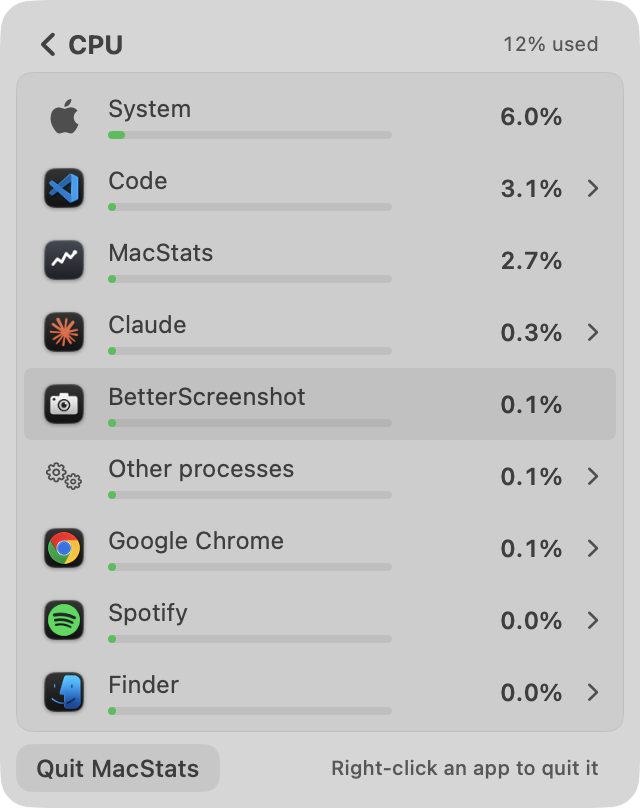
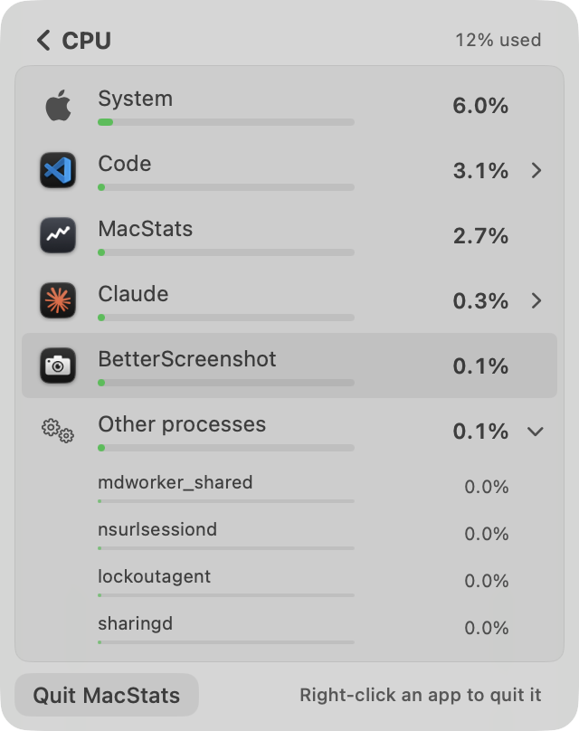

**Works well**
- Expanding works with a real click on the row in the off-screen probe (synthetic mouse event, as above). The chevron rotates, children are indented to the name column, 5 children show, then "N more…".
- Context menus freeze the order (`NSMenu` begin/end tracking, `BreakdownView.swift:128-134`), so Quit acts on the row it was opened on. Force Quit confirms with `NSAlert`. Back works by chevron or Esc. Scrolling stays inside the fixed card.
- Accessibility actions (Quit / Force Quit…) exist on app and process rows, along with an Expanded/Collapsed value.
- "Measuring…" lasts about 0.5 s and says "Takes about a second" (accurate).

**Issues**

| # | Severity | Where | Problem | Why it matters | Suggested fix |
|---|---|---|---|---|---|
| I1 | Low–Medium | `BreakdownView.swift:136-142` with `MetricsStore.swift:297-301` | Quit the *expanded* app while the pointer is in the list. It becomes an "Ended" placeholder with `processes: []`, so `expandedProcessCount` drops to 0 and the view collapses it. Its 5+ child rows disappear and every row below jumps up under the pointer. | It's the only path where rows move under a resting pointer, and it's a common one: expand, then quit. | While `isEnded(app:)`, keep the children as dimmed placeholders (or keep the row expanded) until the unfreeze. |
| I2 | Low | `StableRanking.swift:53-55` | While frozen, newly appearing apps are appended at the bottom of the list, often off screen. | A newly launched heavy app is invisible until the pointer leaves the list. | Related to S1; the same fix covers it. |
| I3 | Low | `BreakdownView.swift:266` | The app row tooltip includes a live process count ("Click to show its 32 processes"). | The tooltip text changes as processes come and go. | Drop the count, or round it. |

**Couldn't check live:** right-clicking (a real `NSMenu` would appear on the owner's screen) and hover states. These are judged from code.

**Why 7.8:** no row moved under a *moving* pointer in any measured case. I1 is the one exception, triggered by the user's own action. Together with S1's knock-on effect (I2), that's a high 7.

## Intuitiveness & discoverability — 7.8/10

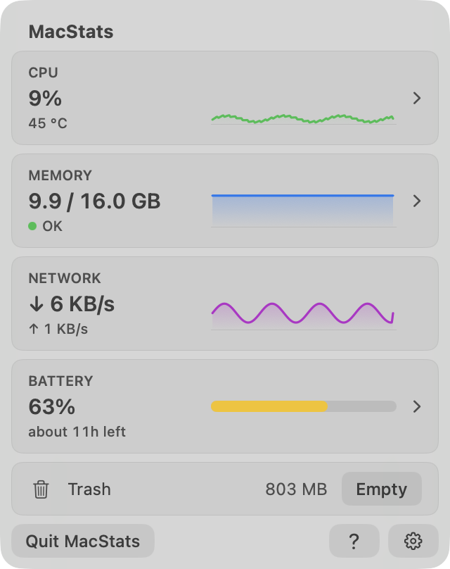
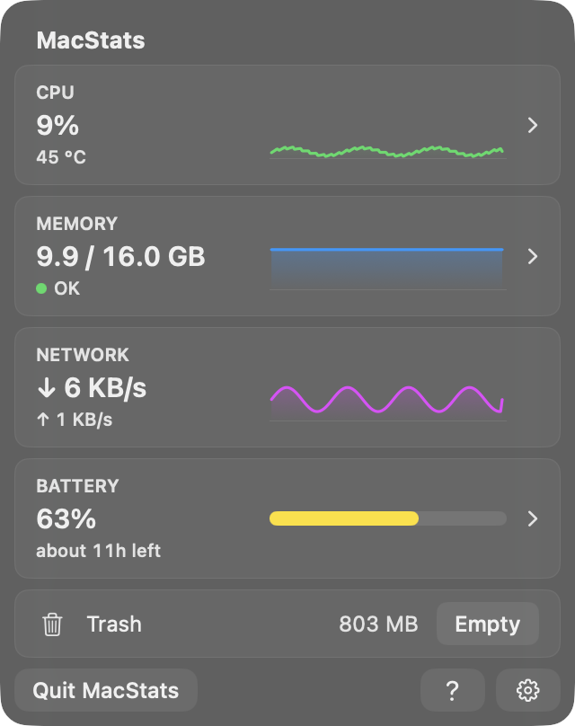

**Works well:** cards that drill in carry a chevron; Network has none and isn't clickable, which is consistent. Rows with processes carry a disclosure chevron. "Right-click an app to quit it" replaces the footnote for the first drill-ins. The welcome card explains both permission prompts before they appear. `?` and Settings → Help replay the tour. Tooltips explain "°C", the memory dot, "Other processes" and "System".

**Issues**

| # | Severity | Where | Problem | Suggested fix |
|---|---|---|---|---|
| U1 | Low–Medium | `MemoryPartsCard.swift:15-17` | "App Memory / Wired / Compressed" are Activity Monitor terms. Their meaning lives only in tooltips. | Keep the labels but add a one-line caption, or use plain words ("Apps", "macOS (reserved)", "Compressed"). |
| U2 | Low | `BreakdownView.swift:78-80` | CPU bars use a 100 % scale, so at typical loads every bar is a dot (System 6 % is a stub). | The bars carry no information. Scale them to the top row, or to 25 % with a sticky ladder like energy. |
| U3 | Low | `OverviewView.swift:115-117` | "45 °C" under CPU has no label (tooltip only). | "45 °C chip" or a small thermometer glyph. |
| U4 | Low | `BreakdownFormat.swift:15` | The Battery list at light load is mostly "0.00 W" rows (see the screenshot below). | Hide rows under 0.005 W behind "Others", or show "<0.01 W". |

**Why 7.8:** a first-time user is guided to every card and the drill-in within about 30 s; the tour takes care of that. The remaining friction is jargon and uninformative visuals on the secondary screens.

## Text / copy clarity — 8.2/10

**Works well:** every tour title is ≤ 4 words and every body ≤ 20 words; a lint test enforces it. The copy is plain ("How hard it's working", "↓ is download and ↑ is upload, right now"). Typographic apostrophes, Title Case buttons. Footnotes fit on one line, and the trash states read "Nothing in it" / "Needs permission".

**Issues (all Low):** "App power: CPU only, not screen or GPU" (`BreakdownView.swift:157`); "Share of the whole Mac (all 8 cores)"; "N% of one core" in menus; "Wired" (see U1). The Memory tour body says "How much memory apps are using", but the number includes macOS's own wired and compressed memory (`Tour.swift:41-42`). Settings → Help pairs "Guided tour" with "Take the Tour", saying it twice.

**Why 8.2:** short and plain throughout. A few technical words remain on secondary screens.

## Visual layout, alignment & centering — 8.6/10

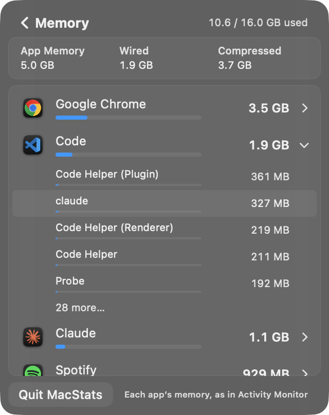
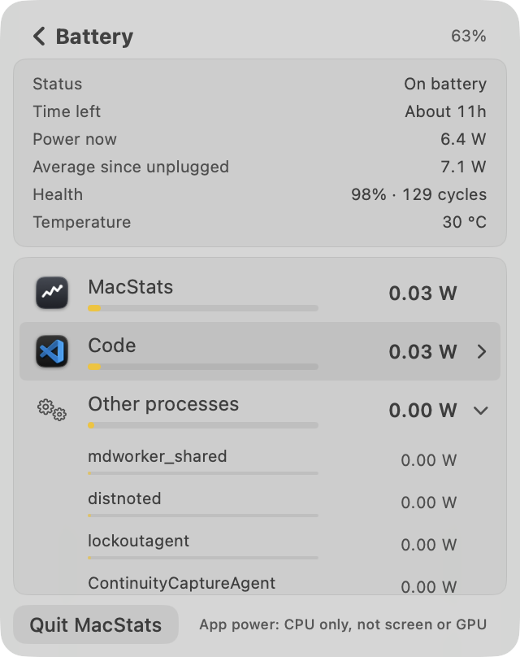
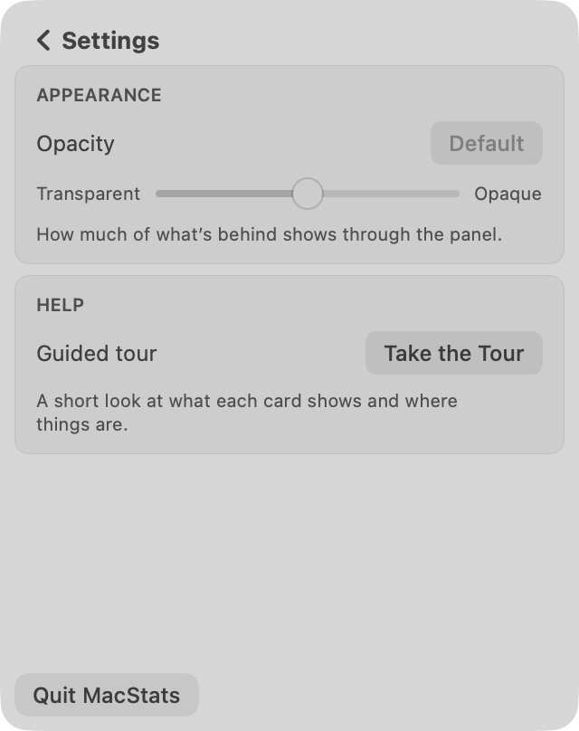
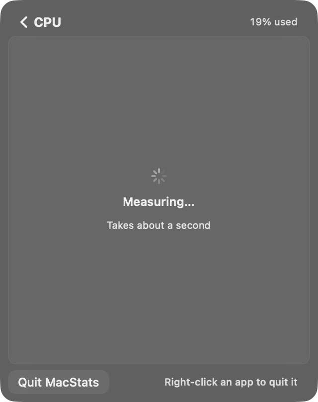

**Works well:** concentric continuous corners throughout: panel 16, cards 8, row highlights 4 inside the 4 pt list padding, footer buttons 8. The value column (58 pt) and chevron column line up between app and process rows. Header text and footnotes end at the card content inset. Light and dark mode are equally balanced. The fixed panel size means no resizing on push.

**Issues (all Low):** the Settings screen leaves about 45 % of the panel empty. In expanded lists the last row is cut at the card edge with no fade (standard scroll behaviour, but abrupt). The "Take the Tour ✕" chip sits 14 pt from the top edge, close to the corner curve (`chip-dark.png`).

**Why 8.6:** basically perfect, with nitpicks only.

## Intro & tour — 8.9/10

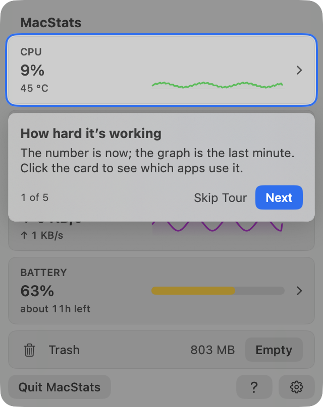
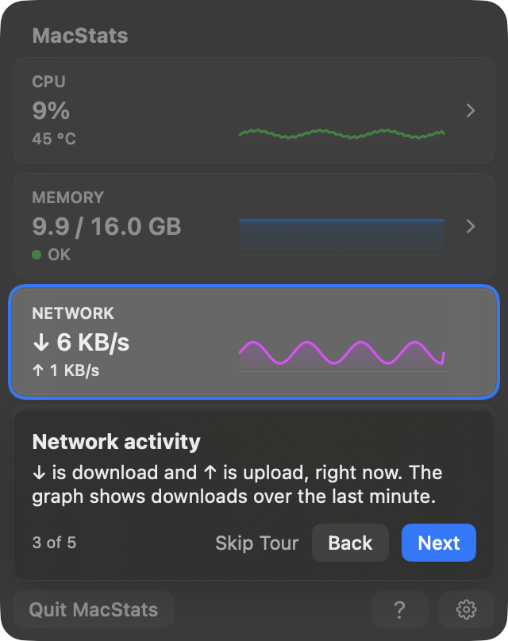
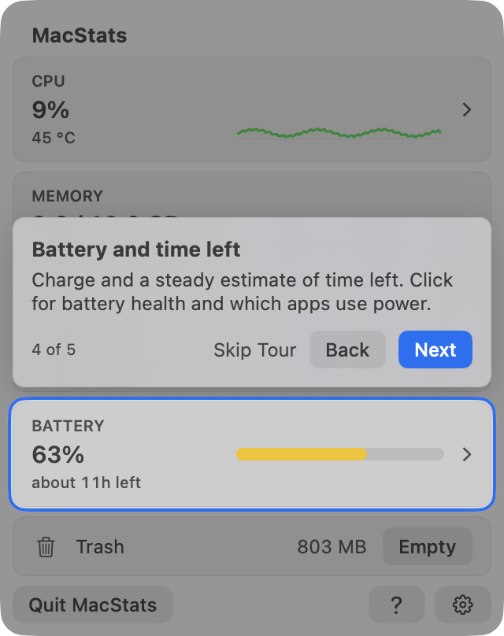
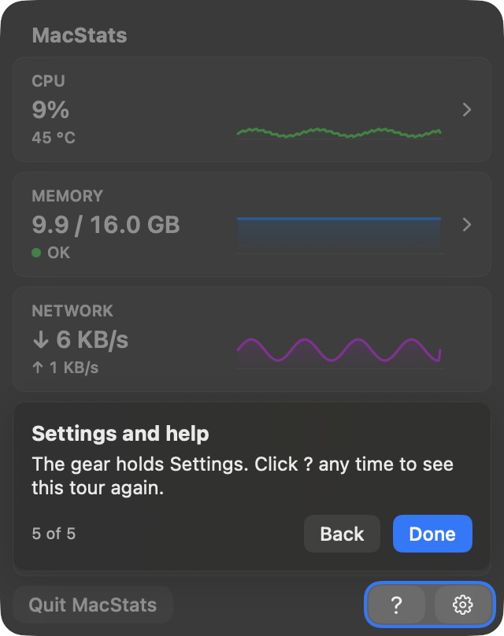
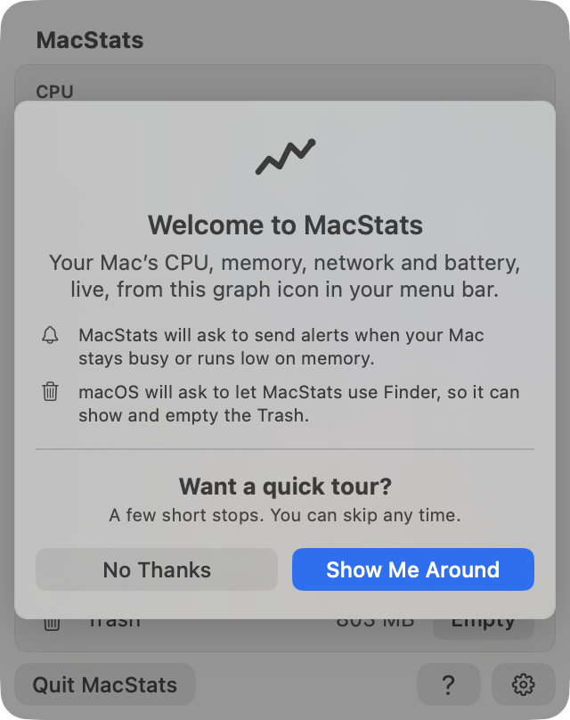
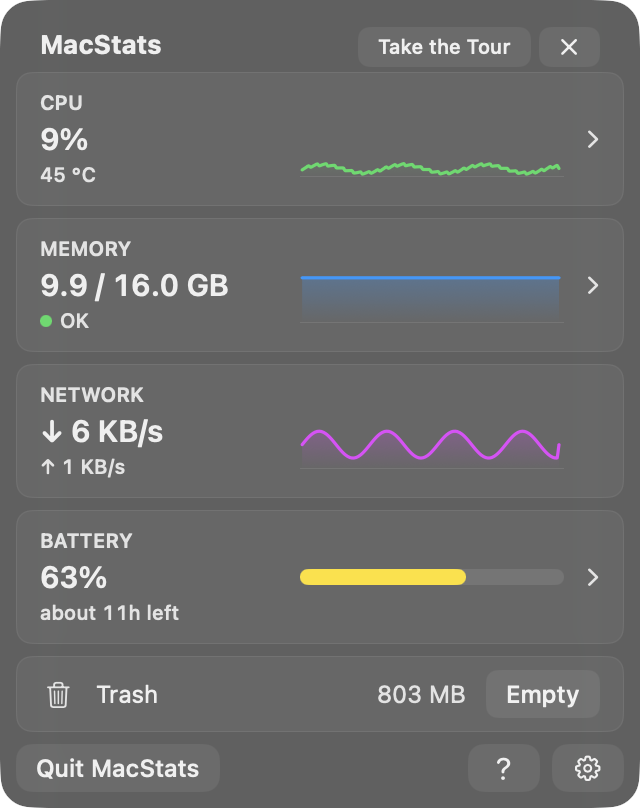
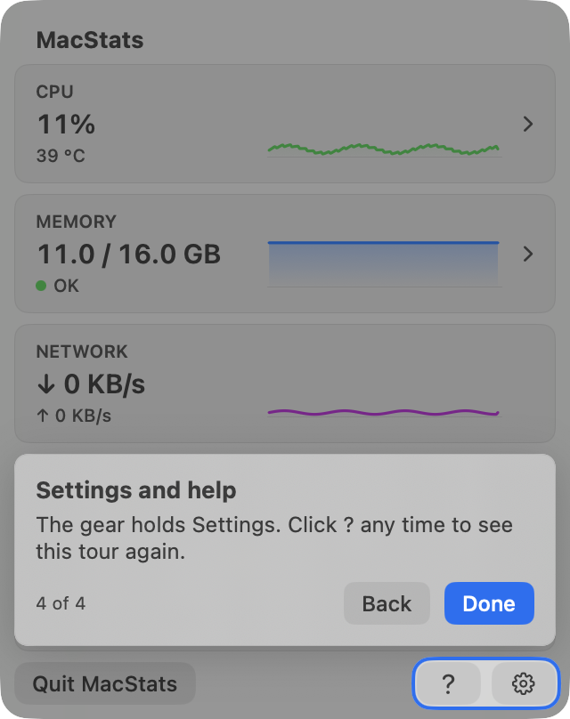

**Spotlight centring, measured from pixels.** For each step I captured the same window without and with the tour and classified every pixel as unchanged, dimmed, or ring. I then walked outward from the target's edge at 25 %, 50 % and 75 % along each side (12 samples per step), and inward from each cutout corner along the 45° diagonal. I also checked that the anchor rect matches the card's visible edge: the offset was 0 px on all four sides for every card.

| Step (light + dark, Opacity 0.5 and 1.0) | Target (pt) | Cutout (pt) | Inset L / R / T / B (ring outer edge to card) | Clear gap inside ring | Corner diagonals TL/TR/BL/BR |
|---|---|---|---|---|---|
| 1 CPU | 8,36 304×67 | 5,33 310×73, r 11 | **3.0 / 3.0 / 3.0 / 3.0** | 1.0 pt all 12 samples | ring 2.83, gap 0.71 on all four (identical) |
| 2 Memory | 8,109 304×67 | 5,106 310×73, r 11 | 3.0 / 3.0 / 3.0 / 3.0 | 1.0 | identical on all four |
| 3 Network | 8,182 304×67 | 5,179 310×73, r 11 | 3.0 / 3.0 / 3.0 / 3.0 | 1.0 | identical |
| 4 Battery | 8,255 304×67 | 5,252 310×73, r 11 | 3.0 / 3.0 / 3.0* / 3.0 | 1.0 | identical |
| 5 `?`+gear | 234,372 78×24 | 231,369 84×30, r 11 | 3.0 / 3.0 / 3.0* / 3.0 | 0.5–1.0 (the gap between the two buttons) | identical in dark* |

\* In light mode, the walk upward from steps 4 and 5 continues for 18–21 pt. That isn't the ring: the callout sits above these targets, and its drop shadow darkens the 6 pt strip between callout and ring (zoom below). The ring itself is 3.0 pt there, as in dark mode. On the diagonals, the gap and ring are the same at all four corners, to the pixel. Concentric radii 8 → 11 → 16 give an identical normal offset at the corner and on the sides, within one-pixel quantisation (one diagonal pixel = 0.71 pt).

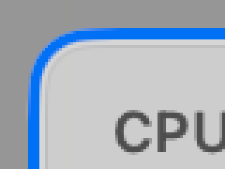

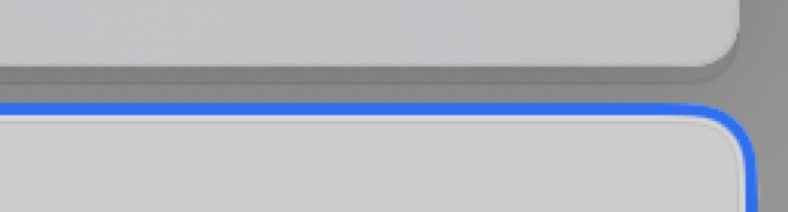

**Works well:** the highlight is exact on every step, in both modes and both Opacity settings. The ring is drawn above the callout. The callout never overlaps the cutout and keeps the cards' 8 pt inset and a 6 pt gap. Without a battery the tour skips that step ("4 of 4"). Skip Tour shows on every step but the last; Esc skips; → / ← / Return work. One accidental close pauses the tour; a second ends it. `?` and Settings → Help replay it. Clicking the highlighted card ends the tour and does what the callout says. The dim swallows other clicks, but Skip is always visible, so the user is never trapped. VoiceOver announces each step; Reduce Motion gets a cross-fade, Increase Contrast a thicker ring, Reduce Transparency a solid callout. The tour adds no work when it's off: anchors report only while it's active, and there are no timers.

**Issues**

| # | Severity | Where | Problem | Suggested fix |
|---|---|---|---|---|
| T1 | Low | `TourOverlay.swift:235` (shadow), `:157` (mask only removes it from the hole) | When the callout is above the target (steps 4–5), its shadow (radius 12, y 4) darkens the dim between callout and ring. The surround looks heavier above the highlight than below. | Use a smaller y-offset shadow, or mask the shadow to the callout's own side. |
| T2 | Low | `TourOverlay.swift:326` | Esc on the welcome card means "No Thanks", which marks the tour as seen. Users often press Esc just to close a menu-bar panel. | Let Esc close the panel (which already counts as "ask again"). |
| T3 | Low | `MacStatsMain.swift:19-21`, `MacStatsApp.swift:117-122` | On first launch the panel opens by itself (`performClick`). The Finder prompt then fires right after Done/No Thanks and closes the panel. Both are explained on the welcome card, but the sequence is still a little abrupt. | Accept, or delay the Finder prompt to the next open. |

**Why 8.9:** this meets the 9 anchor point by point (centred, concentric, skippable, replayable, plain). Three Low nitpicks keep it just under 9.

## Code quality of the new code — 7.8/10

**Works well:** pure, testable cores sit in `MacStatsCore`: `stableRanking`, the display holds, `TourState`/`TourRules`/`TourCatalog` and `TourLayout`. The views only draw state. `./Scripts/test.sh` passes **346 tests in 45 suites**, including 13 ranking, 12 hold, 17 store-breakdown and 27 tour tests, plus a lint test that holds the tour copy to its rules. The doc comments explain the *why* well (for example `RefreshScheduler.swift:38-56`). Cost discipline is visible: anchors only while active, menu observers only while a breakdown exists, the pointer probe read once per scan.

**Issues**

| # | Severity | Where | Problem | Suggested fix |
|---|---|---|---|---|
| C1 | Medium | `MetricsStore.swift:57-81`, `271-372` | Breakdown display state is about 15 parallel private fields (`order`, `lastValues`, `childOrder`, `lastChildValues`, `shownApps`, `shownProcesses`, `endedApps`, `endedProcesses`, `lastProcesses`, three freeze flags, pin, energy scale) inside the overview store. `setBreakdown` is about 100 lines, and every field has to be reset in `resetBreakdownDisplay`. | Move it into one `BreakdownDisplay` value type with `mutating func apply(scan:)`; reset by replacing the value. |
| C2 | Low | `StableRanking.swift:3-6, 33-37`, `TourOverlay.swift:131`, `MetricsStore.swift:180-181` | Comments carry review and probe history ("review round 1's bound", "round 1: a 4.3 % app stuck…", doc paths). | Keep the rule in the comment; move the history to the docs. |
| C3 | Low | `BreakdownView.swift:513` | `updateNSView` installs a closure on the store from inside the view on every update (a model–view back-reference). | Acceptable; could become a binding set once in `makeNSView`. |
| C4 | Low | `TourOverlay.swift:176-187` | Hidden zero-size buttons carry keyboard shortcuts (a known SwiftUI workaround). | Fine for macOS 14; `onKeyPress` (macOS 14+) would be cleaner. |

**Why 7.8:** good, well-tested code. C1 is the one structural debt that the next breakdown change will feel.

## Resource cost — 8.6/10

**Evidence:** the same probe built against HEAD and the baseline (1ed61cf): real views in an off-screen window, real sampling every 0.5 s, real scans at each build's own cadence. 30 s per phase, two alternating rounds.

| Phase | HEAD (CPU % of one core) | Baseline | Footprint HEAD / base |
|---|---|---|---|
| Overview ticking | 8.8, 7.9 | 9.3, 9.3 | 16.5 / 16.3 MB |
| CPU breakdown open | 9.9, 10.0 | 14.6, 13.8 | 26.0 / 27.1 MB |
| Memory breakdown open | 12.5, 11.5 | 13.1, 14.5 | 32.5 / 31.3 MB |
| Tour on (step 1 / step 3) vs off (HEAD only) | 9.0 / 9.6 vs 8.7 | — | +3.7–5.6 MB while shown |

- No new work while the panel is closed: no timers in `TourController`, `PointerProbe` or the holds. The trailing window's interval dictionaries are freed with the scanner.
- New in this build: `PanelWindowObserver` plus the per-tick `isOnScreen` check (`MacStatsApp.swift:150-196`), which drops to idle when the window is ordered out without `onDisappear`. For context, the currently installed MacStats (an **older** v1.1.0 build without the tour) was using **26–29 % of a core** with its panel off screen (window 1992 with no on-screen flag; 46 min of CPU in 2 h 54 m). That is exactly the failure this code targets. I couldn't verify the fix live without driving the owner's menu bar.

**Issue (Low):** the tour adds about 4–6 MB of footprint that hadn't come back 20 s after the tour was skipped. Inside the app, the post-close `malloc_zone_pressure_relief` should reclaim it; this wasn't measured in the real app.

**Why 8.6:** cheaper than the baseline where it matters, with a credible fix for the worst real-world cost.

---

## Cross-cutting issues

- **Freeze vs. currency.** The stability design rightly favours "nothing moves under the pointer". But it treats a *resting* pointer as an intent to click, and the list covers about 80 % of the panel, so in practice the order is frozen most of the time (S1, I1, I2). One rule fixes all three: freeze on a *moving* or *recently clicked* pointer, not a resting one.
- **Consistency:** terminology is consistent ("Ended processes", "Other processes", "System"). Button styles are unified (`SubtleButtonStyle`, prominent accent variant). Corner radii are concentric everywhere I checked. Light and dark mode are both handled carefully.

## Top fixes (ranked by impact ÷ effort)

1. **S1/I2: don't freeze on a pointer that hasn't moved** since the breakdown appeared (or let the freeze lapse after ~3 s of no movement). Don't freeze on the 0.5 s "first numbers" scan. Code: `BreakdownView.swift:507-524` (`PointerProbe`), `MetricsStore.swift:282`.
2. **I1: keep the expanded app's children as placeholders when it ends while frozen**, instead of auto-collapsing. Code: `BreakdownView.swift:136-142`.
3. **S2: rate-limit the CPU card's text** to about one change every 2–3 s (the graph can stay live). Code: `MetricsStore.swift:182`.
4. **U1/U2: plain-language Memory parts and informative CPU bars** (scale to the top row or a sticky ladder). Code: `MemoryPartsCard.swift:15-17`, `BreakdownView.swift:78-80`.
5. **C1: fold the breakdown display state into one value type**, before the next change to it. Code: `MetricsStore.swift:57-81, 271-437`.

## Method & limits

- **Screenshots:** a SwiftPM probe in the session scratchpad compiled the real `Sources/MacStatsApp` views (minus `@main`) with the real `MacStatsCore`. It rendered them in borderless windows at desktop level + 1, ordered back and never activated, captured each with `CGWindowListCreateImage(.optionIncludingWindow, .boundsIgnoreFraming | .bestResolution)`, and closed the windows. Overview values, battery state/telemetry and CPU temperature were real readings. The sparkline *shapes*, battery power/average watts and the Trash size were synthetic, so the probe never talks to Finder. Breakdown rows came from real `BreakdownScanner` scans of this Mac. Tour state used throwaway `UserDefaults` suites, deleted afterwards (including the plists cfprefsd re-wrote); the MacStats domain was never touched.
- **Artifact:** one row in some breakdown captures shows a hover highlight. That comes from the owner's real pointer position over the probe window's screen area, not from the app.
- **Live flows:** the headless probe described above, in 6 runs of 70–130 s: CPU with pointer cycles and a 14 s `/usr/bin/yes` burst, CPU with no pointer, CPU with a still pointer, Memory, and Battery/energy. Light machine load (whole-Mac CPU 3–12 %); a heavily loaded Mac will reorder more.
- **Not checked live:** right-click menus and Force Quit dialogs (they would appear on the owner's screen), hover states, the real `MenuBarExtraWindow` (the probe uses an `NSVisualEffectView` popover backdrop), keyboard focus, and the closed-panel CPU fix in the real menu bar. A human should open a breakdown, leave the pointer still for ~30 s while a busy app starts, and confirm S1. They should also check `ps -o %cpu -p $(pgrep -x MacStats)` after closing the panel on an installed build of this branch.
- **Independence:** I didn't read `docs/superpowers/plans/*`, `docs/research/*.md`, earlier reviews or commit messages. I read only the existing probes' *code*, to judge the stability probe and to copy the capture recipe.
