# MacStats stability + intro/tour review, round 2, reviewer B (2026-10-06)

**Overall: 7.8/10.** This is at the top of the owner's "great app, noticeable issues" band, close to "basically perfect". The goals that matter most are met, and I measured them myself:
- A row under the pointer never moved. Over 30 frozen scans across CPU, Memory and Battery: 0 rows moved, 0 rows were removed and 0 child rows moved.
- The expanded app never moved, disappeared or collapsed by itself in 6 minutes of real scans.
- The tour spotlight is exactly centred. The cutout sits 3.0 pt outside the card on all four sides, at every step, in light and dark mode.
- The tour can be skipped and replayed from four places.
- Scan cost dropped about 5× compared with the baseline.

What keeps it below 8 is a handful of Medium issues that a user can see:
- Lists are sometimes visibly out of order: "System 3.5 %" sits above "MacStats 4.0 %", and child rows read 0.2 % above 0.3 %. Most of these come from the expanded app being pinned to its row index.
- Printed numbers still change often: the CPU card about once a second, and a CPU-breakdown row about 8–10 times a minute with about 1.6 flip-backs (A→B→A) per row per minute.
- Chrome-style child process names are truncated in the middle until several rows look the same.
- The Battery drill-in leaves room for only about 2 app rows.

**Standard:** a 10 means Apple's own Battery / Control Center menu-bar panels, readings as good as Activity Monitor's, and Apple-quality coach marks (tour highlights).
**Method:** both screenshots and live simulation:
- screenshots of the real SwiftUI views, rendered off screen (light and dark)
- headless runs of the real `MetricsStore` + `BreakdownScanner` on this Mac's live processes (2 × 150 s, plus 2 × 70 s with the existing probe on the baseline and current code)
- code reading of `Sources/`
- the test suite (346 tests passed).

**Reviewer:** independent subagent (reviewer B). I did not read the other reviewer's report, the plans, the research conclusions, earlier reviews or commit messages.

## Terms
- **pp:** percentage points (e.g. 3.5 % → 4.0 % is 0.5 pp).
- **Flip-back:** a printed value that changes A → B → A on consecutive changes (the most visible kind of flicker).
- **Held / shown value:** what MacStats prints, which changes only when the real reading moves clearly away from it (`Sources/MacStatsCore/DisplayHold.swift`); the exact reading still drives graphs, bars and alerts.
- **Freeze:** the breakdown's row order stops changing while the pointer is over the list or a context menu is open.
- **Pin:** the expanded app keeps its row index while the other rows re-rank.
- **Cutout / ring:** the clear squircle hole in the tour's dim layer and the 2 pt accent outline drawn inside its edge.
- All `file:line` references are relative to the repo root; evidence files are in `docs/reviews/2026-10-06-stability-tour/r2-B/`.

## Calibration
- **Type and platform:** native macOS 26 menu-bar app (SwiftUI `MenuBarExtra(.window)` popover, fixed at 320 × 404 pt).
- **Audience:** everyday Mac users, including non-technical ones.
- **Maturity:** v1.x, publicly released.
- **Reference for a 10:** Apple's Battery / Control Center panels, Activity Monitor-quality readings, Apple-quality coach marks.
- **Conventions that apply:** squircles (continuous corners) with concentric radii; light and dark mode; Esc / Return / arrow keys; Reduce Motion and Reduce Transparency; tooltips; no window that steals focus from the menu-bar panel.
- **What a 3 looks like:** numbers flicker, rows re-sort every tick so you can't click or expand, the tour is misaligned or traps you, jargon everywhere.
- **What a 6 looks like:** mostly steady, but rows sometimes move under the pointer or an expanded app collapses. The tour works but the highlight is a few points off-centre or the copy is wordy. Some controls are hard to find.
- **What a 9 looks like:**
  - values are steady enough to read yet no more than a few seconds old;
  - rows never move out from under the pointer, and an expanded app never vanishes;
  - a first-time user understands every card and how to drill in within about 30 s;
  - every tour highlight is exactly centred, with concentric continuous corners, in light and dark;
  - the tour can be skipped at any time and replayed;
  - the text is plain and short;
  - MacStats's own CPU and RAM use are no worse than the baseline.

## Scoreboard
| Area | Score | Verdict (one line) |
|---|---|---|
| Stability of numbers & lists | 7.3 | The freeze and pin are flawless; a visible re-sort lag next to the pinned row and frequent CPU/energy text flips remain |
| Interaction reliability | 8.0 | Expand, freeze, ended-row placeholders, Esc back and the pointer check all hold; context menus couldn't be captured |
| Intuitiveness & discoverability | 7.8 | Welcome, tour, chevrons, quit hint and tooltips cover the basics; Battery drill-in is cramped and child names are ambiguous |
| Text / copy clarity | 8.0 | Plain and short almost everywhere; a few clunky tooltips and redundant labels |
| Visual layout, alignment & centering | 7.8 | Concentric squircles throughout and pixel-exact spotlight; middle-truncated child names, near-empty CPU bars, cramped Battery list |
| Intro & tour (incl. spotlight centering) | 8.6 | Exactly centred at all 5 steps in both modes; skippable four ways, replayable three ways; small nits only |
| Code quality of the new code | 7.8 | Pure, tested core logic (346 tests); `setBreakdown` is a long function with 9 parallel state maps; review history in comments |
| Resource cost | 8.0 | Scan cost 13.7 → 2.5 ms/s, probe CPU 1.06 → 0.23 %, no new timers while closed; the off-screen-panel fix is unverified live (owner's installed old build burns about 27 % of a core) |

---

## Stability of numbers & lists — 7.3/10

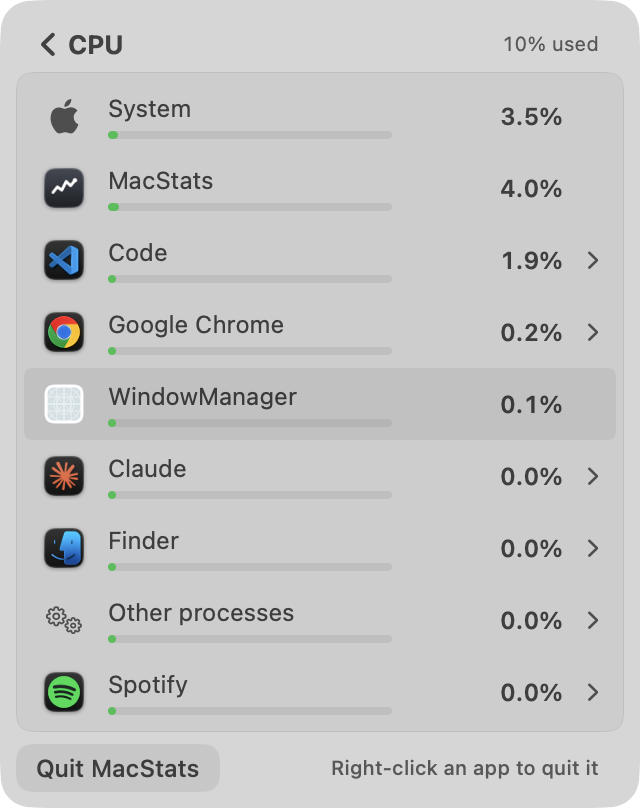

**Evidence.** All figures are from my own probe (`r2-B/probe-src/stability-main.swift`). It runs the real scan path into three real `MetricsStore`s at the app's cadence: overview every 0.5 s, breakdown first rescan at 0.5 s and then every 2 s. Each 150 s run has 67 s with the pointer outside the list, 20 s with it inside, then outside again. The pointer is simulated through the view's own `breakdownPointerProbe` closure plus `setBreakdownPointerInside`. Raw output: `r2-B/stability-run1.txt`, `r2-B/stability-run2.txt`.

| Measure (per minute unless noted) | Run 1 | Run 2 |
|---|---|---|
| CPU card text changes / flip-backs | 49.2 / 4.8 | 37.2 / 4.0 |
| CPU card held vs exact (pp, p95 / max) | 1.00 / 1.23 | 1.13 / 1.24 |
| Memory card changes / flip-backs | 8.0 / 0.8 | 6.0 / 0.0 |
| Network ↓ card changes / flip-backs | 27.6 / 1.6 | 21.6 / 5.2 |
| CPU breakdown: top-8 order changes / slot changes | 7.7 / 20.8 | 5.3 / 12.6 |
| CPU breakdown: row text changes (8 rows) / flip-backs | 81.3 / 12.1 | 66.8 / 13.1 |
| Energy breakdown: row text changes / flip-backs | 44.5 / 10.6 | 30.5 / 8.7 |
| Memory breakdown: order changes / text changes | 0 / 3.9 | 0 / 3.9 |
| Visibly mis-sorted scans, CPU (lower row printed > 25 % and > 2 steps above the row above it) | 28/65 | 12/65 (7 of them next to the expanded row) |
| Same, energy | 27/65 | 25/65 (21 next to the expanded row) |
| Frozen (pointer inside): row moves / removals / child moves | 0 / 0 / 0 | 0 / 0 / 0 |
| Expanded app: moves / vanished / auto-collapses | 0 / 0 / 0 | 0 / 0 / 0 |

The existing probe (`docs/research/2026-10-06-probes/stability`), 70 s each, baseline 1ed61cf vs current (`r2-B/existing-probe-*.txt`):

| | Baseline | Current |
|---|---|---|
| Top-8 order changes per minute | 58.7 | 7.8 |
| Row text changes per minute | 353.6 | 60.0 |
| Expanded (target) app moves per minute | 14.0 | 0.0 |
| Slot changes in the frozen window | 113 | 0 |

That probe measures the right core thing (order and text churn, the freeze), but it has gaps:
- `target_moves = 0` is guaranteed by construction, because the probe itself pins the target.
- It does not count flip-backs or visible mis-sorts.
- It tracks the expanded app's children only as a *set*, not their order.
- Its memory-card count (30.9 vs 10.3 per minute) moved with machine load: whole-Mac CPU averaged 23 % in the current run vs 11 % in the baseline run. My runs read 6–8 per minute.

**Works well:**
- Freezing while the pointer is in the list is airtight:
  - It is checked through both hover events and an AppKit pointer probe at scan time (`BreakdownView.swift:504-524`, `MetricsStore.swift:282`).
  - Ended rows stay as dimmed placeholders while frozen (`MetricsStore.swift:297-331`).
  - After the pointer leaves, a 1 s grace period passes before the list unfreezes.
- Compared with the baseline, the list is 7–8× calmer.
- The Memory breakdown is fully still. Its held text stays within 3 % of the true value.
- The CPU card's held value never strays more than 1.25 pp from the true reading.

**Issues:**
| # | Sev | Where | Problem | Why it matters | Suggested fix |
|---|---|---|---|---|---|
| S1 | Medium | `StableRanking.swift:96-104` with `MetricsStore.swift:307` | The expanded app is pinned to its index for as long as it stays expanded, even when the pointer is far away. Rows can't pass it, so the list shows "Code 1.0 %" above "Chrome 4.8 %" (run 2, t = 27 s) and "Code 0.02 W" under "MacStats 0.03 W". This caused 7 of 12 visible CPU mis-sorts and 21 of 25 energy mis-sorts. | A sorted list that isn't sorted, with no visual cue, undermines trust in the ranking. | Pin only while the list is frozen (pointer inside or menu open), which already holds it still. Outside that, let the expanded app slide like any row (the `.snappy` reorder animation exists). Or keep the pin, but let rows climb past it once they lead it by the `jump` margin. |
| S2 | Medium | `StableRanking.swift:18` (`cpu` rel 0.25, abs 0.2) | Rows within 25 % of each other never swap until the lead holds on two readings. The screenshot shows "System 3.5 %" above "MacStats 4.0 %"; another frame has "Google Chrome 0.2 %" above "Other processes 0.8 %". Child rows show the same thing: 0.2 % above 0.3 % (`breakdown-cpu-expanded-light.png`). | Minor on any one frame, but it is visible on a plain glance. Activity Monitor is always sorted. | Accept the trade-off but tighten it: rel 0.15, or swap at once when the gap is ≥ 1 printed step *and* the order has been wrong for ≥ 2 scans (time-based rather than margin-based). |
| S3 | Medium | `MetricsStore.swift:284-288` (rows), `:182` (CPU card) | Text still flips a lot. The CPU card changes 37–49 times a minute (median about 1 s between changes) with 4–5 flip-backs a minute. A CPU-breakdown row changes about 8–10 times a minute with about 1.6 flip-backs a minute; energy rows about 1.2 flip-backs a minute. | At "readable within a few seconds" a 9 would show roughly 10–20 changes a minute on the card and almost no A→B→A flips. | Add a minimum dwell (e.g. a shown value lives ≥ 1.5 s on the card, ≥ 1 scan on rows unless it moves ≥ 2 steps). Or raise the row band to 1.0 step at < 10 %. Neither touches the stored readings. |
| S4 | Low | `DisplayHold.swift:24-30` | `heldMemory` passes the *unquantised* value once it moves 0.1 GiB, so the printed "x.x" can flip back on a ±0.1 GiB swing. Observed 0–0.8 flip-backs a minute. | Rare, but it is the only hold without a band above one step. | Use `heldValue`-style quantising (band 0.75–1.0 step) on `usedBytes`, keeping the parts summed. |
| S5 | Low | `MetricsStore.swift:362` vs rows | The CPU header and the held rows are held separately. The rows' sum drifted up to 0.8–1.6 pp from the header (both probes). | Rows plus System are supposed to add up to the header. | Derive the shown System row as header − Σ shown others. |
| S6 | Low | `MetricsStore.swift:282` | While the pointer rests on the list the order is frozen indefinitely. A process that suddenly spikes stays in its old slot (a new one is appended at the bottom, maybe below the fold). | A monitor's job is to surface the hot app. | After N seconds frozen, add a subtle "Sorting paused" caption in the footer, or allow a re-sort when a row's lead is huge (e.g. > 5×). |

**Why 7.3:** pointer safety and expanded-app safety, the two hardest requirements of the 9 anchor, are met perfectly and measurably. But S1–S3 are visible Medium issues on the primary drill-in, and the card still ticks about once a second. That fits "very good, a couple of Medium issues".

---

## Interaction reliability — 8.0/10

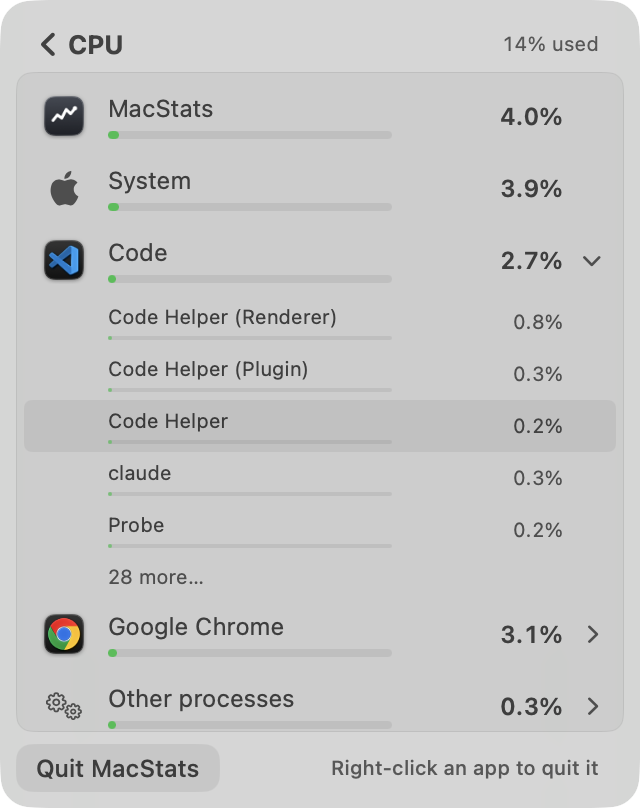

**Works well:**
- **Expand / collapse.** A synthetic click on a row expanded it in CPU, Memory and Battery, in light and dark (all 6 `pressed=true`).
- **Accordion.** One app is expanded at a time, it shows 5 children and then "28 more…" in steps of 25.
- **Chevron.** It rotates 90° when expanded.
- **Auto-collapse.** An expanded app collapses only when it drops to ≤ 1 process (`BreakdownView.swift:136-142`); this happened 0 times in 6 runs.
- **Context menus.** They freeze the order through `NSMenu` begin/end-tracking notifications, so Quit always applies to the row it was opened on (`BreakdownView.swift:128-134`).
- **Ended rows.** An app or process that ended while frozen is shown dimmed ("Ended") with no actions (`BreakdownView.swift:233-235, 275-279`).
- **Keyboard and VoiceOver.** Esc goes back on breakdown and Settings. Quit and Force Quit are also accessibility actions.
- **Scans.** They run off the main thread and are dropped if the breakdown closed meanwhile (`MacStatsApp.swift:537-560`).

**Issues:**
| # | Sev | Where | Problem | Why it matters | Suggested fix |
|---|---|---|---|---|---|
| I1 | Low | `BreakdownView.swift:207-222` | A row with one process is a button whose action does nothing, yet it still highlights on hover. | Hover suggests a click that doesn't happen. | Skip the hover fill when `!expandable` (the context menu still works). |
| I2 | Low | `RootView.swift:58-66` | The tour's pause/resume relies on `onAppear` / `onDisappear`. The refresh pipeline itself no longer trusts these (window observer, `MacStatsApp.swift:22-28`). | If `MenuBarExtra` hides the window without `onDisappear` (the case the code documents), a running tour neither pauses nor counts the close. | Drive `tour.panelOpened/Closed` from `AppModel.updateVisibility` transitions. |
| I3 | — | — | Not verified: right-click menus and NSAlert confirmations can't be captured off screen without driving the owner's UI. | — | A human should right-click → Quit on an expanded child once. |

**Why 8.0:** I measured no bug in the primary interactions. The remaining nits are minor, and one path (context menus) is code-verified only.

---

## Intuitiveness & discoverability — 7.8/10

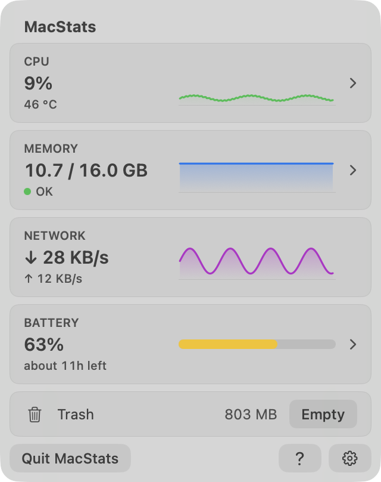
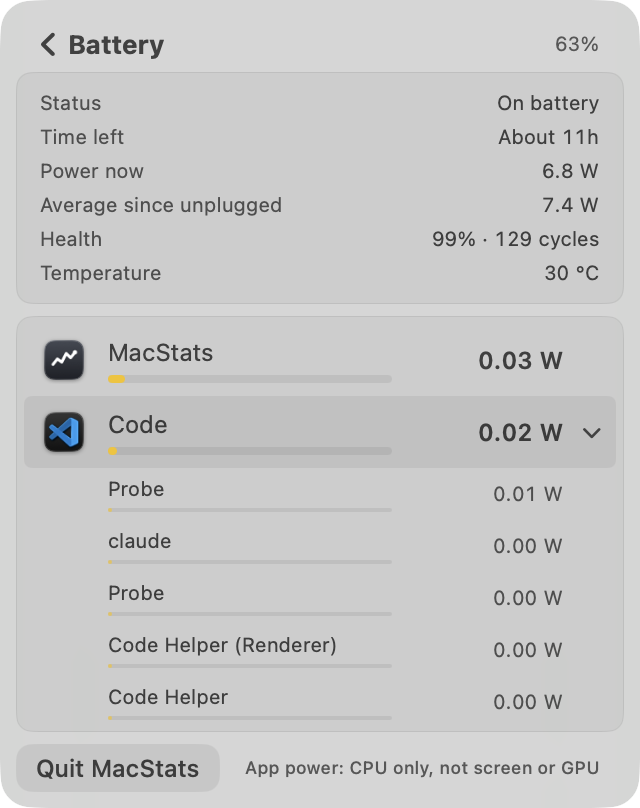

**Works well:**
- Every clickable card has a chevron; Network, which has no drill-in, has none.
- A new user gets a welcome card that explains both upcoming permission prompts. The panel opens itself once on first launch.
- An existing user gets a dismissible "Take the Tour" chip (`chip-dark.png`).
- The breakdown footer says "Right-click an app to quit it" until the menu has been used (or for 10 drill-ins).
- Rows have "Click to show its N processes · Right-click to quit" tooltips.
- The Trash card shows "Needs permission / Allow…" with a deep link when Finder access was refused.

**Issues:**
| # | Sev | Where | Problem | Why it matters | Suggested fix |
|---|---|---|---|---|---|
| U1 | Medium | Battery drill-in (`BreakdownView.swift:105`, fixed 404 pt) | The details card takes about 45 % of the height. With an app expanded, only 2 app rows remain visible (screenshot). | "Which apps use power" is the screen's purpose. | Make the details card collapsible or 2-column (label: value pairs), or move Health / Temperature into a disclosure. |
| U2 | Medium | `BreakdownView.swift:475` (`.truncationMode(.middle)`) | Chrome children all read "Google Chro…lper (Renderer)" (`breakdown-memory-expanded-dark.png`), so three rows look identical. | You can't tell which renderer you'd be quitting. | Strip the parent app's name prefix inside its own group ("Helper (Renderer)"). Activity Monitor's full name stays in the tooltip/menu. |
| U3 | Low | `BreakdownView.swift:80` | CPU bars are scaled to 100 % of the Mac, so at normal load every bar is a dot (screenshot: all bars ≤ 4 % long). | The bar column carries no information most of the time. | Keep the true-share number, but scale bars to the top row (sticky, as Energy already does), or hide bars below 1 %. |
| U4 | Low | Overview, no-battery Mac | A full Battery card shows "—" and "no battery" (`overview-nobattery-light.png`). | Wasted space on desktops. | Hide the card or turn it into a slim "No battery" line. |

**Why 7.8:** a first-time user is guided well through the overview. The drill-ins are where understanding thins (U1, U2).

---

## Text / copy clarity — 8.0/10

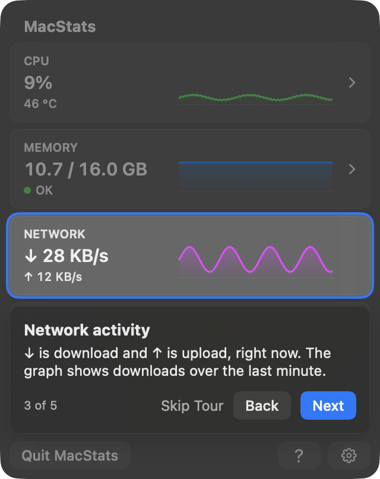

**Works well:**
- Tour titles are at most 4 words and bodies at most 2 lines (lint-tested in `TourCatalogLintTests`). They use typographic apostrophes, and the buttons are Title Case.
- Plain words throughout: "OK / running low / very low" for memory pressure, "About 11h", "Power now", "Average since unplugged", "Each app's memory, as in Activity Monitor", "Share of the whole Mac (all 8 cores)".
- The welcome explains *why* each permission is asked.

**Issues:**
| # | Sev | Where | Problem | Suggested fix |
|---|---|---|---|---|
| T1 | Low | `OverviewView.swift:35-36` | The CPU tooltip reads "Click to see which apps use the CPU · °C is its temperature" (clunky). | "Click to see which apps use the CPU. The °C is the chip's temperature." |
| T2 | Low | `SettingsView.swift:87-95` | "Guided tour" with a "Take the Tour" button, plus a caption, says the same thing three times. | Drop the caption, or label the row "See what each card shows". |
| T3 | Low | `BreakdownView.swift:157` | "App power: CPU only, not screen or GPU" uses jargon ("GPU") for a non-technical audience. | "App power counts processor use only, not the screen or graphics." (tooltip, if it's too long for the line) |
| T4 | Low | Memory card | "OK" next to a green dot is fine, but it never names "memory pressure" outside the tooltip. | Acceptable as is; optional "Memory OK". |

**Why 8.0:** only Low nitpicks.

---

## Visual layout, alignment & centering — 7.8/10

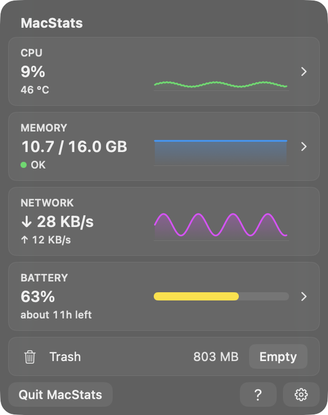
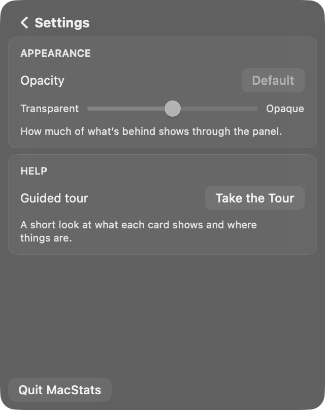

**Works well:**
- One consistent language: cards at 8 pt continuous radius inside the 16 pt panel at an 8 pt inset (concentric); 4 pt row highlights inside 4 pt padding; the footer buttons at 8 pt.
- The chip is laid out as an overlay, so the title doesn't move.
- The prominent button is accent-filled at the same height as its secondary partner.
- Light and dark both read cleanly.
- The overview is fixed at 320 × 404 with no clipping.

**Issues:** U1, U2 and U3 above are also visual issues. In addition:
| # | Sev | Where | Problem | Suggested fix |
|---|---|---|---|---|
| V1 | Low | Settings | The bottom half is empty, and the Quit button floats far below the cards. | Acceptable for a 2-setting screen; optionally vertically group, or add the alert thresholds (Milestone 4) here. |
| V2 | Low | Tour ring at corners | Measured along the 45° diagonal, the ring's inner edge meets the card's anti-aliased edge (about 0 pt gap). On the straight edges the clear gap is 1.0 pt (`zoom-step1-TL-light.png`). It is still visually concentric. | Nitpick; a 2 pt clear gap (inset 4) would read more clearly. That still fits in the 6 pt card spacing only if the cutout is allowed to overlap the neighbouring card by 1 pt (the dim covers it anyway). |

**Why 7.8:** the overview and tour are close to Apple quality, but the drill-ins carry U1–U3.

---

## Intro & tour (including spotlight centering) — 8.6/10

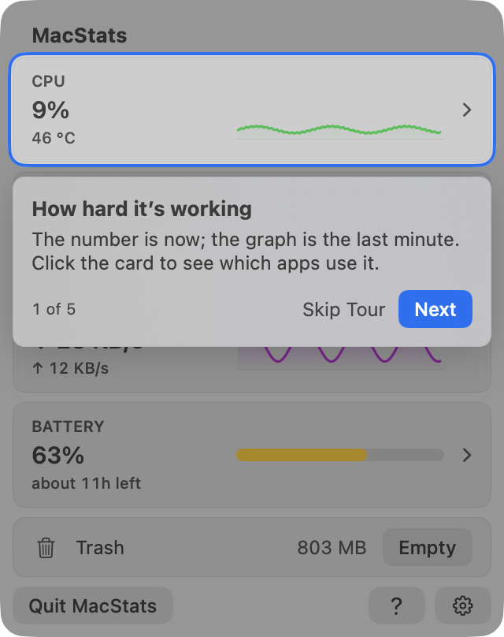
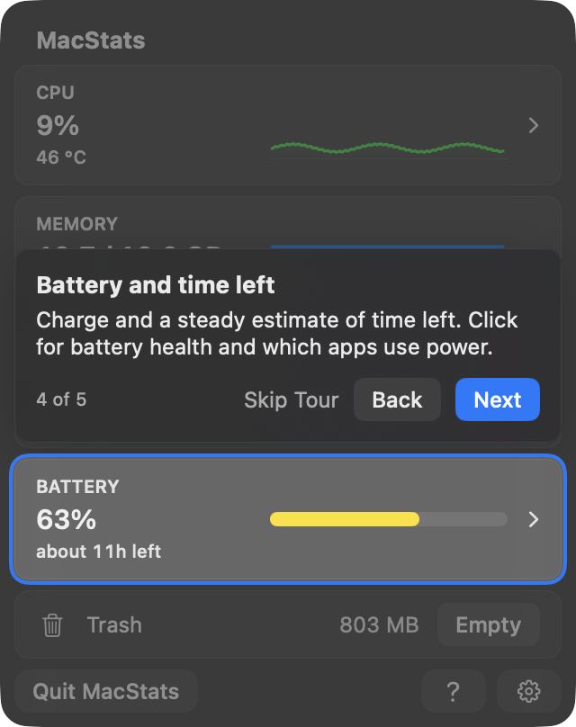
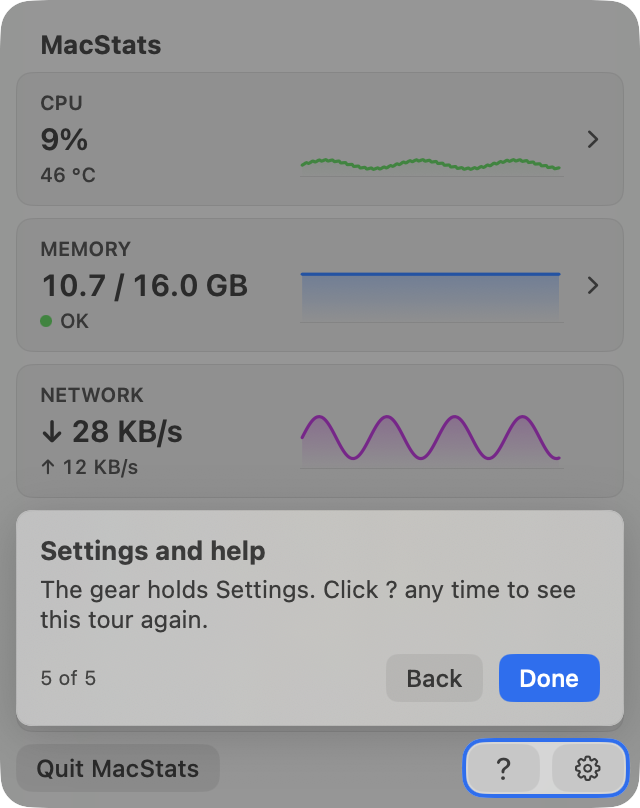
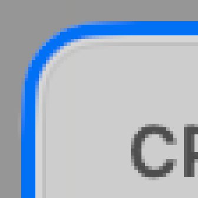
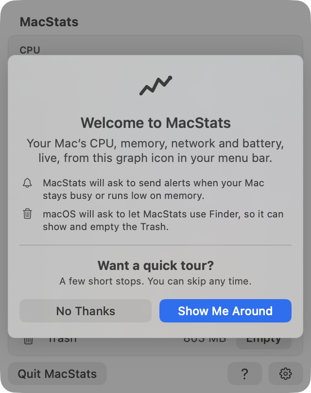

**Spotlight centering, measured.** Method: for each step, the same window is captured without the tour and with it. From the target's edge (the `TourAnchorKey` rect, which matched the card's drawn edge) I walk outward along the centre row and column, counting unchanged pixels and then accent-ring pixels (`r2-B/tour-insets.txt`).

| Step | Target (pt) | Cutout inset L / R / T / B (pt) | Clear gap (pt) | Ring (pt) | Light | Dark |
|---|---|---|---|---|---|---|
| 1 CPU | 8,36 304×67 | 3.0 / 3.0 / 3.0 / 3.0 | 1.0 all sides | 2.0 | ✓ | ✓ |
| 2 Memory | 8,109 304×67 | 3.0 / 3.0 / 3.0 / 3.0 | 1.0 | 2.0 | ✓ | ✓ |
| 3 Network | 8,182 304×67 | 3.0 / 3.0 / 3.0 / 3.0 | 1.0 | 2.0 | ✓ | ✓ |
| 4 Battery | 8,255 304×67 | 3.0 / 3.0 / 3.0 / 3.0 | 1.0 | 2.0 | ✓ | ✓ |
| 5 ? + gear | 234,372 78×24 | 3.0 / 3.0 / 3.0 / 3.0 | 1.0 | 2.0 | ✓ | ✓ |

The corners are symmetric: all four corners measure the same along the diagonals at every step, and the radii run 8 → 11 → 16 (card → cutout → panel).

**Works well:**
- **Ways to skip:** Skip Tour, Esc, No Thanks, or closing the panel twice. One close pauses and the next open resumes at the same step.
- **Ways to replay:** the footer "?", Settings → Take the Tour, and the existing-user chip.
- **Keyboard:** → / ← / Return.
- **On a Mac without a battery** the Battery step is skipped and progress reads "4 of 4" (`tour-nobattery-last-light.png`).
- **Callout placement:** it sits below the cutout when it fits, otherwise above, and never overlaps it.
- **Steady layout:** the body always reserves 2 lines, so the callout never jumps between steps.
- **Accessibility:** Reduce Motion cross-fades, Reduce Transparency gives a solid surface, Increase Contrast thickens the ring, and VoiceOver hears an announcement per step.
- **Cost:** the overlay costs nothing when off. Anchors only report while the tour is active.
- **Permission prompts** are held back until the welcome is answered. The Finder prompt is deliberately not fired mid-tour, because its window would close the panel.

**Issues:**
| # | Sev | Where | Problem | Suggested fix |
|---|---|---|---|---|
| R1 | Low | `RootView.swift:69-73` | Clicking the highlighted card (which step 1 invites: "Click the card…") silently *ends* the tour and marks it seen. Nothing says the remaining steps were skipped. | Pause instead of finish (resume on return to the overview), or say "Click the card any time after the tour". |
| R2 | Low | Step 5 | Highlights "?" and the gear as one pill-shaped hole. The body mentions both, so it's fine, but "Quit MacStats", the other footer control, is dimmed without explanation. | Fine as is; optional. |
| R3 | Low | I2 above | Pause/resume depends on `onDisappear`. | See I2. |

**Why 8.6:** the hard, measurable part is perfect and the flow is complete. Only small judgement calls remain.

---

## Code quality of the new code — 7.8/10

**Works well:**
- **Pure logic in `MacStatsCore` with focused tests:** `DisplayHold`, `StableRanking`, `TourState` / `TourRules` / `TourLayout` / `TourCatalog`, the `MetricsStore` breakdown flow. `./Scripts/test.sh` passed 346 tests in 45 suites when run during this review.
- **The view layer is thin.**
- **`TourController` is isolated** from `MetricsStore`, so tour state changes never re-render the cards.
- **The geometry is deterministic:** each edge is snapped on its own.
- **Comments explain *why*.**
- **The scanner's trailing window** (`ProcessScan.swift`) keeps rows and header over one span.

**Issues:**
| # | Sev | Where | Problem | Suggested fix |
|---|---|---|---|---|
| C1 | Medium | `MetricsStore.swift:271-372` | `setBreakdown` is about 100 lines and keeps 9 parallel per-row state maps (`order`, `lastValues`, `childOrder`, `lastChildValues`, `shownApps`, `shownProcesses`, `endedApps`, `endedProcesses`, `lastProcesses`), plus freeze, pin and unfreeze flags. Each future change has to keep them in lockstep. | Extract a `BreakdownDisplayState` value type (one struct per row: order key, last value, shown value, ended flag, children) with a pure `next(scan:frozen:pinned:) -> State` function, and test it directly. |
| C2 | Low | `StableRanking.swift:3-8, 41-45`, `MetricsStore.swift:180-181` | Comments cite review rounds and research files ("review round 1's 'visibly mis-sorted' bound", "round 1: a 4.3 % app stuck…", "docs/research/…§5.4"). | Keep the rule and its reason; move the history to the docs. |
| C3 | Low | `DisplayHold.swift:24` | `heldMemory` uses a different hold model (no quantising, band = 1 step) from every other hold. | Unify on `heldValue` semantics (see S4). |
| C4 | Low | `RootView.swift:58-66` | Two sources of truth for "panel open" (I2). | See I2. |

**Why 7.8:** solid and well tested. C1 is a real maintainability cost in the most delicate code.

---

## Resource cost — 8.0/10

**Evidence:**
- **Existing probe, baseline vs current:**

  | | Baseline | Current |
  |---|---|---|
  | Breakdown scan cost | 13.68 ms/s | 2.45 ms/s |
  | Probe process CPU | 1.06 % | 0.23 % |
  | Scans per second | 1.01 | 0.51 |

  Each scan is also cheaper: 13.5 → 4.8 ms mean.
- **My probe** ran three breakdowns at once plus the overview at 0.81 % of a core.
- **Timers and observers while the panel is closed:** the idle sampler is unchanged (10 s, 2 s tolerance). `TourController` has no timers or observers. The `NSMenu` observers exist only while a breakdown view exists. `PointerProbe` is read once per scan. Tour anchors are attached only while the tour is active (`TourOverlay.swift:53-61`). So the closed-panel path gained nothing.
- **Off-screen panel guard:** a timer-time check stops the 0.5 s tick if the window is off screen (`MacStatsApp.swift:189-196`), and `PanelWindowObserver` reacts to occlusion and key changes.

**Issues:**
| # | Sev | Where | Problem | Suggested fix |
|---|---|---|---|---|
| P1 | — (flag) | Owner's installed app | `~/Applications/MacStats.app`, built 17:49 (before this branch's tour and window-observer commits), is at about 25–29 % of one core and 82 MB RSS. Its panel window is *not* on screen. It has used 49 min of CPU in 3 h 05 min (`r2-B/installed-app-cost.txt`). This matches the off-screen-panel bug the current code documents and guards against. I could not verify the fix live, because installing was out of scope. | Install this branch and re-measure with `ps -o pcpu,rss,cputime -p $(pgrep -x MacStats)` after opening and closing the panel a few times, including clicking another app while the panel is open. Expect < 0.5 % closed. |
| P2 | Low | `ProcessScan.swift` window | Keeps 2 intervals of per-process dictionaries (about 20–60 KB) while a breakdown is open. They are freed on close. | None. |

**Why 8.0:** measurably cheaper than the baseline. The one serious cost observation (P1) is on an older build, and the code that should prevent it looks right but wasn't verified live.

---

## Cross-cutting issues
- **Sorting vs steadiness.** Every list-stability mechanism trades away correct ordering: the 25 % hysteresis, the pin and the freeze. The freeze is justified (it's under the pointer). The pin outside a freeze and the 25 % margin cost more trust than they buy (S1, S2).
- **Consistency.** Corners, fills, button heights and type ramp are consistent across overview, breakdowns, Settings, callout and welcome, in light and dark.
- **Terminology.** "Battery" (card and drill-in title) vs "App power" (footnote) vs "which apps use power" (tour). That's OK. "Ended" (row) and "Ended processes" (group) are consistent.

## Top fixes (ranked by impact ÷ effort)
1. **Pin the expanded app only while the list is frozen** (S1). It removes most of the measured visible mis-sorts.
2. **Install this build and confirm idle CPU after close** (P1). This is a 2-minute check; the old build is burning about 27 % of a core right now.
3. **Strip the parent-app prefix from child process names** (U2), e.g. "Helper (Renderer)" under Google Chrome.
4. **Add a short minimum dwell to shown values** (S3): about 1.5 s on the CPU card, and no A→B→A within one scan on rows. This cuts flip-backs without staleness.
5. **Compact the Battery details card** (U1) so the app list gets at least 4–5 rows.
6. Tighten CPU/energy rank hysteresis to about 15 %, or make it time-based (S2).
7. Extract the breakdown display state into a tested value type (C1).

## Method & limits
- **Render probe** (`r2-B/probe-src/render-main.swift` + `Package.swift`). It was built in the scratchpad from the current `Sources/MacStatsCore`, `CAppleSensors` and `Sources/MacStatsApp/*.swift` minus `MacStatsMain.swift`. It renders the real views inside an `NSVisualEffectView(.popover)` stand-in for the Liquid Glass panel, with windows at desktop level + 1, ordered back, never activated, and closed after each capture.
  - Overview data is synthetic. The Battery sample and telemetry are real (`readBattery`, `SmartBatteryReader`).
  - Breakdowns use **real scans** of this Mac.
  - Rows were expanded with synthetic mouse events on the hosting view.
  - Tour state lived in throwaway defaults suites (`MacStatsReviewB2-*`), deleted afterwards along with their plists.
  - Hover highlights visible in some captures come from where the owner's real pointer happened to be, not from probe input.
- **Stability probes** are headless and use real data at the app's cadences. The machine was under varying load from the owner and another reviewer, so the per-minute counts carry noise. The two 150 s runs bracket it.
- **Not checked:**
  - context menus and `NSAlert` dialogs (can't be captured off screen without driving the owner's UI);
  - the real `MenuBarExtraWindow` glass (approximated);
  - live idle cost of *this* build (P1);
  - VoiceOver output (only the code was read).
- **A human should:** right-click → Quit / Force Quit on an expanded child; run the tour once in the real menu-bar panel, including closing it mid-tour and reopening; check idle CPU after closing the panel.
