# MacStats stability + tour review, round 3, reviewer A (2026-10-06)

**Overall: 7.9/10.** This is a great app, and the new intro and tour are close to Apple quality. Measured from pixels, every tour highlight has exactly 3.0 pt of inset on all four sides, in light and dark. The corners are concentric, and you can skip the tour at any step and replay it later. Number and list stability improved a lot over the baseline (1ed61cf): the CPU list reorders 5–13 times a minute instead of 60, and each row's number changes every 8–20 s instead of every second. While the pointer is in the list, nothing moves at all: 0 slot changes over 45 frozen scans across three breakdowns. An expanded app never collapsed or disappeared. The score stays just under 8 because two Medium issues remain in the primary flow. First, about 2.5 s after a CPU or Battery drill-in opens, the list that replaced "Measuring…" is re-sorted from scratch, so 5–8 of the top 8 rows move as the user starts reading. Second, whenever the pointer is *not* in the list, the list and an expanded app's block of process rows still reorder every few seconds. Smaller items: on a 128 GB Mac the Memory card value is cut off ("102.5 / 128.0..."), and the tour callout cuts a line of text in half at its edge. Nothing else is above Low.

**Standard:** Apple's own Battery / Control Center menu-bar panels, Activity Monitor-quality readings, Apple-quality coach marks. **Method:** Both. (1) The real SwiftUI views were rendered in an off-screen probe, light and dark. (2) A live headless simulation ran the real `MetricsStore` + `BreakdownDisplay` + `BreakdownScanner` on this Mac's processes for 2 × 96 s, with all three breakdowns at once and a scripted pointer. (3) The existing stability probe was rerun against the baseline. (4) I read the code under `Sources/`. **Reviewer:** independent subagent (A). I did not read the plans, research conclusions, earlier reviews or commit messages.

## Calibration

- **Type:** a native macOS 26 menu-bar system monitor. It is a SwiftUI `MenuBarExtra(.window)` panel with a fixed 320×404 size.
- **Audience:** everyday Mac users, including non-technical ones.
- **Maturity:** shipping, v1.x.
- **Reference for a 10:** Apple's Battery and Control Center panels, Activity Monitor's readings, and Apple-quality coach marks.
- **Conventions:** squircle (continuous) corners with concentric radii, light and dark appearance, and Esc / Return / arrow keys. Right-click context menus are the standard place for Quit.
- **What a 3 looks like:** numbers flicker and rows re-sort every tick, so you can't click or expand anything. The tour is misaligned or traps you, and there is jargon everywhere.
- **What a 6 looks like:** the panel is mostly steady, but rows sometimes move under the pointer or an expanded app collapses. The tour works, but the highlight is a few points off-centre or the copy is wordy. Some controls are hard to discover.
- **What a 9 looks like:** values are steady enough to read and still current within a few seconds. Rows never move out from under the pointer, and an expanded app never vanishes. A first-time user understands every card and how to drill in within about 30 s. Every tour highlight is exactly centred, with equal insets and concentric corners in both appearances; the tour can be skipped and replayed. Text is plain and short. MacStats's own CPU and RAM use is no worse than the baseline.

## Scoreboard

| Area | Score | Verdict (one line) |
|---|---|---|
| Stability of numbers & lists | **7.5** | Perfectly still under the pointer and far calmer than the baseline. A full re-sort 2.5 s after opening, and frequent reorders when the pointer is outside the list, are still visible. |
| Interaction reliability | **8.0** | The freeze, "Ended" placeholders, the menu freeze and the collapse rule all hold. A resting (unmoved) pointer is not protected by the freeze. |
| Intuitiveness & discoverability | **8.0** | The welcome card, the 5-step tour, chevrons, tooltips and the quit hint cover the first 30 s. The °C has no label, and after the hint retires, Quit can only be found by right-clicking. |
| Text / copy clarity | **8.2** | Plain and short throughout. A few small redundancies and one word used for two meanings. |
| Visual layout, alignment & centering | **7.8** | Consistent squircles and alignment. The Memory value truncates on high-RAM Macs, the callout cuts text, and Settings is half empty. |
| Intro & tour (incl. spotlight centering) | **8.8** | Insets measured at 3.0 pt on all sides for every step in both appearances, with concentric corners. Skippable, replayable and resumable. |
| Code quality of the new code | **8.0** | Pure, tested core logic (356 tests pass). One parameter is always passed empty (dead), along with tests for a mode the app never uses, and the freeze/fresh flags are dense. |
| Resource cost | **8.3** | Scan cost fell from 11.8 to 7.2 ms/s. The tour adds about 0.4 pp only while it is on screen. The fix for the off-screen-panel CPU burn is in the code but not verified live. |

---

## Stability of numbers & lists — 7.5/10

**Evidence: live simulation.** The scratchpad probe ran the real `MetricsStore.setBreakdown` + `BreakdownDisplay` + `BreakdownScanner` for CPU, Memory and Battery at once. Timing followed the app: first rescan after `breakdownFirstRescanDelay`, then every `breakdownScanInterval` = 2 s. The cards ticked at 0.5 s. The pointer was fed through `breakdownPointerProbe` plus hover events, exactly as `BreakdownView` sends them, and followed this script:

- **0–24 s:** the pointer rests where the card was clicked (inside the list, not moved).
- **24–54 s:** the pointer has moved into the list (frozen).
- **54–96 s:** the pointer is outside the list.

The "expanded" app was VS Code (Code, 33–35 processes). There were two runs with load averages of 2–4.

| Metric (live = pointer not pointing at the list) | CPU (run 1 / run 2) | Memory | Battery |
|---|---|---|---|
| Top-8 order changes per minute, live | 10 / 13 | 0 / 0 | 10 / 5 |
| Top-8 slot changes per minute, live | 32 / 36 | 0 / 0 | 36 / 10 |
| Slots changed by the first re-sort at 2.5 s (of 8) | **7 / 5** | 0 / 0 | **8** / 0 |
| Slot changes while frozen (15 scans per run) | **0 / 0** | 0 / 0 | 0 / 0 |
| Rows that vanished while frozen | 0 / 0 | 0 / 0 | 0 / 0 |
| Slot changes at the unfreeze (the 2 scans after the pointer leaves) | [0,0] / [0,2] | [0,0] | [0,0] |
| Seconds between text changes, per top-8 row | 7.9 / 11.7 | 109 / 136 | 12.6 / 20.3 |
| Shown vs exact value, 95th percentile | 0.79 / 0.29 pp | 2.5 % / 0.9 % | 0.019 / 0.006 W |
| Expanded app: row moves per minute, live | 3 / 4 | 0 / 0 | **10** / 5 |
| Expanded app: top-5 process order changes per minute, live | 6 / **20** | 1 / 3 | 5 / **16** |
| Expanded app collapsed or missing (scans) | 0 / 0 | 0 / 0 | 0 / 0 |

Overview cards (0.5 s ticks), text changes per minute:

| Run | CPU | Memory | ↓ | ↑ |
|---|---|---|---|---|
| 1 | 36.9 | 6.9 | 11.9 | 15.6 |
| 2 | 40.6 | 15.6 | 9.4 | 11.2 |

The CPU card never differed from the reading by more than 2.0 pp, and it was never off by 2 pp or more for any length of time. The ↓ card was at most 15–31 % off the 2 s rate.

**Evidence: baseline vs current** (the existing probe `docs/research/2026-10-06-probes/stability`, 60 s each, same machine, about 10 % load):

| Metric | Baseline 1ed61cf | Current |
|---|---|---|
| CPU top-8 order changes per minute | 60.0 | **5.0** |
| Row text changes per minute | 275.7 | **31.7** |
| CPU card changes per minute | 70 | **17** |
| ↓ card changes per minute | 40 | **4** |
| Slot changes in the 20 s pointer window | 119 | **0** |

**Is the existing probe measuring the right thing?** Mostly yes for the CPU list order and the cards, but it misses four cases:

- It freezes only through `setBreakdownPointerInside` and never installs a `breakdownPointerProbe`, so it can't model a resting (unmoved) pointer.
- It measures only the CPU breakdown.
- Its expanded-app metric compares the *set* of the top 5 processes. It reports 3.3 changes/min where the visible *order* changes 16–20 times a minute.
- It doesn't measure staleness (shown vs exact).

The table above fills those gaps.

**Works well:**
- Nothing moves under a pointer that has moved into the list. The same holds while a context menu is open: `setMenuOpen`, `BreakdownDisplay.swift:83`.
- An expanded app never collapsed, and a frozen app that quits stays in place as an "Ended" placeholder (image below).
- Values are steady but current: a row's number changes every 8–20 s, and the CPU card is never more than 2 pp from the reading.
- Memory is essentially still.

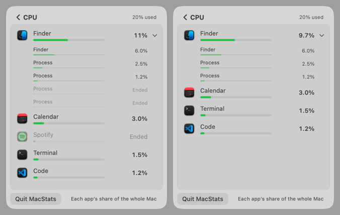

**Issues:**

| # | Severity | Where | Problem | Why it matters | Suggested fix |
|---|---|---|---|---|---|
| S1 | Medium | `BreakdownDisplay.swift:107-111` with `RefreshScheduler.swift:42` | The first numbers after "Measuring…" cover only 0.5 s. The first unfrozen scan after them (t ≈ 2.5 s) throws the order away and re-sorts from scratch, moving 5–8 of the top 8 rows (measured 7, 5 and 8 slots). | This happens on every CPU and Battery drill-in, right as the user starts reading the list. If they have already moved into the list, the reshuffle waits and lands when they leave. | Keep "Measuring…" until the first full 2 s window, so the first list shown is already the steady one. Alternatively, apply normal hysteresis to the provisional order instead of a fresh sort. |
| S2 | Medium | `BreakdownDisplay.isFrozen`, `:91-95` | With the pointer outside the list (on the header, footer or elsewhere), the CPU and Battery lists reorder 5–13 times a minute. The expanded app's block moves 3–10 times a minute, and its process rows reorder 16–20 times a minute, because the process-level hysteresis is only 1.5 printed steps (0.15 pp). | Someone reading the list without pointing (the normal "what's using my CPU?" glance) still sees rows and whole expanded blocks slide every few seconds. | Hold the expanded app's process order (and its own row) like a frozen list while it is expanded. Or use a stronger relative margin for process rows, which are small and noisy. |
| S3 | Low | `MetricsStore.swift:165-167` | Any move of 2 pp or more bypasses the 2 s dwell, so under bursty load the CPU card changes about every 1.5 s (37–41 per minute). | Readable thanks to the soft fade, but livelier than Apple's panels. | Make the dwell apply to moves below about 5 pp. |
| S4 | Low | CPU header vs rows | The sum of the held row values differed from the held header by up to 2.8–4.6 pp under load (0.8 pp at light load). | The rows "add up to the header" only approximately. Few users sum them. | Accept, or hold the header from the sum of the shown rows. |

**Why 7.5:** this meets the hardest part of the 9 anchor: nothing moves under a moved pointer, and an expanded app never vanishes. But S1 and S2 are Medium issues that a user notices in the primary flow, which keeps the area in the 7 band.

## Interaction reliability — 8.0/10

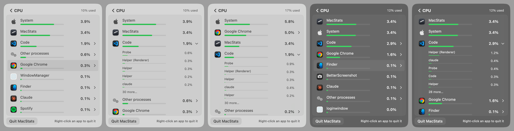

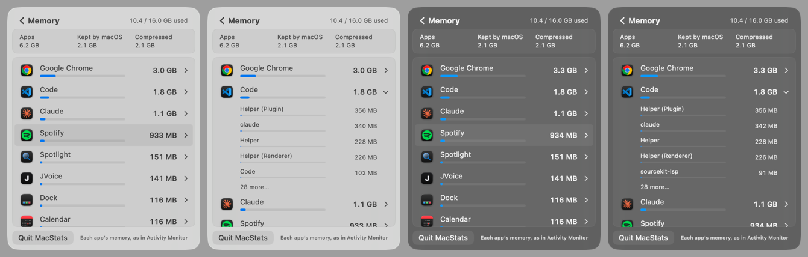
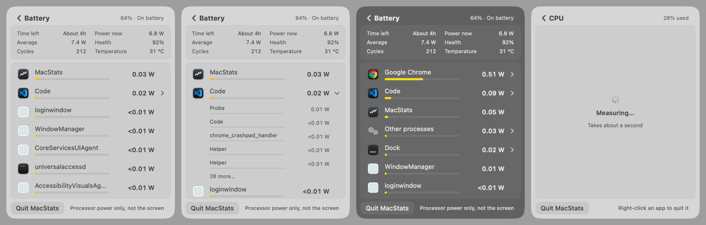

**Works well (checked):**
- **Expand / collapse:** a synthetic click on the row expands Code into "Probe, Helper (Renderer), Helper, Helper, claude, 30 more…" (`m-bd-cpu.png`, panel 2). It is an accordion (one app at a time). It collapses only when the app is down to 1 process *after* the freeze (`BreakdownView.swift:133-140`).
- **Freeze while a menu is open:** a context menu freezes the order through `NSMenu.didBeginTracking` (`:126-132`), so Quit acts on the row the menu was opened on. The menu header names the app.
- **Process actions:** quit and force quit check the start time, so a reused pid is never hit (`ProcessActions.swift:34-37`). Force Quit confirms with an `NSAlert`.
- **Back:** Esc goes back (`.cancelAction`). Rows are Buttons with accessibility actions.
- **Scrolling:** the scan timer runs in `.common` mode, so it keeps going while scrolling (`MacStatsApp.swift:514-525`).

**Issues:**

| # | Severity | Where | Problem | Why it matters | Suggested fix |
|---|---|---|---|---|---|
| I1 | Low | `BreakdownDisplay.swift:93`, `BreakdownView.swift:523-539` | A pointer that hasn't moved since the drill-in doesn't freeze the list. In the simulation, the rows under the resting pointer (top 3) changed 2–3 times in 24 s, including the S1 re-sort. | Someone who right-clicks without first moving the pointer can open the menu on a row that just slid in. The menu header names the app, which limits the damage. | Treat a right-click as "moved", or freeze for 1 s after any order change. |
| I2 | Low (unverified) | `AppRow.hovering` | When rows reorder under an unmoved pointer, the hover highlight can stay on the row that slid away, because SwiftUI `onHover` doesn't re-fire without mouse movement. | A stale highlight. | Verify on device; clear `hovering` when the order revision changes. |

I could not verify real right-click menus, real hover or real scrolling inside the actual `MenuBarExtra` panel (see Method & limits). **Why 8.0:** every mechanism I could drive works, and there are only Low issues, one of them unverified.

## Intuitiveness & discoverability — 8.0/10

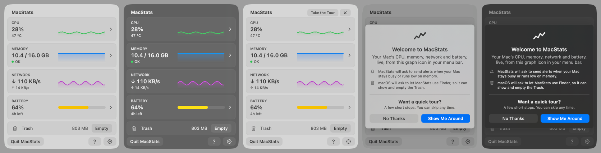

**Works well:**
- Clickable cards have a trailing chevron. The Network card, which isn't clickable, reserves the chevron's space so all graphs line up.
- A new user gets the welcome card on the auto-opened panel. It explains both permission prompts *before* they appear.
- The tour says "Click the card to see which apps use it."
- In breakdowns, expandable apps have a disclosure chevron. The footer says "Right-click an app to quit it" for the first 10 drill-ins, until a menu has been used. Every app row's tooltip says it too.
- An existing user sees a "Take the Tour ✕" chip.

**Issues:**

| # | Severity | Where | Problem | Why it matters | Suggested fix |
|---|---|---|---|---|---|
| D1 | Low | CPU card meta (`OverviewView.swift:114-117`) | "47 °C" has no label. Only the tooltip says it is the chip's temperature, and the tour's CPU step doesn't mention it. | A non-technical user may wonder what is at 47 °C. | Add "chip" to the meta ("47 °C chip"), or add half a sentence to the CPU step. |
| D2 | Low | Breakdown rows | After the hint retires, Quit and Force Quit are reachable only by right-click or tooltip. | This matches macOS conventions, but a non-technical user who missed the hint has no visible way in. | Acceptable. Optionally show the hint again whenever the user opens a breakdown and hovers a row for more than 2 s. |

**Why 8.0:** the 30-second goal is met by the welcome card, the tour and the chevrons, leaving only two Low gaps.

## Text / copy clarity — 8.2/10

**Works well:**
- Tour bodies are at most 20 words and contain no live numbers.
- Footnotes say what the numbers are measured against: "Each app's share of the whole Mac", "Processor power only, not the screen".
- Plain-word memory parts: Apps, "Kept by macOS", Compressed, with Activity Monitor's terms in the tooltips.
- "Nothing in it" for an empty Trash, and "Needs permission" plus "Allow…" when Finder access was refused.

**Issues:**

| # | Severity | Where | Problem | Suggested fix |
|---|---|---|---|---|
| T1 | Low | `Tour.swift:41-42` | The title "Memory in use" is followed by a body that starts "How much memory is in use." | Start the body with what's new: "Used out of total. The dot turns yellow or red when your Mac runs short." |
| T2 | Low | `BreakdownView.swift:294` vs `:438/488` | "Ended" means two things: a dimmed placeholder row with no value, and a live child row called "Ended processes" that carries real CPU. | Rename the child row to "Finished processes" or "Short-lived processes". |
| T3 | Low | `BreakdownFormat.swift:37` | Removing the app-name prefix leaves several identical "Helper" rows under Code (`m-bd-cpu.png`). | Acceptable (Activity Monitor does the same). Optionally add the pid in faint text to duplicate names. |
| T4 | Low | `Tour.swift:54` | "…live, from this graph icon in your menu bar" is a bit clumsy. | "…live in your menu bar, under this icon." |

## Visual layout, alignment & centering — 7.8/10

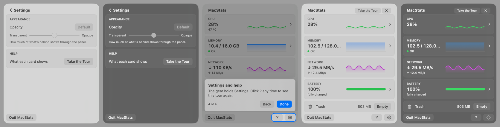

**Works well:**
- Every surface uses continuous corners with concentric radii: cards 8 pt in a 16 pt panel, row highlights 4 pt inside the list's 4 pt padding, footer buttons 8 pt.
- The value columns line up between app rows and process rows.
- The chevron column is kept even on rows that have no chevron.
- Light and dark both read correctly.
- The fixed panel size never jumps between screens.

**Issues:**

| # | Severity | Where | Problem | Why it matters | Suggested fix |
|---|---|---|---|---|---|
| V1 | Medium | `StatCard.swift:20,55` (120 pt value column, `lineLimit(1)`) | On a Mac with 128 GB of RAM, the Memory card reads "102.5 / 128.0..." in both appearances (crop below). | The main number on a primary card is cut off on supported high-RAM Macs (Mac Studio / Pro). | When `totalBytes ≥ 100 GB`, drop the decimals ("103 / 128 GB"), or let the value column take space from the graph. |
| V2 | Low | `TourLayout.callout` | The callout edge cuts the line next to it in half. In step 4, the top half of "10.4 / 16.0 GB" peeks out above it, and in step 1 the "↑ 14 KB/s" line peeks out below it. | Visual noise under the dim, which Apple coach marks avoid. | Accept, or snap the callout edge to the gap between cards when it lands within a few points of one. |
| V3 | Low | `SettingsView.swift:28` | The Settings screen is about 55 % empty space (two small cards, then a blank area). | Looks unfinished next to the full overview. | Expected while Milestone 4 is pending. Optionally centre the cards, or add short "About" information. |

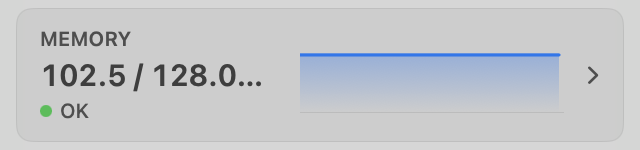
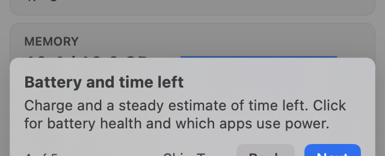

**Why 7.8:** a polished visual language with one Medium issue on an edge configuration and two Low issues.

## Intro & tour — 8.8/10

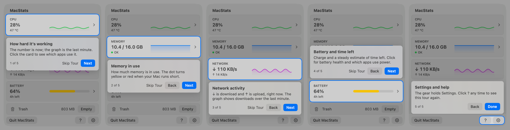
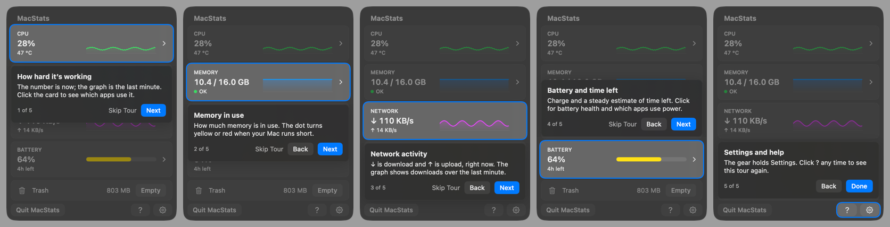

**Spotlight centering, measured from pixels only.** The method did not use the overlay's own anchor rect:

- Each step was rendered on a flat opaque background.
- The **card edge** is where the base capture (no tour) first departs from the panel background.
- The **cutout edge** is where the accent ring starts in the tour capture.
- Both were sampled along lines through the card, and along the 45° diagonals for the corners.

| Step | Light L / R / T / B (pt) | Dark L / R / T / B (pt) | Ring width | Clear gap ring→card | Corner radial gap (TL/TR/BL/BR) |
|---|---|---|---|---|---|
| 1 CPU | 3.0 / 3.0 / 3.0 / 3.0 | 3.0 / 3.0 / 3.0 / 3.0 | 2.0 | 1.0 | 2.8 / 2.8 / 2.8 / 2.8 |
| 2 Memory | 3.0 / 3.0 / 3.0 / 3.0 | 3.0 / 3.0 / 3.0 / 3.0 | 2.0 | 1.0 | 2.8 ×4 |
| 3 Network | 3.0 / 3.0 / 3.0 / 3.0 | 3.0 / 3.0 / 3.0 / 3.0 | 2.0 | 1.0 | 2.8 ×4 |
| 4 Battery | 3.0 / 3.0 / 3.0 / 3.0 | 3.0 / 3.0 / 3.0 / 3.0 | 2.0 | 1.0 | 2.8 ×4 |
| 5 `?` + gear | 3.0 / 3.0 / 3.0 / 3.0 | 3.0 / 3.0 / 3.0 / 3.0 | 2.0 | 1.0 | 2.8 (outer corners) |

A radial gap of 2.8 vs 3.0 is within the diagonal sampling step (1 device px × √2), so the corners are concentric: card 8 pt, cutout 11 pt, panel 16 pt. For step 5, the top and bottom were measured on columns through each button. A first pass along a line through the gear's rounded corner read 7 pt there; that was a measurement artefact, and `z-step5-footer-dark.png` shows the even inset.

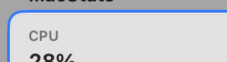 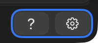

**Works well:**
- **Skippable:** Skip Tour on steps 1–4, Esc on every step, No Thanks on the welcome card.
- **Replayable:** the footer `?`, Settings → Help → Take the Tour, and the existing-user chip.
- **Resumable:** the first panel close pauses on the current step; the second close ends the tour.
- **Without a battery:** the Battery step is skipped and the counter reads "4 of 4". The probe measured progress "3 of 5" at step 3 and, after Done, phase off with seen version 1.
- **Clicks:** the hole passes clicks through, so clicking the highlighted card does what the callout says. The dim swallows stray clicks, but you can't get trapped.
- **Callout:** sits 6 pt from the cutout, aligned with the cards' 8 pt margin, below or above as room allows.
- **Accessibility:** VoiceOver announcements, Reduce Motion, Reduce Transparency and Increase Contrast (ring +1 pt) are all handled.

**Issues:**
- V2 (the callout cuts a line of text in half): Low.
- T1 (redundant Memory copy): Low.
- Low: the tour never mentions expanding an app or right-click to quit. The breakdown's footer hint covers right-click, so this is intentional, but a sixth stop isn't needed.

**Why 8.8:** this meets the 9 anchor on centering, concentricity, skipping and replay in both appearances. Only Low polish remains.

## Code quality of the new code — 8.0/10

**Works well:**
- The decisions live in pure, documented, tested types: `BreakdownDisplay`, `stableRanking`, `HeldReading`/`heldValue`/`heldRate`, `TourState`, `TourRules`, `TourLayout`.
- `./Scripts/test.sh` ran **356 tests in 45 suites, all passing**.
- Comments explain *why*, for example why a resting pointer doesn't freeze (`BreakdownDisplay.swift:6-8`) and why there are no SwiftUI alerts in the panel.
- `TourController` is observed only by `RootView`, so tour state never re-renders the cards.
- Scans run off the main thread with a generation guard (`MacStatsApp.swift:539-562`).

**Issues:**

| # | Severity | Where | Problem | Suggested fix |
|---|---|---|---|---|
| C1 | Low | `StableRanking.swift:41` with `BreakdownDisplay.swift:123,151` | `before:` is always passed `[:]` in production, so the "leads on two readings" logic and its doc comment (`StableRanking.swift:3-6, 29-33`) describe a mode the app never uses. Several `StableRankingTests` cases test only that mode. The real two-scan confirmation is done by `HeldReading`. | Remove the parameter and its tests, or document that confirmation happens upstream. |
| C2 | Low | `BreakdownDisplay.apply`, `:106-111` | Three interacting flags (`measured`, `provisional`, `fresh`) handle one first-window special case, which is hard to follow (and it causes S1). | Fold this into a single "first steady scan" state, or remove it by fixing S1 as suggested. |
| C3 | Low | `MetricsStore` | The store now also owns display holds, dwell timestamps and the breakdown display. It is about 320 lines and growing. | Consider moving the card holds into a small `CardDisplay` value type, like `BreakdownDisplay`. |
| C4 | Low | `TourOverlay.swift:182-193` | Keyboard shortcuts are attached to zero-size `Button("")` views. It works, but it is a hack. | Acceptable; `.onKeyPress` (macOS 14+) would be the clean way. |

## Resource cost — 8.3/10

**Evidence:**
- **Breakdown scan cost** (existing probe, 60 s each, with `Code` as the target): 11.82 → **7.16 ms of scanning per second**. The probe's own CPU went 0.93 % → 0.62 %. The extra `setBreakdown` bookkeeping costs 0.36 ms per scan.
- **My three-breakdown simulation:** 0.61–0.95 % CPU in total.
- **Overview open at 0.5 s ticks** (real views in a vibrancy window, 25 s each): **11.5 %** of a core with the tour off and **11.95 %** with it on (step 1). RSS went from 53 to 58 MB.
- **By code reading:**
  - The tour adds no timers or observers when it is off (`TourController.swift:8-10`).
  - Anchors report only while the tour is active (`TourOverlay.swift:53-61`).
  - The pointer reading happens once per scan.
  - The NSMenu observers exist only while a breakdown is shown.
- **Hidden-panel fix:** in code, the 0.5 s tick now stops when the panel window is off screen (`MacStatsApp.swift:144-155, 193-196`).
- **The currently installed copy** (`~/Applications/MacStats.app`, built 17:49, *before* this branch: no tour strings in the binary) was using **26–28 % of a core**. Its panel window was not on screen (`kCGWindowIsOnscreen = false`). That matches the bug this branch's code fixes.

**Issues:**

| # | Severity | Where | Problem | Suggested fix |
|---|---|---|---|---|
| R1 | Low (unverified) | `MacStatsApp.swift:144-155` | I could not verify live that the off-screen-panel fix stops the 26–28 % burn, because installing the app was out of scope. | Install the branch build and confirm the CPU stays under about 1 % with the panel closed after it has been opened. |
| R2 | Low (not new) | Overview while open | 11.5 % of a core while the overview is on screen (sparkline slides at 0.5 s) is well above Apple's panels. It was not changed by this branch. | Later work: slide the sparklines with a cheaper redraw, or update at 1 s. |

**Why 8.3:** the branch lowered the scan cost and adds almost nothing while the tour is off. The only open point is the unverified live fix.

## Cross-cutting issues

- **One visual language everywhere:** continuous corners, the same `SubtleButtonStyle`, the same secondary caption styles. No inconsistencies were found across the overview, breakdowns, Battery, Settings, the callout and the welcome card, in light or dark.
- **Two "stability" philosophies:** the list is frozen *only while pointed at*, so its behaviour depends on where the pointer happens to be (S2, I1). A rule that also holds the order for a few seconds after any reorder, or while an app is expanded, would make it calm regardless of the pointer.
- **"Ended" is overloaded** (T2).

## Top fixes (ranked by impact ÷ effort)

1. **S1:** keep "Measuring…" until the first full 2 s window, or don't fresh-sort the provisional list. This removes the reshuffle 2.5 s into every CPU and Battery drill-in. (`BreakdownDisplay.swift:107-111`, `RefreshScheduler.swift:42`)
2. **S2:** hold the expanded app's process order (and its own row) while it is expanded, and use a stronger relative margin for process rows. This removes the block moves (3–10 per minute) and process reorders (16–20 per minute) with the pointer outside the list.
3. **V1:** fit the Memory value at ≥ 100 GB, e.g. "103 / 128 GB" without decimals. (`StatCard.swift:20`, `OverviewView.swift:103-106`)
4. **R1:** install the branch build and confirm the closed-panel CPU is under about 1 %. The currently installed old build burns 26–28 % of a core.
5. **I1 + S3:** treat a right-click as "pointer moved", and apply the card dwell to moves under about 5 pp.

## Method & limits

**Terms:**
- **pp:** percentage points (whole-Mac CPU %).
- **Slot change:** one of the top 8 list positions shows a different app than at the previous scan.
- **Frozen:** `BreakdownDisplay` keeps the row order (pointer moved into the list, or a context menu is open).
- **RSS:** resident memory.

**Reproducing:**
- **Baseline vs current:** `docs/research/2026-10-06-probes/stability/run.sh 60 Code`, with `SRC_ROOT=<checkout of 1ed61cf> BASELINE=1` for the baseline.
- **My render, stability and cost probe:** it lived in the session scratchpad and is not committed, per the review rules. It is the same harness as `docs/research/2026-10-06-probes/tour-render/` (copy `Sources/`, build with `SDKROOT=/Library/Developer/CommandLineTools/SDKs/MacOSX26.5.sdk swift build -c release`, run under a kill timeout), plus three additions:
  - pixel-based inset detection on a flat background;
  - a scripted `breakdownPointerProbe`;
  - CPU, Memory and Battery breakdowns run at once.

- **Render probe:**
  - Built in the scratchpad from a copy of `Sources/` (MacStatsApp minus `@main`).
  - Windows sat at desktop level + 1, were ordered back and never activated, and were captured with `CGWindowListCreateImage(.optionIncludingWindow)`.
  - Throwaway `UserDefaults` suites were deleted afterwards; the MacStats domain was never touched.
  - Overview, tour and Settings captures used a fake store; the breakdowns used **real scans** of this Mac's processes. Expanding was done with a synthetic click on the probe's own window.
  - Hover highlights visible in two captures come from the real cursor position over the background window, not from a scripted hover.
- **Stability:** two 96 s runs of three real breakdowns plus the cards, with a scripted pointer through `breakdownPointerProbe` and the hover events.
- **Baseline:** the existing stability probe was rerun against `git archive 1ed61cf`.
- **Not checked, because I could not drive the real `MenuBarExtra` panel without disturbing the owner:**
  - real right-click menus and real hover/scroll (I2);
  - the welcome card auto-opening on first launch;
  - the panel-close pause and resume of the tour;
  - the live closed-panel CPU of this branch (R1).

  A human should spend two minutes on these on the installed branch build.
- Loads during the runs were moderate (load average 2–4, whole-Mac CPU around 10–30 %). A heavier, burstier workload would raise the live reorder rates in S2.
