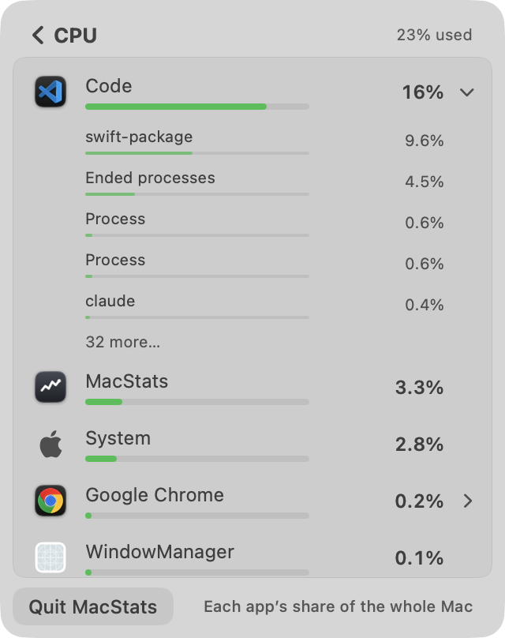
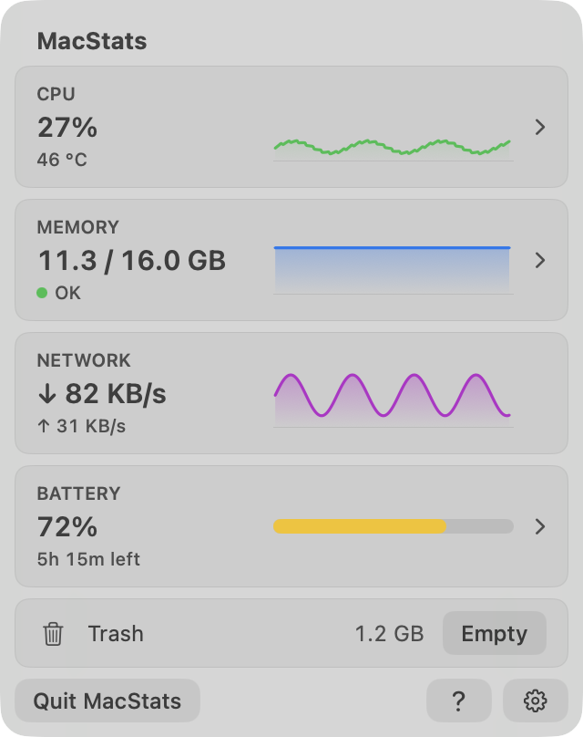
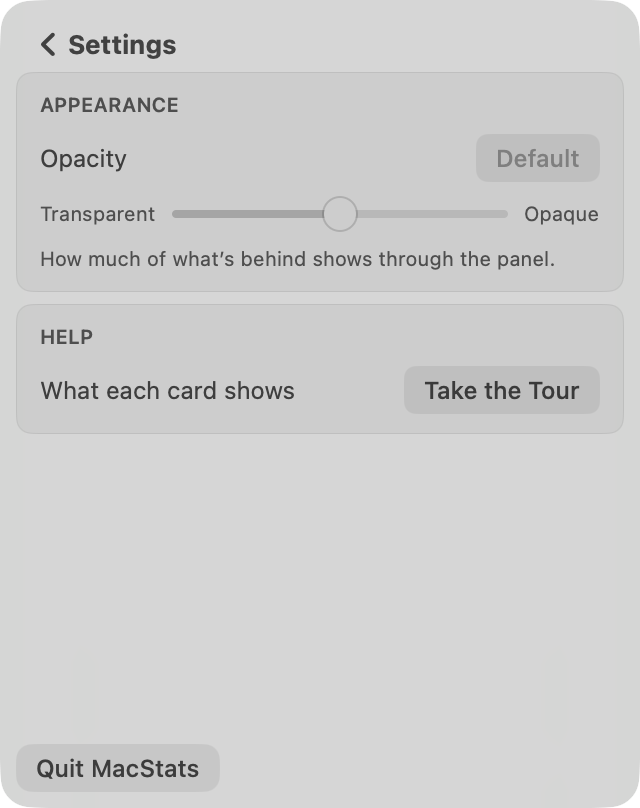
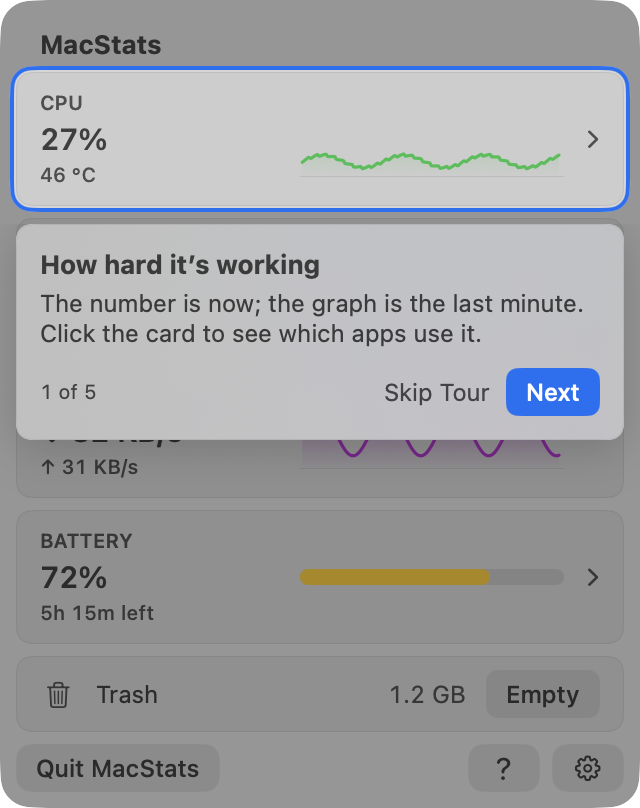
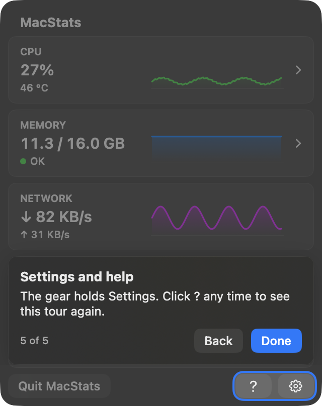

# MacStats stability + tour review, round 3, reviewer B (2026-10-06)

**Overall: 7.9/10.** This is a great app that is close to "basically perfect". The tour now meets the
standard: on every step, in light and dark, the spotlight sits exactly 3.0 pt outside the card on all
four sides, with the ring 2 pt wide and 1 pt of clear space inside it. Its corners are concentric
continuous squircles (11 pt outside 8 pt), and the dim is equally dark on all four sides. A row that
the pointer has moved onto never moved in 120 frozen scans of the live processes across three runs.
The overview cards are steady but stay current: a newly busy core shows on the card in 0.5–2 s. The
remaining issues are all in the per-app lists **when the pointer is not on them**, plus one edge case
when it is:

- The list visibly re-sorts about 2.5 s after it opens, under a pointer that has not moved yet.
- At idle, the top two rows of the Battery list swap every 4 s.
- Almost half of CPU scans show a row with a lower number above a row with a higher one.
- If the expanded app gains a process while the list is frozen, that inserts a row and pushes every
  row below it down.

None of these is High. Together they keep the two most important areas (stability, interaction)
in the 7s, and they pull the overall score just under 8.

**Standard:** Apple's own Battery / Control Center menu-bar panels; readings as good as Activity
Monitor; the tour as good as Apple's coach marks.
**Method:** Both. I rendered the REAL SwiftUI views off-screen (light and dark), ran a headless live
flow with the real `MetricsStore` + `BreakdownScanner` (3 runs, 90–120 s each, 5 scenarios at once),
ran a synthetic freeze test, measured render cost against a baseline (1ed61cf) build, ran the test
suite, and read the code.
**Reviewer:** independent subagent, reviewer B, round 3.

## Calibration
- **Type and platform:** a native macOS 26 menu-bar system monitor. It is a SwiftUI `MenuBarExtra`
  popover with a fixed 320×404 size.
- **Audience:** everyday Mac users, including non-technical ones.
- **Maturity:** shipping, v1.x.
- **Reference for a 10:** Apple's Battery / Control Center panels, with Activity Monitor-quality
  readings. The tour should be as good as Apple's coach marks.
- **Platform conventions:** continuous corners with concentric radii; menu-bar panel behaviour
  (clicking outside closes it, Esc); light and dark appearance; tooltips; right-click menus.
- **3:** numbers flicker and rows re-sort every tick, so you can't click or expand. The tour is
  misaligned or traps you. Jargon everywhere.
- **6:** mostly steady, but rows still sometimes move under the pointer or an expanded app
  collapses. The tour works, but the highlight is a few points off-centre or the copy is wordy.
  Some controls are hard to find.
- **9:** values are steady enough to read and still current within a few seconds. Rows never move
  out from under the pointer, and an expanded app never vanishes. A first-time user understands
  every card and how to drill in within about 30 s. Every tour highlight is exactly centred, with
  equal insets and concentric continuous corners, in light and dark. The tour can be skipped at
  any time and replayed. The text is plain and short. MacStats's own CPU and RAM use is no worse
  than before.

## Scoreboard
| Area | Score | Verdict (one line) |
|---|---|---|
| Stability of numbers & lists | **7.4** | Rock-solid under the pointer. When the pointer is elsewhere, the lists still re-sort several times a minute, re-sort once just after opening, and show small out-of-order pairs. |
| Interaction reliability | **7.6** | Expand, collapse, freeze and context-menu safety all work. A process appearing in the expanded app can shift rows under a frozen pointer. Unnamed "Process" rows. |
| Intuitiveness & discoverability | **8.0** | Chevrons, tooltips, the welcome, the tour, the `?` and the quit hint cover the first 30 s. Rows you can't expand give no hover feedback. |
| Text/copy clarity | **8.2** | Plain and short almost everywhere. A few redundant or slightly mismatched phrases. |
| Visual layout, alignment & centering | **8.5** | Consistent squircles, concentric radii, clean in light and dark. Settings is mostly empty space, and a 3 pt sliver of the next card shows between the spotlight and the callout. |
| Intro & tour (incl. spotlight centering) | **8.8** | Exactly centred on all 5 steps (and the no-battery variant) in both modes. Skippable in 3 ways, replayable in 3 places. Only nitpicks. |
| Code quality of the new code | **7.8** | Pure, tested core (356 tests pass). `BreakdownDisplay.apply` is dense and carries one real bug class (insertion while frozen) and weak low-value hysteresis. |
| Resource cost | **8.6** | Open-panel render cost no worse than baseline (11.6 vs 13.0 % of a core). The tour costs nothing while off. Breakdown scans halved. |

## Stability of numbers & lists: 7.4/10

Evidence, from the headless live flow with real processes (`r3-B/stability-run{1,2,3}.txt`; probe in
`r3-B/probe-src/main.swift`). Each run opens CPU, Memory and Battery breakdowns at the app's cadence:
a scan at 0 s, at 0.5 s, then every 2 s. Pointer scenarios:

- **away:** the pointer never on the list.
- **hover:** the pointer moves onto the list at 15 s and stays until 25 s before the end. The
  probe's own app (Code) is expanded.
- **still:** the pointer rests where the card was clicked and never moves.

The probe also starts two `sleep` processes at 25 s and a busy `yes` at 45–51.5 s.

| Measure | Run 1 (120 s) | Run 2 (100 s) | Run 3 (90 s) |
|---|---|---|---|
| CPU card text changes/min (flip-backs) | 45.0 (6.0) | 31.8 (1.2) | 22.0 (3.3) |
| CPU card held vs exact, p95 / max | 1.78 / 2.00 pp | 1.53 / 2.00 pp | 1.41 / 1.89 pp |
| Busy core → card shows it / shows it gone | 0.5 s / 2.0 s | 0.5 s / 2.0 s | 2.0 s / 4.5 s |
| Memory / ↓ / ↑ card changes/min | 11.5 / 11.0 / 14.5 | 1.2 / 10.8 / 12.6 | 0 / 1.3 / 4.7 |
| CPU list, pointer away: top-8 order changes/min | 14.7 | 8.0 | 6.1 |
| … of which the top 3 changed | — | 6.7 | 4.8 |
| CPU list: scans with a visible inversion in the top 8 | — | — | **20 / 45** |
| CPU list: row-text changes/min across the top 8 (flip-backs) | 71.7 (4.1) | 40.4 (4.9) | 37.5 (4.8) |
| Battery list, away: top-8 order changes/min (flip-backs) | 9.7 (6.6) | 4.9 (5.5) | **15.0 (8.9)** |
| Memory list: order changes/min | 1.6 | 0 | 0 |
| **Hovered list: rows moved / inserted / removed / collapses** | 0/0/0/0 in 40 scans | 0/0/0/0 in 30 | 0/0/0/0 in 25 |
| Still pointer: top row changed at t = | 2.5 s, then 7 more | 2.5 s, then 7 more | 2.5 s, then 6 more |

**Works well:**
- The freeze while pointing is perfect in live use: zero moves, inserts, removals or collapses
  across 95 frozen scans.
- No row is ever printed clearly out of order (more than 25 % and 2 printed steps). The probe
  counted 0 such pairs in every run.
- Memory is essentially still.
- The cards are current: a newly busy core shows in 0.5–2 s. The held value is never more than
  2 pp from the exact one.
- Text holds stop the A→B→A flicker that the 0.5 s tick would otherwise cause.

**Issues:**
| # | Severity | Where | Problem | Why it matters | Suggested fix |
|---|---|---|---|---|---|
| S1 | Medium | CPU/Battery list, first seconds | The list always re-sorts 2.5 s after it opens. The "still" run's top row changed at exactly 2.5 s in all 3 runs. Cause: the first unfrozen scan after "Measuring…" re-sorts from scratch (`BreakdownDisplay.swift:107-111`, `fresh`), and a pointer that hasn't moved doesn't freeze (`BreakdownDisplay.swift:93`). | The user has just started reading, and the row under the resting pointer changes. A click without moving now hits a different app. | Keep "Measuring…" until the first 2.5 s window is in (one state change instead of two). Or treat the resting pointer as pointing once the first full scan is shown. |
| S2 | Medium | Battery list at idle | The top two rows swap every scan pair: Code 0.05 ↔ 0.01 W vs MacStats 0.03 W, 15 order changes/min and 8.9 flip-backs/min (run 3, `stability-run3.txt` order log). Cause: energy hysteresis `abs = 0.015 W` (`StableRanking.swift:18`) is tiny next to idle burstiness, and a 4× move passes the text hold at once. | This is the "re-sorts every tick" symptom, on a drill-in. | For energy below about 0.1 W, rank by a slower average (e.g. 10–20 s), or raise `abs` to 0.03–0.05 W. Rows that print "<0.01 W"/"0.0x W" could share a tie band. |
| S3 | Medium | CPU list, pointer away | 20 of 45 scans show a row printed lower above one printed higher, e.g. "System 3.0% · MacStats 3.3%", "BetterScreenshot 0.1% · Spotify 0.2%", "Code 5.6% · System 5.8%". This is because of the 15 % / 0.15 pp climb margin (`StableRanking.swift:16,75`). | A list that looks unsorted half the time reads as a bug to non-technical users. Activity Monitor never shows that. | Once a held pair has been inverted for 2 scans, let the lower row drop (an inversion timeout). Or, when pointer-away, sort by the held text and use the hysteresis only for ties within a step. |
| S4 | Low | CPU list, pointer away | The top 3 still change about 5–7 times a minute (System ↔ MacStats ↔ Code at 3–6 %). | Fine while pointing (frozen), but a glance from afar sees churn. | Covered by S3's fix or a slightly larger relative margin for the top 3. |
| S5 | Low | CPU card | 22–45 text changes/min with 1–6 flip-backs/min. That is readable, but livelier than Control Center. | Nitpick. | Optional: dwell 3 s for moves under 3 pp. |

**Why 7.4:** this meets the 9-anchor's core promise: no row moves under the pointer, and an
expanded app never vanished in live runs. But three Medium issues remain in the lists the user
reads without pointing (S1–S3), and S2 is literally the "re-sort every tick" behaviour, on the
Battery drill-in. Better than the 6-anchor, short of 8.

## Interaction reliability: 7.6/10

**Works well:**
- A synthetic click on an app row expanded it in every case: CPU, Memory and Battery, light and
  dark (6/6, `render-log.txt`). It worked on "Other processes" with 319 processes too
  (`breakdown-cpu-expanded-dark.png`), where it shows 5 rows and then "314 more…".
- A context menu freezes the order, and its actions capture the pid and start time
  (`BreakdownView.swift:126-132, 245-249`; `ProcessActions.quit(pid:startTime:)`). A re-sort or a
  reused pid can't redirect Quit.
- Esc and the back chevron go back. Ended rows become dimmed "Ended" placeholders while frozen.
- An ended expanded app keeps its process placeholders, so it doesn't collapse under the pointer.

**Issues:**
| # | Severity | Where | Problem | Why it matters | Suggested fix |
|---|---|---|---|---|---|
| I1 | Medium | Expanded app, list frozen | If the expanded app gains a process while frozen, the new row is appended **inside** the expanded block, and every row below shifts down one row (36 pt). The same happens when the "N more…" row first appears (5 → 6 processes). Proven with the real store (`synthetic-insert.txt`: `p103` inserted before `a200`; `m100` inserted before `a200`). Code: `BreakdownDisplay.swift:151-152` (frozen ranking = kept + fresh), `BreakdownView.swift:384-389`. In live runs Code had 26–32 processes, so new ones fell past the 5 shown and nothing moved. Apps with 2–5 processes (Terminal running commands, small apps) will shift. | This breaks "nothing moves under the pointer" in exactly the expanded view. | While frozen, don't add new child rows (or the "more" row) to the visible prefix. Bump the "N more…" count instead, or hold new children until the unfreeze. |
| I2 | Low | Expanded rows | Two rows named just "Process" (`breakdown-cpu-expanded-light.png`, `breakdown-energy-expanded-light.png`). The name is read at render time and falls back to "Process" (`BreakdownView.swift:604`), so a short-lived process gets an unhelpful label. | Rows with no name can't be acted on with confidence. | Capture `processName` during the scan (on the scan queue), or use the executable name from the raw scan. |
| I3 | Low | App rows | Only expandable rows highlight on hover (`BreakdownView.swift:452-454`). Rows that have only a right-click menu give no feedback that they are interactive. | Discoverability of Quit once the hint is gone. | A faint hover fill on every actionable row, or keep the hint footnote's tooltip. |
| I4 | Low | Right-click menus | Not exercised live: showing a menu would put it on the owner's screen. Judged from code only. | — | A human should right-click → Quit/Force Quit once on a frozen list. |

**Why 7.6:** every core interaction works and is protected against reordering. One real Medium
(I1) breaks the "never moves under the pointer" promise in the expanded case, plus small polish
issues.

## Intuitiveness & discoverability: 8.0/10

**Works well:**
- The cards that drill in have chevrons. Network, which has no drill-in, has none.
- Card tooltips say "Click to see which apps use the CPU".
- On first launch the panel opens itself with a welcome card that explains the two permission
  prompts (`welcome-light.png`).
- The breakdown footnote reads "Right-click an app to quit it" until the menu has been used once
  (`breakdown-cpu-measuring-light.png`).
- `?` replays the tour.
- Existing users get a "Take the Tour ✕" chip that doesn't move the title (`chip-dark.png`).
- "Measuring… / Takes about a second" explains the wait.

**Issues:**
| # | Severity | Where | Problem | Fix |
|---|---|---|---|---|
| D1 | Low | Breakdown header | It says "23% used" right after the user clicked a card showing 27% (`breakdown-cpu-light.png` vs `overview-light.png`): a 4 s row window vs the card's 2 s window (`BreakdownView.swift:52`). A first-time user sees two different numbers for "the same" thing. | Show the card's held value in the header until the rows' window has filled, or label the header "last 4 s". |
| D2 | Low | Rows you can't expand | No hover feedback (see I3). Once the hint is retired, Quit is findable only through the tooltip. | As I3. |
| D3 | Low | CPU card | "46 °C" is explained only in a tooltip. | Fine for most users; optional "chip 46 °C". |

**Why 8.0:** a first-time user gets the cards and the drill-in within 30 s. The remaining issues
are small.

## Text/copy clarity: 8.2/10
**Works well:**
- Plain words: "Kept by macOS", "Ended processes", "Other processes", "Each app's share of the whole
  Mac", "Processor power only, not the screen".
- Every tour body fits in 2 lines (`tour*.png`).
- Typographic apostrophes, and Title Case buttons.

**Issues:**
| # | Severity | Where | Problem | Fix |
|---|---|---|---|---|
| T1 | Low | Tour step 2 (`Tour.swift:41-42`) | The title "Memory in use" is followed by the body "How much memory is in use." The second phrase only repeats the first. | Body: "The dot turns yellow or red when your Mac runs short. Click to see which apps use it." |
| T2 | Low | Tour step 1 | "The number is now; the graph is the last minute." is clipped and semicolon-heavy for non-technical users. | "The number is right now, the graph shows the last minute." |
| T3 | Low | Battery | The card says "5h 15m left", but the drill-in says "About 5h 15m" for the same estimate (`overview-light.png`, `breakdown-energy-expanded-light.png`; `BatteryDetailsCard.swift:58,135`). | Use one wording in both places. |
| T4 | Low | Welcome card | About 60 words in six blocks (`welcome-light.png`). This is denser than Apple's first-run sheets. | Fold the subline into the question ("Want a quick tour? You can skip any time."). |
| T5 | Low | Rows | "Process" fallback name (I2). | As I2. |

**Why 8.2:** this is basically perfect copy, with a handful of Low items.

## Visual layout, alignment & centering: 8.5/10

**Works well:**
- Cards (8 pt) are concentric with the panel (16 pt) at an 8 pt inset.
- Row highlights are 4 pt inside the list's 4 pt padding.
- Buttons in the corners are concentric (8 pt).
- Values sit in fixed columns, so graphs never shift.
- Light and dark are both correct (`overview-dark.png`, `breakdown-memory-expanded-dark.png`).
- The tour's geometry is exact (next section).

**Issues:**
| # | Severity | Where | Problem | Fix |
|---|---|---|---|---|
| V1 | Low | Settings | Two cards and then about 55 % empty panel (`settings-light.png`). This is because of the fixed 404 pt height (`SettingsView.swift:28`). | Acceptable for a push screen. Optionally centre the content, or add the planned Milestone-4 settings. |
| V2 | Low | Tour steps 1–4 | A 3 pt sliver of the neighbouring card shows between the spotlight and the callout. The callout gap is 6 pt from the cutout edge, but the cutout only reaches the middle of the 6 pt card gap (`TourLayout.swift:12,16`; zoom `z-t4-gap.png`). | Make `calloutGap` 3 pt, so the callout covers the neighbour exactly from its edge. Or extend the callout's backdrop over the sliver. |
| V3 | Low | Probe vs real panel | Rendered on `NSVisualEffectView(.popover)`, not the real Liquid Glass `MenuBarExtraWindow`. | A human should confirm one tour step in the real panel. |

**Why 8.5:** this is polished and consistent, with only nitpicks.

## Intro & tour (incl. spotlight centering): 8.8/10
 

**Measured insets** (`render-log.txt`):
- Method: the anchor rect comes from the same `TourAnchorKey` the overlay reads, and the cutout from
  `TourLayout.cutout`. A pixel walk outward from each card edge, in a capture with the tour compared
  against one without it, gives the clear gap, the ring width and the hole edge.

| Step | Card (pt) | Cutout (pt) | Geometry insets L/R/T/B | Pixels: clear gap + ring = hole edge, L/R/T/B | Dim strip T/B/L/R (tour/base luminance) |
|---|---|---|---|---|---|
| 1 CPU (light) | 8,36 304×67 | 5,33 310×73, r 11 | 3.0/3.0/3.0/3.0 | 1+2=3.0 on all four sides | 0.701/0.701/0.701/0.701 |
| 2 Memory (light) | 8,109 304×67 | 5,106 310×73 | 3.0 ×4 | 3.0 ×4 | 0.701 ×4 |
| 3 Network (light) | 8,182 304×67 | 5,179 310×73 | 3.0 ×4 | 3.0 ×4 | 0.701 ×4 |
| 4 Battery (light) | 8,255 304×67 | 5,252 310×73 | 3.0 ×4 | 3.0 ×4 | 0.701 ×4 |
| 5 `?`+gear (light) | 234,372 78×24 | 231,369 84×30 | 3.0 ×4 | 3.0 ×4 | 0.701/0.701/0.704/0.704 |
| 1–4 (dark) | same | same | 3.0 ×4 | 3.0 ×4 | 0.604/0.604/0.605/0.605 |
| 5 (dark) | same | same | 3.0 ×4 | 3.0 ×4 | 0.604/0.604/0.608/0.608 |
| No battery, last step (light/dark) | 234,372 78×24 | 231,369 84×30 | 3.0 ×4 | 3.0 ×4 | as step 5; progress "4 of 4" |

The corner zooms `z-t1-corner-TL.png` and `z-t5-corner-BR.png` show continuous corners at 11 pt,
concentric with the 8 pt card and (at the bottom right) with the panel's 16 pt corner.

**Works well:**
- Exact centring everywhere.
- The callout's shadow is masked, so the surround is evenly dark (the strips match to 0.004).
- Three ways out: Skip Tour, Esc, or clicking away twice (the first click away pauses, the second
  ends it, `Tour.swift:133-141`).
- Three ways back in: `?`, Settings → Help → Take the Tour, and the existing-user chip.
- "n of m" skips Battery on Macs without one.
- Clicks inside the cutout go through, so "Click the card" really works.
- VoiceOver announces each step. Reduce Motion gives a cross-fade; Reduce Transparency gives a
  solid surface.
- The tour costs nothing when off (Resource cost).

**Issues:**
| # | Severity | Where | Problem | Fix |
|---|---|---|---|---|
| R1 | Low | Ring | Only 1 pt of clear space between the card's hairline and the 2 pt ring (`TourLayout.swift:12-13`). At normal viewing size it reads as hugging the card. Apple's focus rings leave about 2–3 pt. | Optional: inset 4 pt (still inside the 6 pt gap if the callout gap goes to 2 pt), or a 1.5 pt ring. |
| R2 | Low | Steps 1–4 | The neighbour-card sliver (V2). | As V2. |
| R3 | Low | Keyboard | → / ← / Esc / Return shortcuts exist in code (`TourOverlay.swift:182-193`) but weren't exercised: the probe window can't become key without activating. | A human check. |

**Why 8.8:** this is the 9-anchor almost to the letter, apart from two visual nitpicks.

## Code quality of the new code: 7.8/10
**Works well:**
- The decisions live in pure, documented MacStatsCore types: `stableRanking`, `HeldReading` /
  `heldValue`, `BreakdownDisplay`, `TourState`, `TourRules`, `TourLayout`.
- `./Scripts/test.sh` reports **356 tests in 45 suites passed**.
- The app layer is thin: `TourController` only reads and writes defaults.
- The tour anchors report their rects only while the tour is active. The pointer probe does nothing
  between scans. No new timers.
- `ProcessKey` (pid + start time) handles pid reuse in the trailing window.

**Issues:**
| # | Severity | Where | Problem | Fix |
|---|---|---|---|---|
| C1 | Medium | `BreakdownDisplay.swift:106-179` | `apply` is about 75 dense lines with three interacting flags (`measured`, `provisional`, `fresh`) plus frozen placeholders. It holds the I1 bug (the frozen child list appends fresh keys into the visible prefix) and the S1 behaviour. The tests didn't catch I1. | Split it into "rank apps", "rank children (frozen-aware)" and "holds". Add a test for "a frozen expanded app gains a child: flattened rows below don't move". |
| C2 | Low | `StableRanking.swift:16-18` | The hysteresis constants are tuned for mid-range values and are weak near zero (S2). | Make the abs margin scale-aware, or tune it with the energy idle replay. |
| C3 | Low | `MetricsStore.swift` (322 lines) | Display holds, card dwell and breakdown freeze now live in the "single source of truth" store, so it mixes readings with presentation. | Fine for now. Consider a `CardDisplay` value like `BreakdownDisplay`. |
| C4 | Low | `BreakdownView.swift:301` vs `.tooltip(...)` elsewhere | `.help` and `.tooltip` are mixed for the same purpose. | Use `.tooltip` throughout. |
| C5 | Low | Comments | Many doc comments cite `docs/research/...` sections and past measurements. Useful context, but they will rot. | Keep the "why"; move the numbers to the docs. |

**Why 7.8:** good, tested, well-separated code, with one Medium design/bug cluster in the most
important new type.

## Resource cost: 8.6/10
Evidence (`cost.txt`):
- **Open-panel render cost.** The real overview in an off-screen window, with `store.record` every
  0.5 s for 20 s: **current 11.6 % of a core vs baseline 1ed61cf 13.0 %** (two runs each).
- **Tour host.** Present but off: 11.60 % vs 11.64 % without it (no cost). Tour on: about +0.6 % of
  a core.
- **Breakdown scan.** About 17 ms per scan (p50), every 2 s instead of every 1 s, so about 0.8 % of
  a core. The 4 s trailing window keeps two small dictionaries.
- **Nothing new runs while the panel is closed.** No timers in `TourController`. The pointer probe
  is read only during scans. `PanelWindowObserver` is two notification observers.

**Issues:**
| # | Severity | Where | Problem | Fix |
|---|---|---|---|---|
| P1 | Low (info) | Installed app | `~/Applications/MacStats.app` (built 17:49, before this branch) is using **28–36 % of a core** with its panel window off screen (`ps` samples in `cost.txt`). It is the "MacStats 3.3–3.8 %" row in every CPU capture. That is the old build. This branch adds window-occlusion tracking and a per-tick on-screen check (`MacStatsApp.swift:144-156, 193-196`) that should stop it, but this review could not verify that live (installing was out of scope). | Install the branch build and confirm the closed-panel CPU drops to about 0. |
| P2 | Low | RAM | RAM was not measured on the real app. The new state is small (a few dictionaries of about 500 entries while a breakdown is open). | — |

**Why 8.6:** this is no worse than baseline, and better in render and scan cost. It isn't higher
only because the closed-panel fix is unverified live and RAM wasn't measured.

## Cross-cutting issues
- **Steadiness depends on the pointer.** Lists are frozen solid when pointed at, but they still
  re-sort and show inversions when not. Most remaining stability complaints come from that split.
  A slower ranking clock when the pointer is away (rank every 2nd–3rd scan while still updating
  values) would close most of S1–S4 at once.
- **Different time windows show different numbers** (card 2 s, breakdown 4 s). Make that seamless
  at the moment of drill-in (D1).
- **The visual language is consistent:** continuous corners and concentric radii on every surface
  checked, in light and dark.

## Top fixes (ranked by impact ÷ effort)
1. **I1/C1:** while frozen, never insert child or "more" rows into the expanded app's visible
   prefix. Bump the count instead. Add a test. (`BreakdownDisplay.swift:151`, `BreakdownView.swift:384`)
2. **S2:** stronger hysteresis for low watts (abs ≥ 0.03–0.05 W, or a slower average below 0.1 W),
   so the Battery list's top rows stop swapping every 4 s at idle. (`StableRanking.swift:18`)
3. **S1:** no re-sort from scratch 2.5 s after opening. Either keep "Measuring…" until the first
   full window, or freeze for a resting pointer after the first real scan.
   (`BreakdownDisplay.swift:107-111`)
4. **S3:** an inversion timeout, so a held pair that is printed out of order for more than 2 scans
   swaps. (`StableRanking.swift:73-77`)
5. **V2 + T1/T3 polish:** `calloutGap` 3 pt (no neighbour sliver); the memory step's body; one
   battery time wording.

## Method & limits
- **Render:** `r3-B/probe-src/main.swift` is a SwiftPM executable built in the scratchpad. It
  contains the current `Sources/MacStatsCore` and `CAppleSensors`, plus `Sources/MacStatsApp/*.swift`
  without `MacStatsMain.swift`.
  - Windows were borderless at `CGWindowLevelForKey(.desktopWindow)+1`, `orderBack`, never
    activated, and closed after capture. Capture used
    `CGWindowListCreateImage(.optionIncludingWindow, [.boundsIgnoreFraming, .bestResolution])`.
  - The fake store has fixed values. Breakdowns use real scans of this Mac's processes.
  - Rows were expanded by a synthetic click on the probe's own window.
  - Tour defaults went into throwaway suites, which were deleted. The MacStats domain was never
    touched.
- **Stability:** the same probe's `stability` mode, headless, with three runs (120, 100 and 90 s)
  and five breakdown sessions each.
  - The pointer was simulated through `breakdownPointerProbe` and `setBreakdownPointerInside`.
  - It mirrors `BreakdownView`'s collapse rule and flattens rows with the real `BreakdownList.rows`.
  - The probe's code gained metrics between runs (top-3 and inversion counters in runs 2–3).
    `probe-src/main.swift` is the final version.
  - `synthetic` mode feeds the real `MetricsStore` hand-made scans to prove I1.
- **Cost:** the probe's `cost` mode, plus a separate harness built from `git archive 1ed61cf`
  (`probe-src/baseline-cost-main.swift`).
- **Not checked live:** right-click menus, keyboard shortcuts, hover highlights and the real
  Liquid Glass `MenuBarExtraWindow`. A probe window can't become key or show a menu without
  disturbing the owner's screen. The installed app was not replaced, so the closed-panel CPU fix
  is unverified.
- **Independence note:** to check build times for the installed app, I listed recent commits
  with their subject lines. I did not read plans, research conclusions or earlier reviews. Scores
  rest on my own captures and measurements.
- **Housekeeping:**
  - In the shared session scratchpad, I extracted the 1ed61cf sources into an existing `base/`
    folder before noticing it held another agent's files. Those files are now partly overwritten.
    My own baseline build is in `r3B-baseline/`.
  - The repo and the owner's apps were not touched.
  - All probe processes were run under kill timeouts and have exited.
