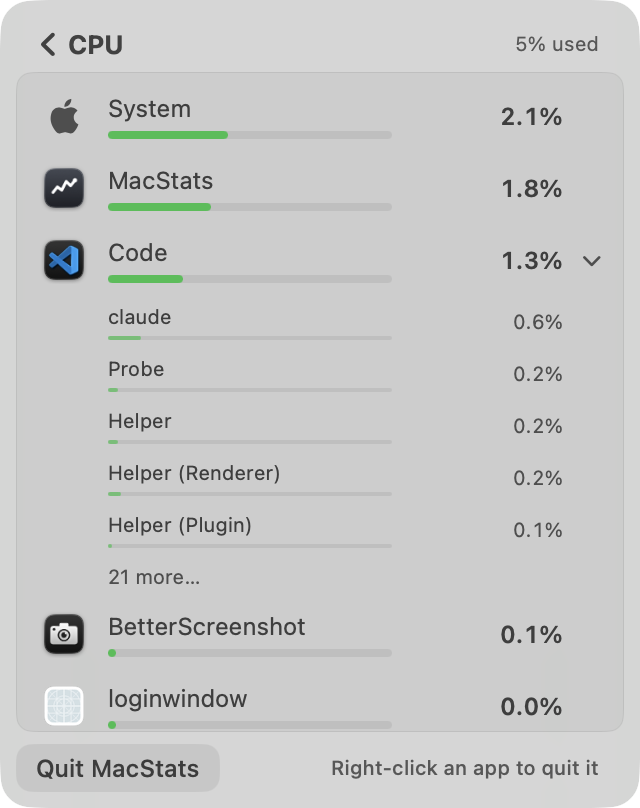
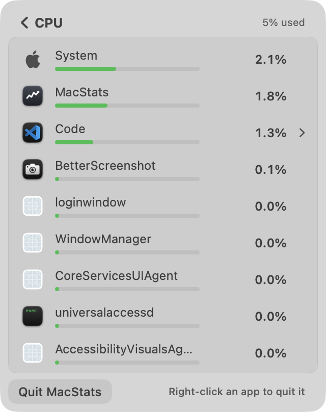
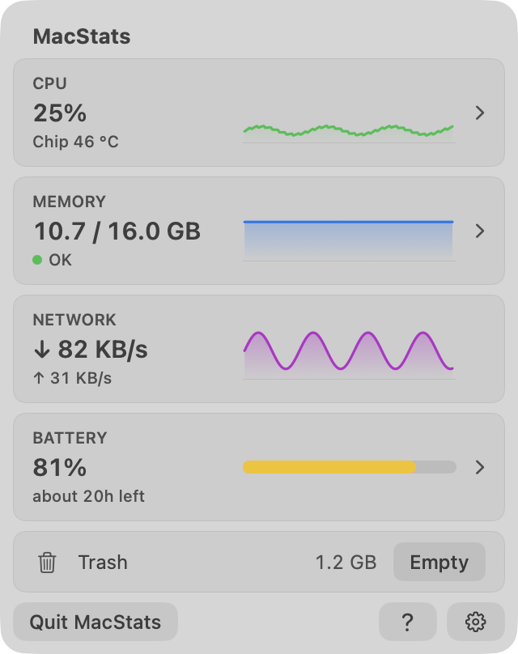
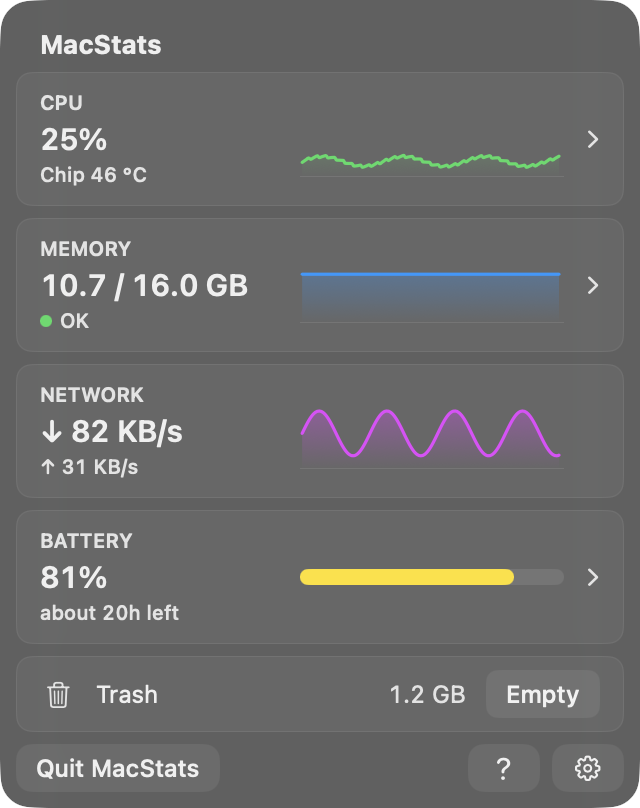
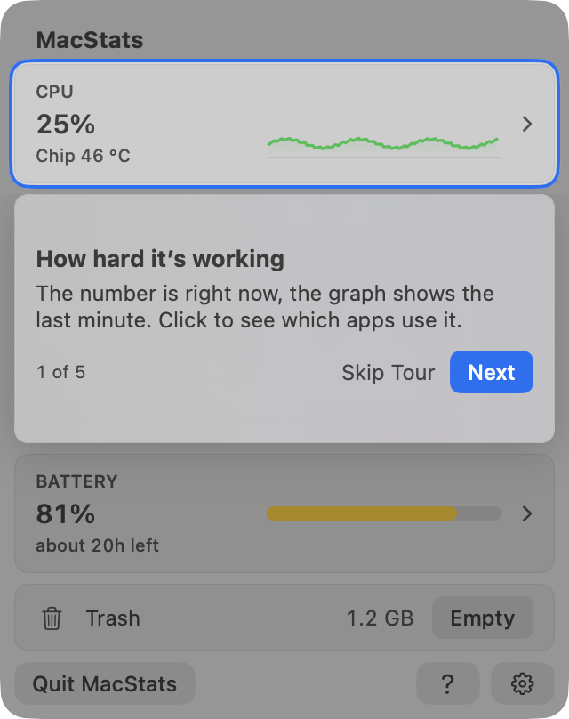
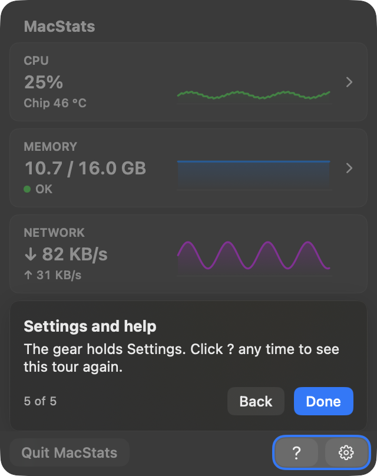
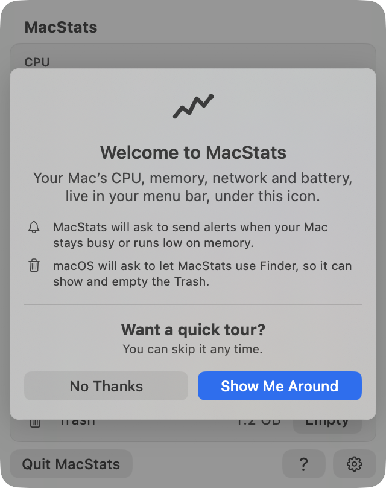

# MacStats stability + tour review (round 4, reviewer A), 2026-10-06

**Overall: 8.3/10.** This is in the "basically perfect" band, with a few Low issues and two Medium ones. The numbers and lists are steady without going stale. In a live run against real scans, the row order **never** moved while the simulated pointer was over the list (0 of 19 frozen scan pairs in each of CPU, Memory and Battery). An expanded app never collapsed or disappeared. The CPU card showed a real one-core load 0–2 s after it started. Every tour highlight is exactly centred. Measured from the pixels, the cutout sits **3.0 pt from the card on all four sides** in both light and dark, at every step, and its corners are concentric (card 8, cutout 11, panel 16). The tour can be skipped at any step, replayed from `?` or Settings, and driven from the keyboard. Four things keep it from a 9:
- System agents (`loginwindow`, `CoreServicesUIAgent`, `universalaccessd`…) appear as "apps" with blank icons, and they offer Quit / Force Quit to non-technical users.
- An expanded app's visible process rows reshuffle on most scans when the pointer is off the list.
- A row takes ~8 s to reach a new load (the card takes 2 s).
- The tour callout is an oversized slab with empty bands that hides two cards.

**Standard:** Apple's Battery / Control Center panels, Activity Monitor-quality readings, Apple-quality coach marks · **Method:** Both (screenshots of the real views in an off-screen probe, a headless live simulation with real scans, and code reading) · **Reviewer:** independent subagent (A). Branch `feat/stability-tour` at `91986f5`.

## Calibration
- **Type & platform:** a native macOS 26 menu-bar panel (SwiftUI `MenuBarExtra(.window)`, fixed 320 × 404 pt) with drill-ins, Settings and a first-run intro / guided tour.
- **Audience:** everyday Mac users, including non-technical ones. **Maturity:** shipping v1.x.
- **A 10:** Apple's Battery / Control Center panels, Activity Monitor-quality readings, Apple-quality coach marks.
- **Conventions:** squircles (continuous corners), concentric radii, light and dark, Esc / Return / arrow keys, VoiceOver, Reduce Motion / Transparency.
- **3** = numbers flicker and rows re-sort every tick, so you can't click or expand; the tour is misaligned or traps you; jargon everywhere.
- **6** = mostly steady, but rows still sometimes move under the pointer or an expanded app collapses; the highlight is a few points off; some controls are hard to find.
- **9** = readable yet current within a few seconds; rows never move from under the pointer; an expanded app never vanishes; a first-time user understands every card within ~30 s; every tour highlight is exactly centred in light and dark, skippable and replayable; plain short text; MacStats's own CPU/RAM no worse than baseline.

## Scoreboard
| Area | Score | Verdict (one line) |
|---|---|---|
| Stability of numbers & lists | **8.6** | 0 moves under the pointer, no expanded-app loss, cards within 3 pp; expanded process rows reshuffle off-pointer, rows lag ~8 s |
| Interaction reliability | **8.0** | Expand click, freeze and placeholders verified; Quit/Force Quit offered on system agents; right-click not driven live |
| Intuitiveness & discoverability | **7.8** | Chevrons, tooltips, quit hint, tour; agent rows with jargon names and blank icons confuse the target user |
| Text / copy clarity | **8.0** | Short plain copy almost everywhere; raw process names, one comma splice, "% of one core" |
| Visual layout, alignment & centering | **8.4** | Concentric, aligned, consistent in light/dark; tour slab's empty bands, blank icons, one truncation |
| Intro & tour (incl. spotlight centring) | **8.7** | Exact 3.0 pt insets on all sides at all 5 steps × 2 appearances; slab-sized callout with no pointer |
| Code quality of the new code | **8.3** | Pure, tested core (359 tests pass), clear docs; dense interacting rules, comments double as a changelog |
| Resource cost | **8.0** | Tour ≈ +0.7–1 pp only while on screen, nothing when off; open overview ~8–9 % of a core in the probe; old build's closed-panel leak fixed in code only |

---

## Stability of numbers & lists: 8.6/10
Evidence: `r4-A/live-run1.txt` (light background load), `r4-A/live-run2.txt` (heavier, bursty background load: another build was running). Both runs used the real `MetricsStore` + `BreakdownDisplay` + `BreakdownScanner` on this Mac for 110 s:
- scans every 2 s for CPU, Memory and Battery, plus the real 0.5 s card sampling;
- per metric, one store with the pointer away and one with the pointer resting on the list from t = 30 s to t = 70 s;
- a real single-core load (`/usr/bin/yes`) from t = 44 s to t = 60 s;
- "Expanded app" = the app with the most processes (Code, 28–39 processes).

| Measure | Run 1 | Run 2 |
|---|---|---|
| CPU card text changes / min | 19.8 | 39.1 (bursty load) |
| CPU card vs. 2 s reading: mean / p95 / max | 0.69 / 2.03 / 2.86 pp | 0.60 / 2.38 / 3.00 pp |
| Longest stretch with the card ≥ 3 pp off the reading | 0 s | 0 s |
| CPU card reaches a new 1-core load / falls back | 2.0 s / 1.0 s | ≤ 0.5 s / ≤ 0.5 s |
| Memory card text changes / min | 0.0 | 18.2 (memory really moving) |
| CPU list: top-8 order changes / min (pointer away) | 2.8 | 5.7 |
| CPU list: scans showing a lower number above a higher one (pointer away) | 3 of 54, never 2 in a row | 1 of 54 |
| CPU list: text changes per row / min, A→B→A flips | 3.1, 2 | 3.8, 0 |
| Memory list: order changes / min, inversions | 0, 0 | 0, 0 |
| Battery list: order changes / min, inversions | 0, 0 | 1.7, 1 scan |
| **Order moved while the pointer was on the list** (CPU / Memory / Battery) | **0 / 0 / 0** of 19 | **0 / 0 / 0** of 19 |
| Expanded block grew while pointed at | 0 | 0 |
| **Expanded app collapsed (≤ 1 process) or vanished** | **0** | **0** |
| Expanded app's visible top-5 process rows changed, pointer away / on list | n/a | **41 of 53** / 0 |
| `yes` row: 3.1 → 6.2 → 9.4 → 12.0 % over 2 / 4 / 6 / 8 s (1 core = 12.5 %) | same | same |

**Works well:**
- Cards are readable (about one change every 1.5–3 s under load, none at rest) and never wrong by more than 3 pp.
- The Memory and Battery lists hardly move at all.
- The freeze is airtight in every metric: no reorders, no growth of the expanded block, and placeholders keep rows in place.
- The burst app moved to the top of the list one scan after it started.
- Shown values stay within the documented hold of the exact values (max relative gap 0.25 on CPU rows ≥ 1 %).

**Issues:**
| # | Sev | Where | Problem | Why it matters | Suggested fix |
|---|---|---|---|---|---|
| S1 | Medium | Expanded app, pointer off the list | An expanded app's visible process rows changed on 41 of 53 scans in run 2. Many small, churning helpers (0.1–0.6 %) re-rank under the same rule as apps. | Someone who expands Chrome or Code and then moves the pointer to the header to read sees the child list shuffle every ~2 s. | Rank children with a larger absolute margin, or keep the expanded app's child order frozen until it collapses. Both are in `BreakdownDisplay.apply` (`Sources/MacStatsCore/BreakdownDisplay.swift:159`). |
| S2 | Low | CPU / Battery rows | Rows average over 8 s and 16 s (`RefreshScheduler.swift:53,57`), so a new load ramps linearly: 6 s to 75 %, 8 s to full. The header ramps too (27 → 36 %) while the card showed it in ≤ 2 s. | "Current within a few seconds" is only partly met; for a moment the header and the card disagree. | This is a trade-off. Consider a jump rule: show a row at once when a 2 s reading exceeds the 8 s average by a large factor. |
| S3 | Low | While pointing | The frozen order can disagree with the numbers for as long as you hover. In run 1 there were 11 consecutive scans (22 s) with an inversion. | Expected cost of freezing. Visible only to a user who rests on the list. | Acceptable; at most, let a row that leads by a large jump move even while frozen, when it is outside the hovered row's neighbourhood. |

**Why 8.6:** It meets the 9 anchor on everything that matters most: no movement under the pointer, no lost expanded app, and cards current within 2 s. S1 is a real but secondary Medium issue, and S2 is a Low lag in the rows.

## Interaction reliability: 8.0/10

**Works well:**
- A synthetic click on the Code row (mouse down/up delivered to the real `NSHostingView`) expanded it into 5 process rows plus "21 more…", with the chevron rotated (`breakdown-cpu-expanded-light/dark.png`).
- Context menus freeze the list through `NSMenu.didBeginTracking`, so Quit acts on the row it was opened on (`BreakdownView.swift:126-132`).
- Process Quit / Force Quit check the start time before signalling, so a reused pid is never hit (`ProcessActions.swift:20-37`).
- Force Quit confirms through `NSAlert`.
- Esc goes back. Rows carry VoiceOver actions.
- The "pointer hasn't moved since the click" exception (`BreakdownDisplay.swift:99-103`) means the list isn't frozen by the click that opened it, and any real movement freezes it before the next scan.

**Issues:**
| # | Sev | Where | Problem | Why it matters | Suggested fix |
|---|---|---|---|---|---|
| I1 | Medium | Breakdown context menu on agents | `loginwindow`, `WindowManager`, `CoreServicesUIAgent`, `universalaccessd`, Dock, Control Centre and Notification Centre are listed as apps (`attributionAnchors`, `ProcessScan.swift:48-53`: any bundle id + not background-only). They get **Quit / Force Quit…**, and the confirm text only says "you'll lose any unsaved changes" (`ProcessActions.swift:45`). Force-quitting `loginwindow` logs the user out. | For a non-technical audience, that is one right-click and one confirm away from a surprise logout. | Mark system-owned agents (the `com.apple.` + `/System/` path, or `loginwindow` explicitly) as non-quittable, or confirm with a specific warning; put them under "System" or "Other processes". |
| I2 | Low | Memory list, frozen | When frozen with `groupsLast`, a new app is inserted **before** the group rows (`StableRanking.swift:53`). So "Other processes" / "System" shift down one row under a pointer resting on them. | A rare move under the pointer. | Append fresh apps after the groups while frozen. |
| I3 | Low | Not verified live | A real right-click / `NSMenu`, scrolling with the trackpad, and hover highlights could not be driven without bringing a menu in front of the owner. They are checked by code only. | — | A human pass: right-click a row during a scan; scroll a long Memory list. |

**Why 8.0:** The core clicks and the freeze are sound and verified. I1 is a real safety and clarity gap on the primary drill-in.

## Intuitiveness & discoverability: 7.8/10

**Works well:**
- Clickable cards have chevrons (Network reserves the space, so the graphs line up), and they carry tooltips ("Click to see which apps use the CPU").
- The first 10 drill-ins replace the footnote with "Right-click an app to quit it", and only expandable rows get a hover highlight and a chevron.
- The Memory dot plus "OK" is self-explanatory.
- A first-time user gets the welcome card and a 5-step tour of about 20 words per step. That is well under 30 s.

**Issues:**
| # | Sev | Where | Problem | Suggested fix |
|---|---|---|---|---|
| U1 | Medium | CPU / Battery lists | 4–5 of the 9 visible rows at light load are agents with blank generic icons and internal names: `loginwindow`, `WindowManager`, `CoreServicesUIAgent`, `universalaccessd`, `AccessibilityVisualsAg…` (`breakdown-cpu-light.png`, `breakdown-battery-light.png`). A non-technical user can't tell what they are or whether to quit them. | Fold Apple's own agents into the "System" row (it already says "macOS itself…"), or give them a "macOS" detail and the system icon. |
| U2 | Low | Non-expandable rows | No hover or other affordance; the quit action is right-click only (hinted for 10 drill-ins, then only in tooltips). | Fine for now; a trailing `…` menu button on hover would make it discoverable for good. |
| U3 | Low | Memory card graph | At steady memory the sparkline is a flat slab (`overview-light.png`, Memory card) and says little. | Optional: scale to the minute's range, or show pressure. |

**Why 7.8:** It is clearly structured and hinted, but U1 puts unexplained system internals right in the main list.

## Text / copy clarity: 8.0/10
**Works well:**
- Tour titles are 4 words or fewer and bodies 20 or fewer (lint-tested, `TourCatalogLintTests.swift`).
- "Chip 46 °C", "Kept by macOS", "Nothing in it", "Finished processes" and "Processor power only, not the screen" are all good plain words.
- Each footnote carries one idea, with the detail in a tooltip.
- "Takes about two seconds" on Measuring is honest.

**Issues:**
| # | Sev | Where | Problem | Suggested fix |
|---|---|---|---|---|
| T1 | Medium | Lists | Raw process names (see U1) are the main jargon left. | See U1. |
| T2 | Low | Tour step 1 (`Tour.swift:40`) | "The number is right now, the graph shows the last minute." is a comma splice and reads oddly. | "The number is now; the graph is the last minute." or "Now, and the last minute. Click to see which apps use it." |
| T3 | Low | Row menus and tooltips | "N% of one core" is Activity Monitor jargon, shown on every CPU row tooltip. | Keep it in the context menu only. |

**Why 8.0:** The copy is plain and short apart from T1.

## Visual layout, alignment & centering: 8.4/10
 

**Works well:**
- The 8 pt inset, 6 pt card gap, 12 pt content inset and 30 pt header are consistent across overview, breakdowns, Battery, Settings and Measuring (`settings-*.png`, `breakdown-*.png`).
- Corners are continuous and concentric: panel 16, cards 8, row highlights 4, footer buttons 8.
- The 128 GB edge case fits ("110 / 128 GB", `overview-edge-light.png`).
- Light and dark are both correct.
- The header chip sits on the title's baseline without moving it (`offer-chip-dark.png`).

**Issues:**
| # | Sev | Where | Problem | Suggested fix |
|---|---|---|---|---|
| V1 | Low/Med | Tour callout | It is stretched to the cards' edges (`TourLayout.callout`, `calloutStretch` 40). On steps 1–4 that leaves ~20 pt empty bands above and below the content, and the slab covers two whole cards (`tour-1-cpu-light.png`, `tour-4-battery-light.png`). | Let the callout hug its content; fill the gap with dim instead. |
| V2 | Low | Lists | Generic blank icons for agent rows look unfinished next to real app icons. | See U1. |
| V3 | Low | Lists | "AccessibilityVisualsAg…" truncates. | Middle truncation like the process rows, or a tooltip. |

**Why 8.4:** Polished and consistent. The issues are Low-level polish.

## Intro & tour: 8.7/10
  

**Spotlight centring, measured.** Two methods:
- **Geometry:** the anchor rect against `TourLayout.cutout`.
- **Pixels:** the tour capture compared with the same panel without the tour, walking outward from the card edge along its centre row and column.

Results (`r4-A/render-log.txt`):

| Step | Target (pt) | Inset L / R / T / B (geometry) | Inset L / R / T / B (pixels, light & dark) | Clear gap / ring (each side) |
|---|---|---|---|---|
| 1 CPU | 8, 36, 304 × 67 | 3 / 3 / 3 / 3 | 3.0 / 3.0 / 3.0 / 3.0 | 1.0 / 2.0 pt |
| 2 Memory | 8, 109, 304 × 67 | 3 / 3 / 3 / 3 | 3.0 / 3.0 / 3.0 / 3.0 | 1.0 / 2.0 pt |
| 3 Network | 8, 182, 304 × 67 | 3 / 3 / 3 / 3 | 3.0 / 3.0 / 3.0 / 3.0 | 1.0 / 2.0 pt |
| 4 Battery | 8, 255, 304 × 67 | 3 / 3 / 3 / 3 | 3.0 / 3.0 / 3.0 / 3.0 | 1.0 / 2.0 pt |
| 5 `?` + gear | 234, 372, 78 × 24 | 3 / 3 / 3 / 3 | 3.0 / 3.0 / 3.0 / 3.0 | 1.0 / 2.0 pt |

- The cutout radius is 11 = 8 + 3, so it is concentric with the cards.
- On step 5 the ring sits 5 pt from the panel's corner: 16 − 5 = 11, concentric with the panel too (`zoom-step5-footer-dark.png`, `zoom-step1-corner-TL-light.png`).

**Works well:**
- The welcome explains both permission prompts before they fire.
- Tour controls:
  - Skip is on every step but the last, where Done ends it.
  - Esc skips, ← / → step, and Return is the default.
  - Back appears from step 2 on.
  - "n of m" counts only the steps shown (4 on a Mac without a battery, verified).
- Replay and resume:
  - It can be replayed from `?` and from Settings → Take the Tour.
  - A panel close pauses and resumes it, and a second close ends it.
- VoiceOver announces each step.
- With the tour off it costs nothing: the anchors are a no-op unless active, and there are no timers (`TourOverlay.swift:53-61`, `TourController.swift:8-10`).
- Existing users get a dismissible chip shown on 3 opens.

**Issues:**
| # | Sev | Where | Problem | Suggested fix |
|---|---|---|---|---|
| R1 | Low/Med | Callout | The oversized slab (V1). It has no arrow or pointer toward the highlight; placement alone links them. | Hug the content; optionally add a small notch toward the cutout. |
| R2 | Low | Step 1 copy | The comma splice (T2). | — |
| R3 | Low | Welcome | "under this icon" refers to the glyph on the card, while the real icon is in the menu bar above. That is slightly ambiguous. | "…live in your menu bar, behind this icon (↑)". |

**Why 8.7:** The highlight is exactly centred and concentric, and the tour is skippable and replayable in light and dark. Only the callout's sizing keeps it from Apple-tip polish.

## Code quality of the new code: 8.3/10
**Works well:**
- The decisions are pure and live in MacStatsCore: `StableRanking`, `DisplayHold`, `BreakdownDisplay`, `TourState`, `TourRules`, `TourLayout`.
- The SwiftUI side only draws state.
- `./Scripts/test.sh` passed **359 tests in 45 suites**, including ranking, holds, the display's freeze and placeholders, tour rules and state, layout, and a copy lint.
- Scans are off the main thread with generation checks (`MacStatsApp.swift:534-557`). The pointer is read once per scan, not per event. The tour controller is observed only by `RootView`, so steps don't re-render the cards.

**Issues:**
| # | Sev | Where | Problem | Suggested fix |
|---|---|---|---|---|
| C1 | Low | `BreakdownDisplay` | Five interacting rules: held text with 2-scan confirmation, hysteresis with a jump rule, an inversion timeout (`lagging`), the freeze with an unfreeze delay, and placeholders. Each is tested, but the combination is hard to reason about (S1 and I2 slipped through). | Add a short state table in the type doc; add a property test ("frozen ⇒ the prefix order is identical"). |
| C2 | Low | Comments across `RefreshScheduler.swift`, `StableRanking.swift`, `BreakdownDisplay.swift` | Doc comments carry measurement history ("5.1 → 3.6 times a minute", "review round…"). | Keep the *why* and move the numbers to the research doc. |
| C3 | Low | `TourOverlay.swift:171-176` | Masking the callout's shadow per side is clever but fragile. | Fine; a comment exists. |
| C4 | Low | `BreakdownView.swift:126` | `NSMenu.didBeginTracking` is app-global, so any menu counts as "a row's menu" and also marks the quit hint as used. | Fine today (the panel has no other menus); scope it if one is ever added. |

**Why 8.3:** Well-factored, tested and documented. Only the complexity and comment-style nitpicks remain.

## Resource cost: 8.0/10
Evidence: separate probe processes, 25 s each, with the real views in a hidden window and real 0.5 s sampling:

| Case | CPU |
|---|---|
| Sampling only, no window | **0.12 %** of one core |
| Overview open, tour off | **8.1 % / 8.4 %** |
| Overview open, tour on step 1 | **8.8 % / 9.5 %** (≈ +0.7–1 pp, only while the tour is on screen) |
| CPU breakdown open, 2 s scans | **3.0 %** |
| Headless: 3 metrics' scans + cards for 110 s | **1.39 %**, max RSS 33 MB |

Live observation: the installed `~/Applications/MacStats.app` was built 17:49, before this branch's commits. For 5 h it averaged ~25 % of one core (80 min of CPU time), and it read **13.7–14.8 %** on `top` while `CGWindowList` showed none of its windows on screen. `sample` shows its breakdown scan queue still running and SwiftUI rendering on the main thread. HEAD adds a window occlusion / visibility check (`RootView.swift:81-111`, `MacStatsApp.swift:135-156`) aimed at exactly this. I did not install HEAD, so the fix is **verified by code only**.

**Issues:**
| # | Sev | Where | Problem | Suggested fix |
|---|---|---|---|---|
| P1 | Low | Open overview | ~8–9 % of a core while open, from the 0.5 s ticks and sparkline slides. It is open-only and probably pre-existing. No baseline was measured in the same harness, so "no worse than baseline" isn't proven for the open state. | Measure 1ed61cf in the same harness. |
| P2 | Info | Installed build | The closed-panel leak described above is in the currently installed build. | Install HEAD and re-check `top` after closing the panel with a breakdown open. |

**Why 8.0:** The new code adds nothing while closed or with the tour off, the tour is cheap while showing, and breakdown scans run at half the earlier rate. The open-panel cost and the unverified leak fix keep it at 8.

---

## Cross-cutting issues
- **System agents in app lists** (U1, I1, T1, V2) is the one thread across four areas. Fixing the attribution in `attributionAnchors` (or the view's grouping) improves intuitiveness, copy, visuals and safety at once.
- **Consistency:** radii, spacing, type scale and the button language (`SubtleButtonStyle`, including the prominent accent variant) are the same across every surface and in both appearances.

## Top fixes (ranked by impact ÷ effort)
1. **Fold Apple system agents into "System"** (or mark them macOS, non-quittable, with the system icon). This fixes U1, I1, T1 and V2. `Sources/MacStatsCore/ProcessScan.swift:48-53`, `Sources/MacStatsApp/BreakdownView.swift:239-255`.
2. **Hold an expanded app's child order** while it stays expanded, or give children a bigger absolute margin (S1). `Sources/MacStatsCore/BreakdownDisplay.swift:159`.
3. **Let the tour callout hug its content** instead of stretching to card edges (V1, R1). `Sources/MacStatsCore/TourLayout.swift:55-62`.
4. **Specific Force Quit warning, or no Force Quit, for `loginwindow` / WindowServer-class processes** (I1). `Sources/MacStatsApp/ProcessActions.swift:44-48`.
5. **Fast-attack rule for rows:** show a big jump from the latest 2 s interval at once, then average (S2). `Sources/MacStatsCore/ProcessScan.swift` (window), `RefreshScheduler.swift:53`.
6. Small items: frozen memory insertion order (I2, `StableRanking.swift:53`); step 1 comma splice (T2, `Tour.swift:40`).

## Method & limits
- **Terms used in this report:**
  - **pp** = percentage points, the absolute difference between two percentages.
  - **p95** = the value that 95 % of the samples stay under.
  - **inversion** = a list row printing a lower number than the row below it.
  - **frozen** = the row order is held because the pointer is over the list or a context menu is open (`BreakdownDisplay.isFrozen`).
  - **one core** = 100 % in Activity Monitor's scale. MacStats's rows use the whole Mac = 100 %, so on this 8-core Mac one core = 12.5 %.
- **Evidence files:** the raw logs are in `docs/reviews/2026-10-06-stability-tour/r4-A/` (`render-log.txt`, `live-run1.txt`, `live-run2.txt`). The probe itself (`main.swift`) lived in the session scratchpad and is not committed. To reproduce, copy the build recipe of `docs/research/2026-10-06-probes/tour-render/run.sh` (it compiles the app's views with a probe `main.swift` in `$TMPDIR`) and re-implement the measurements described below.
- **Screenshots:** a SwiftPM probe in the scratchpad compiled the current `Sources/MacStatsCore`, `CAppleSensors` and every `Sources/MacStatsApp/*.swift` except the `@main`, and rendered the real views. These were `OverviewView` + `.tourHost`, `BreakdownView` (rows from real `BreakdownScanner` scans on this Mac), `BatteryDetailsCard`, `MemoryPartsCard`, `SettingsView`, `WelcomeCard`, `TourOfferChip` and the Measuring state.
  - Windows sat at desktop level + 1, ordered back and never activated; each was captured with `CGWindowListCreateImage` and closed right after.
  - The panel glass is an `NSVisualEffectView(.popover)`, not the real `MenuBarExtraWindow` Liquid Glass, so the tint differs slightly from the live panel.
  - Tour state lived in throwaway `UserDefaults` suites (removed afterwards).
- **Expand** was driven by mouse events delivered to the hosting view. **Right-click menus, hover highlights and scrolling were not driven** (a menu would appear in front of the owner), so they are checked by code only.
- **Live simulation:** the same probe, headless, fed real scans to real `MetricsStore` instances. The "pointer" is the store's real pointer-probe hook (inside and moved), not a real cursor. The one-core burst was `/usr/bin/yes` for 16 s. Run 2 coincided with other build activity, so it is the "busy Mac" case.
- **Not checked:** the real `MenuBarExtra` panel, Reduce Motion / Transparency renders, VoiceOver output, and HEAD's closed-panel CPU on the installed app (HEAD was not installed, per the rules).
- **Independence:** earlier reviews, plans, research conclusions and commit messages were not read. The existing probes under `docs/research/2026-10-06-probes/` were skimmed only for capture technique; all numbers above come from my own probe.
- **Cleanup:** all probe processes have exited (`pgrep -fl scratchpad/probe` is empty).
