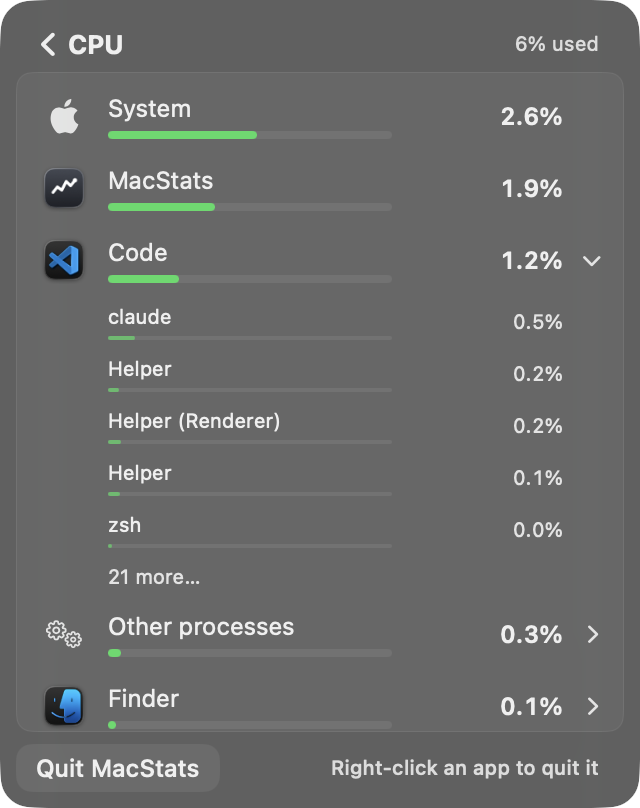
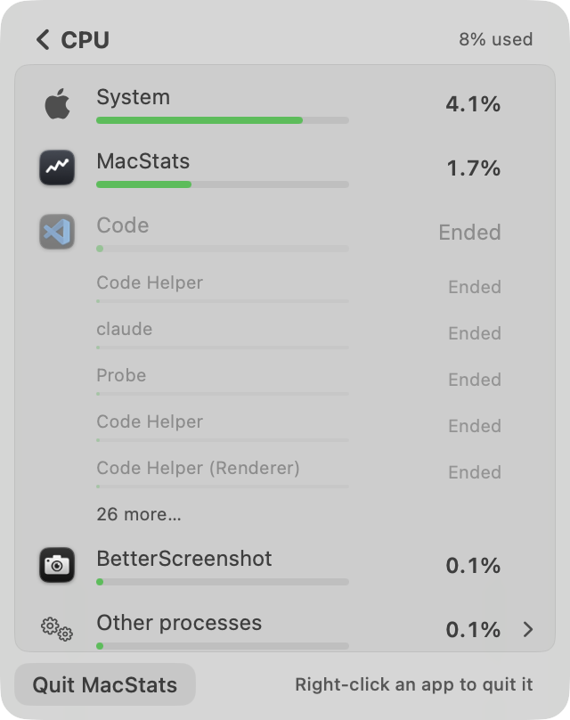
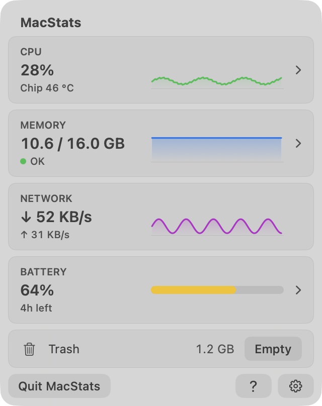
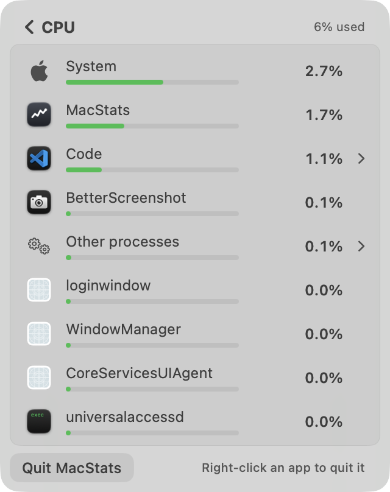
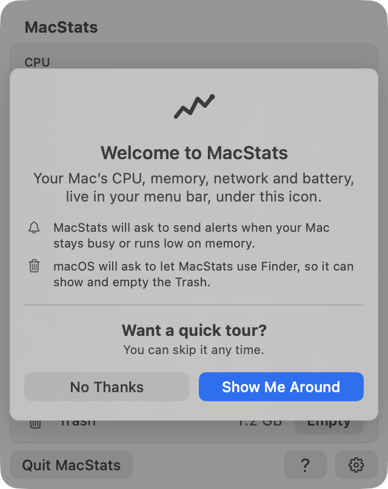
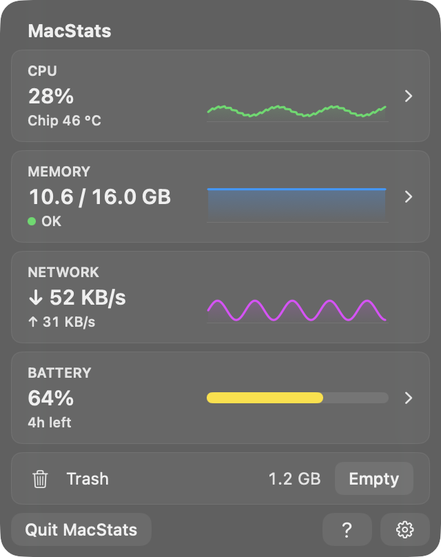
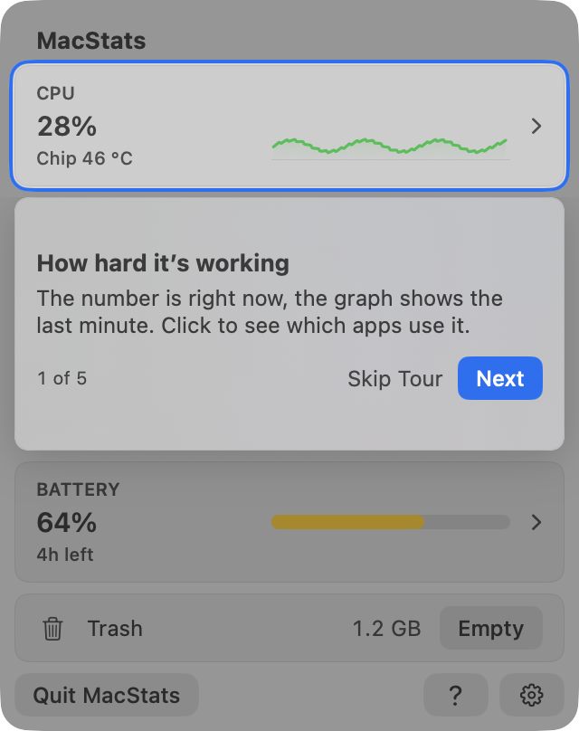
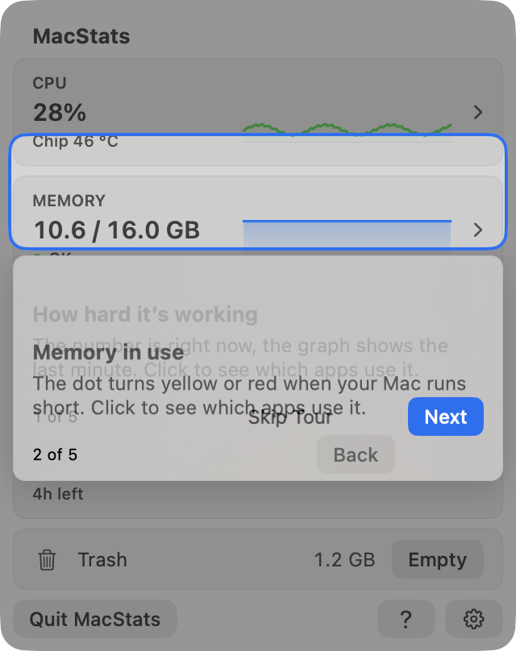
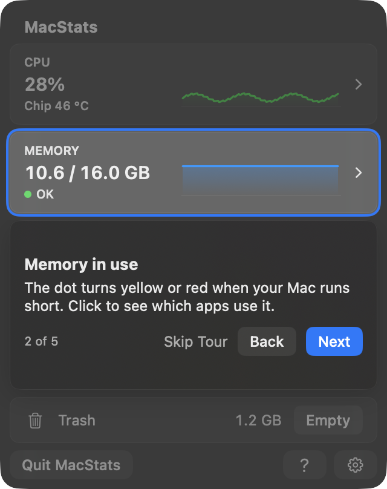
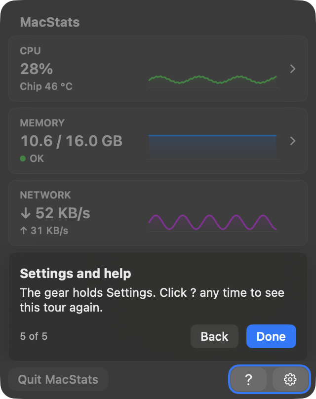

# MacStats stability + tour review, round 4, reviewer B (2026-10-06)

**Overall: 8.1/10.** MacStats is now in the "basically perfect" band, with a few things left to fix. I measured the spotlight directly: the outline sits exactly 3.0 pt outside every card on all four sides, in both light and dark mode. On this Mac, with real processes, no row and no expanded app moved or disappeared while the pointer was over a list. That held for 30 s of hovering and 2–3 minutes of resting after a right-click, in CPU, Memory and Battery. The overview's numbers change 3–4 times less often than the raw readings, and the CPU card is never 3 pp or more from its reading. What keeps the score off 9 is a short list of Medium and Low issues:
- Background helpers with internal names (universalaccessd, CoreServicesUIAgent, AccessibilityVisualsAgent and similar) fill the lower half of the CPU and Battery lists on a quiet Mac.
- When several apps use about the same CPU and the pointer is not over the list, the list still reorders every few seconds. A lower number shows above a higher one in about 40 % of scans, never for longer than one scan.
- The tour has small polish issues: tall callouts with empty bands, and two callouts overlapping during the move between steps.
- I could not confirm on the installed app that the closed-panel CPU leak is fixed. The installed build predates this branch and uses 15–20 % of a core with its panel off screen.

**Standard:** Apple's own Battery / Control Center menu-bar panels, Activity Monitor-quality readings, and Apple-quality coach marks for the tour. **Method:** both. I took screenshots of the real SwiftUI views in an off-screen probe (light and dark) and ran a headless live-flow simulation of the real `MetricsStore` and `BreakdownScanner` for 150 s and 240 s on this Mac's processes, plus a synthetic contention test. I also read the code in `Sources/`. **Reviewer:** independent subagent (reviewer B). I did not read the other reviewer's report, the plans, the research conclusions, earlier reviews or commit messages.

## Calibration

Terms: **pp** = percentage points (CPU % of the whole Mac, all cores = 100 %); **scan** = one breakdown refresh (every 2 s); **frozen** = the breakdown's row order is held because the pointer is over the list or a context menu is open; **inversion** = a row printing a lower value directly above a row printing a higher one; **CV** = coefficient of variation (standard deviation ÷ mean).

- **Project type:** a native macOS 26 menu-bar system monitor, built with a SwiftUI `MenuBarExtra(.window)` popover at a fixed 320×404 pt. It has four overview cards with sparklines. Clicking a card opens a per-app breakdown, where an app can be expanded into its processes and right-clicked for Quit / Force Quit. There is also a Battery drill-in, a Settings screen, a first-run welcome and a skippable guided tour.
- **Audience:** everyday Mac users, including non-technical ones. **Maturity:** v1.x, shipping through GitHub releases.
- **Reference for a 10:** Apple's Battery / Control Center panels, Activity Monitor-level readings and Apple-quality coach marks.
- **Platform conventions:** light and dark appearance, continuous (squircle) concentric corners, Esc / Return / arrow keys, VoiceOver, and a menu-bar panel that closes when you click elsewhere.
- **Anchors:**
  - **3:** numbers flicker and rows re-sort on every tick so you can't click or expand; the tour is misaligned or traps you; jargon is everywhere.
  - **6:** mostly steady, but rows still sometimes move under the pointer or an expanded app collapses; the tour works but the highlight is a few points off-centre or the copy is wordy; some controls are hard to find.
  - **9:** values are steady enough to read and still current within a few seconds; rows never move out from under the pointer and an expanded app never vanishes; a first-time user understands every card and how to drill in within about 30 s; every tour highlight is exactly centred, with concentric continuous corners, in light and dark; the tour can be skipped at any time and replayed; the text is plain and short; MacStats's own CPU and RAM use is no worse than before.

## Scoreboard

| Area | Score | Verdict (one line) |
|---|---|---|
| Stability of numbers & lists | 8.0 | Live: nothing moves under the pointer, cards change 3–4× less often than raw; under close, bursty contention the list still reorders every ~3 s while the pointer is elsewhere |
| Interaction reliability | 8.2 | Expand works, the frozen order and "Ended" placeholders hold exactly; small leftovers (an ended app can't be collapsed, a stale "N more…" row) |
| Intuitiveness & discoverability | 7.5 | Chevrons, hint, welcome, `?`, chip all good; system agents with daemon names fill the lower half of CPU/Battery lists |
| Text/copy clarity | 8.2 | Short, plain tour and welcome copy; the jargon is in process names, not MacStats's own words |
| Visual layout, alignment & centering | 8.4 | Concentric squircles throughout, both appearances clean; tall tour callouts with empty bands; 0.3 s overlap during step changes |
| Intro & tour (incl. spotlight centering) | 8.8 | Spotlight measured 3.0 / 3.0 / 3.0 / 3.0 pt on every card in light and dark; skippable, replayable, keyboard-driven; only polish nitpicks |
| Code quality of the new code | 8.3 | Pure, documented, well-tested core (359 tests pass); some layered freeze logic and naming drift |
| Resource cost | 8.2 | Nothing new runs while closed; tour +0.4 pp CPU only while shown; breakdown scan ~15 ms / 2 s; closed-panel fix not verifiable on the installed build |

---

## Stability of numbers & lists: 8.0/10

How I measured it: a headless probe drove the real `MetricsStore.record` at the app's 0.5 s cadence using the real readers and `AppModel.sample`'s 2 s rate window. It drove the real `BreakdownScanner` → `MetricsStore.setBreakdown` every 2 s for CPU, Memory and Battery on this Mac's live processes, for 150 s and then 240 s.

Each breakdown was fed to two stores from the same scans:
- **"U"**: the pointer is never on the list.
- **"F"**: a scripted pointer.
  - 0–12 s outside the list.
  - 12–42 s inside and moved, hovering row 3, with the app that has the most processes treated as expanded.
  - 42 s leaves.
  - 60 s right-click without moving.
  - Then resting until the end.

A reference run used the same scans with no averaging, no holds and a plain sort. It approximates the old behaviour at the new 2 s cadence; the old code also scanned every 1 s.

**Results from the live 240 s run** (the 150 s run agrees):

| Measure | MacStats | Reference (raw) |
|---|---|---|
| CPU card text changes / min | **19.8** (median 2.5 s apart) | 69.4 (2 s window), 82.7 (1 s window, old) |
| Memory card text changes / min | **2.3** | 6.0 |
| Network ↓ / ↑ text changes / min | **5.5 / 8.3** | 26.6 / 22.5 (1 s) |
| CPU card vs its 2 s reading | mean 0.67 pp, p95 1.84, max 2.97; never ≥ 3 pp off | — |
| CPU breakdown top-8 order changes / min (pointer away) | **2.6** (23 row moves in 4 min) | 29.7 (599 row moves) |
| CPU breakdown row text changes / row / min | **2.6**, 1 A→B→A flip | 14.8, 97 flips |
| Memory / Battery top-8 order changes / min | **0 / 0.3** | 0.5 / 29.7 |
| Pointer inside 12–42 s (all three metrics) | **0 violations**: order, hovered row index and expanded app's process rows unchanged | — |
| Right-click without moving, then resting 60–240 s | **0 order changes in 90 scans** (each metric) | — |
| First unfrozen scan after leaving | CPU: 3 of 8 positions catch up; Memory, Battery: 0 | — |

**Synthetic contention test.** I fed the real store 10 apps with close CPU means (6.0 / 5.6 / 5.2 / 3.1 / 2.9 / 1.6 / 1.5 / 1.0 / 0.6 / 0.5 %). Each scan's readings were bursty and averaged over the last 4 scans (8 s), the way the scanner averages them, for 20 simulated minutes:

| Noise | Top-8 order changes / min | Scans showing a lower % above a higher % | Longest a single pair stays inverted | Reference reorders / min |
|---|---|---|---|---|
| High (CV 0.6 per 2 s) | 22.7 | 249 / 596 (42 %) | 1 scan | 29.9 |
| Moderate (CV 0.3) | 14.7 | 202 / 596 (34 %) | 1 scan | 29.6 |

**Works well**
- Nothing moves under a pointer on the list. A context menu also freezes the order, even without a pointer move. An expanded app's process block never grows or shrinks while frozen. These are enforced in `BreakdownDisplay.apply` and verified above.
- The cards read steadily but stay current. The CPU card is within 3 pp of its 2 s reading at all times. Memory is held as one unit, so App + Wired + Compressed always add up to Used (`heldMemory`).
- The "inversion timeout" does what it promises: no pair of rows ever shows lower-above-higher for more than one scan while unfrozen. I confirmed this per pair in the synthetic run.
- The Memory and Battery lists are practically still: 0 and 0.3 reorders a minute.

**Issues**

| # | Severity | Where | Problem | Why it matters | Suggested fix |
|---|---|---|---|---|---|
| S1 | Medium | CPU breakdown, pointer not on the list | When several apps use similar, bursty CPU (browser tabs, a video call), the top 8 still reorders 15–23 times a minute and about 40 % of scans show a lower % above a higher % (one scan each). | Someone reading the list with the pointer resting elsewhere sees rows hopping every ~3 s, which is close to the "6" anchor in that situation. On this quiet Mac it is 2.6 a minute. | Add a minimum time between reorders while unfrozen (for example, no more than one reorder every 6 s), like `cardDwellSeconds` does for the cards, in `BreakdownDisplay.rank` / `stableRanking`. Or raise `RankHysteresis.cpu.rel` from 0.15 toward 0.25 (`StableRanking.swift:17`). |
| S2 | Low | CPU breakdown, pointer resting on the list | Frozen order plus live text: in 8 of 15 frozen scans, a lower number sat above a higher one. | It is a deliberate trade-off (rows must not move), but a careful reader notices "1.8 %" above "3.6 %". | Acceptable as is. Optionally, let the frozen state also hold the row text (`BreakdownDisplay.held`) after a few seconds of hovering. |
| S3 | Low | CPU card | A ≥ 3 pp move bypasses the 2 s dwell, so the text can change twice in 0.5 s (shortest gap measured 0.5 s). | It is rare (median gap 2.5 s) but breaks the "at most every 2 s" feel during spiky load. | Let a big move bypass the dwell only once per dwell period (`MetricsStore.updateCards`, `dwellAllows`). |
| S4 | Low | First ~10 s after "Measuring…" | The CPU list reordered 3 times in its first 5 scans (18 a minute), because the 8 s window is still filling (2 → 4 → 6 → 8 s). | This is when a first-time user looks hardest. The freeze protects clicks, but the list visibly settles. | Use a looser ranking margin until the window is full, or hold the first order for one extra scan. |
| S5 | Low | Breakdown row text | Held text can be up to 2.4 pp (CPU), 0.33 W (Battery) or 130 MB (Memory, on a 1.7 GB app) from the exact window value. This is within each hold's stated bound. | It slightly widens the gap to Activity Monitor at any one moment. | Fine as designed. Mention it in the footnote tooltip. |

**Why 8.0:** the 9-anchor requirements hold live: values are steady and current, rows never move under the pointer, and an expanded app never vanishes. S1 is a real, measurable weakness in a plausible situation: it is not under the pointer, but it is visible. That keeps this area at the low end of "basically perfect".

## Interaction reliability: 8.2/10

**Works well**
- A synthetic click on an app row in the off-screen window expanded it (CPU, Memory and Battery, light and dark). The chevron rotates, process rows are indented to the name column, and a "21 more…" row appears (`breakdown-cpu-expanded-dark.png`).
- If an app quits while the list is frozen, its row and all its process rows stay in place, dimmed and reading "Ended", with no actions. The probe reported `still listed: true, ended=true, processes kept=31` (`breakdown-cpu-expanded-app-ended-light.png`).
- The freeze inputs are robust. The pointer is read from AppKit once per scan (`PointerProbe`, `BreakdownView.swift:514-545`), so a pointer that hasn't moved since a context menu closed still counts. A pointer resting where the card was clicked does not freeze the list until it moves. An open `NSMenu` freezes it (`BreakdownView.swift:126-132`).
- Rows are buttons with accessibility actions (Quit / Force Quit). Esc goes back. Force Quit is confirmed with `NSAlert` and checks the pid's start time before signalling (`ProcessActions.swift:20-33`).

**Issues**

| # | Severity | Where | Problem | Why it matters | Suggested fix |
|---|---|---|---|---|---|
| I1 | Low | Expanded app that ended (frozen) | Its chevron disappears and the row stops being clickable (`expandable = … && !ended`, `BreakdownView.swift:217`), so it can't be collapsed until the pointer leaves. Its "26 more…" row still works and adds dead placeholder rows. | It's a dead end for a few seconds after Quit. | Keep the collapse click for ended expanded apps, and hide the "more" row for ended apps (`BreakdownList.rows`). |
| I2 | Low | Pointer off the list after expanding | Once unfrozen, the expanded block moves as a unit. Code (30 processes, expanded) changed position 11 times in 4 min in run "U". | A 7-row block jumping is more disruptive than one row. Nobody is clicking at that moment, but it is noticeable. | Pin the expanded app's position until it collapses (treat it as `frozen` for its own key in `stableRanking`). |
| I3 | Low | `AppModel.setVisibility` (`MacStatsApp.swift:154-186`) | "Closed" is derived from window occlusion too. If the open panel becomes occluded, the breakdown exits and the tour counts an interruption; a second one ends the tour and marks it seen. | It is rare for a menu-bar panel, but it could drop a user out of a drill-in or end the tour unexpectedly. | Only treat `isVisible == false` (not occlusion) as a close for `exitBreakdown()` / `tour.panelClosed()`, and keep occlusion for pausing the timers. |
| I4 | n/a (limit) | Right-click menus, scrolling, hover highlight | I could not drive these in the off-screen window. The `NSMenu` modal tracking would block the probe. | — | A human should right-click → Quit on a row, scroll the list while scans run, and hover rows in the real panel. |

**Why 8.2:** every interaction I could drive behaved exactly as intended, and the logic I verified headlessly holds. The remaining issues are small edge states.

## Intuitiveness & discoverability: 7.5/10

**Works well**
- Cards that drill in carry a chevron, and the Network card keeps the same column empty. There are tooltips on every card ("Click to see which apps use the CPU").
- On first launch the panel opens by itself with a welcome card that names the menu-bar icon and explains both permission prompts before they appear.
- The breakdown footer says "Right-click an app to quit it" until a menu has been used once, for at most 10 drill-ins.
- `?` in the footer replays the tour, and Settings → Help → Take the Tour does too. Existing users get a dismissible "Take the Tour" chip on 3 opens (`chip-light.png`).
- The memory pressure dot reads "OK / running low / very low", with plain words and a coloured dot (`overview-warning-128gb-light.png`).

**Issues**

| # | Severity | Where | Problem | Why it matters | Suggested fix |
|---|---|---|---|---|---|
| D1 | Medium | CPU and Battery breakdowns | Background agents appear as app rows, with generic icons and internal names: loginwindow, WindowManager, CoreServicesUIAgent, universalaccessd, AccessibilityVisualsAg…, talagentd. On a quiet Mac they are 4–6 of the 9 visible rows (`breakdown-cpu-light.png`, `breakdown-energy-dark.png`). | A non-technical user can't tell what these are or whether quitting them is safe. They crowd out real apps. | Fold background-only or accessory "apps" at 0.0 % into "Other processes" (or a "macOS helpers" row) unless they use noticeable CPU. Decide this in `attributionAnchors` / `AppInfoCache.info(for:)`, and keep them in the Memory list if their footprint is large. |
| D2 | Low | App rows that don't expand | No hover feedback; Quit lives only on right-click. The hint and tooltip cover it, but there is no visible affordance once the hint is gone. | Quit is hard to find for people who don't right-click. | Fine for a menu-bar panel (Activity Monitor works the same way). Optionally show an "ⓧ" on hover. |
| D3 | Low | CPU footnote | "Each app's share of the whole Mac" means the numbers differ from Activity Monitor's per-core figures. The explanation is only in the tooltip and the context menu ("% of one core"). | Users comparing the two will be confused for a moment. | Fine. A short "Why different from Activity Monitor?" tooltip is already there. |

**Why 7.5:** the overview, drill-in and tour make the core flow learnable in well under 30 s. The jargon rows (D1) are what a first-time, non-technical user will actually question.

## Text/copy clarity: 8.2/10

**Works well**
- Tour copy is short: titles of 4 words or fewer, bodies of 2 lines or fewer, enforced by `TourCatalogLintTests`. Examples: "↓ is download and ↑ is upload, right now."; "The gear holds Settings. Click ? any time to see this tour again."
- The welcome explains why each permission is asked, in one line each.
- The Memory parts are plain: "Apps / Kept by macOS / Compressed", with Activity Monitor's terms in the tooltips.
- Footnotes say what the numbers are measured against. Empty and edge text is honest: "Nothing in it" for the Trash, "Measuring… Takes about two seconds", "<0.01 W".

**Issues**

| # | Severity | Where | Problem | Suggested fix |
|---|---|---|---|---|
| T1 | Low | Tour step 1 | "The number is right now, the graph shows the last minute." is a comma splice. The title "How hard it's working" never says "CPU" (though the card label does). | "The number is now; the graph is the last minute." |
| T2 | Low | Process rows | Several rows read just "Helper" (`breakdown-cpu-expanded-dark.png`). `processDisplayName` strips "Code " and leaves identical labels; the full name is in the tooltip only. | Keep the stripped form only when it stays unique within the app. |
| T3 | Low | Code vs UI naming | The UI says "Finished processes", but `BreakdownGroup.exitedProcesses` and the `ProcessScan.swift` docs say "Exited processes". | Pick one term. |

**Why 8.2:** MacStats's own words are plain and short throughout. The remaining jargon is in process names (D1).

## Visual layout, alignment & centering: 8.4/10

**Works well**
- One consistent card language: continuous corners, with card radius 8 = panel 16 − inset 8. Row highlights are 4 pt inside the list's 4 pt padding. Buttons in the panel corners are 8 pt.
- Light and dark both look clean. "110 / 128 GB" fits the value column. The Battery details use a two-column grid.
- The breakdown bars use a sticky 1-2-5 scale, so short bars still carry information.

**Issues**

| # | Severity | Where | Problem | Suggested fix |
|---|---|---|---|---|
| V1 | Low | Tour callouts, steps 1 and 4 | The callout is stretched (up to `calloutStretch` = 40 pt) to the next card edge. Step 1's bubble is about 140 pt tall for about 95 pt of content, centred, which leaves about 22 pt empty bands above and below the title (`tour1-cpu-light.png`, `tour4-battery-light.png`). | Hug the content and let the dim fill the rest, or top-align the content (`TourOverlay.swift:153-170`, `TourLayout.callout`). |
| V2 | Low | Step changes | During the 0.3 s glide, the old and new callouts cross-fade in different positions, so two titles, bodies and button rows overlap (`tour-glide-midframe-light.png`, captured 0.12 s into the change). | Fade the old callout out before the new one moves in, or use the Reduce Motion path (`.id(phaseKey)` + opacity, `TourOverlay.swift:107-111`) for the callout content while the hole keeps gliding. |
| V3 | Low | Settings | The lower half of the screen is empty (`settings-dark.png`). | Fine for two settings. |

**Why 8.4:** this is close to Apple quality, with only transition and spacing nitpicks.

## Intro & tour (incl. spotlight centering): 8.8/10

**Spotlight measurement.** I captured each step at 2× in the same window as a capture without the tour. I took the card edge from the strongest luminance step in the base image and the ring from accent-coloured pixels that differ from the base image. On each side I measured from the card edge to the ring's outer edge (that is, the cutout edge) at 30 %, 50 % and 70 % along the edge. Corners were measured along the 45° diagonal from the corner-arc centre.

| Step | Target (pt) | Inset L | R | T | B | Ring | Corner diagonals (pt) |
|---|---|---|---|---|---|---|---|
| 1 CPU, light / dark | 8,36 304×67 | 3.0 | 3.0 | 3.0 | 3.0 | 2.0 | TL 3.5 · TR 2.8 · BL 2.8 · BR 3.5 |
| 2 Memory, light / dark | 8,109 304×67 | 3.0 | 3.0 | 3.0 | 3.0 | 2.0 | same |
| 3 Network, light / dark | 8,182 304×67 | 3.0 | 3.0 | 3.0 | 3.0 | 2.0 | same |
| 4 Battery, light / dark | 8,255 304×67 | 3.0 | 3.0 | 3.0 | 3.0 | 2.0 | same |
| 5 `?`+gear, light / dark (also the no-battery "4 of 4") | 234,372 78×24 | 3.0 | 3.0 | 3.0* | 3.0* | 2.0 | same |

\* The 50 % column on the footer target falls into the gap between the two buttons, where there is no card edge. That reading (7.0 / 4.5) is a measurement artefact; the 30 % and 70 % columns read 3.0.

The diagonal readings differ by one diagonal pixel step (0.7 pt), which is my edge detector's resolution, and the zoomed crops show an even 1 pt clear gap plus the 2 pt ring all the way around. The geometry agrees: cutout radius 11 = card 8 + 3, and 11 + the 5 pt to the panel edge = the panel's 16 pt, all continuous (`TourLayout.cutout`, `TourOverlay.swift:210-235`).

**Works well**
- The highlight is exactly centred on every target, in both appearances. The callout never overlaps the cutout, and its shadow is masked away from the highlight's side.
- **Skip** works on every step except the last (Esc and the Skip Tour button). The last step has **Done**. **Back** and **Next** work, as do ← and →; Return is the default action. The probe confirmed Back from step 2 lands on "1 of 5" and Skip ends the tour at once.
- The tour can be replayed from `?` and from Settings. The no-battery Mac skips step 4 and reads "4 of 4" (`tour-nobattery-last-light.png`).
- Closing the panel pauses the tour; a second close ends it. Clicking the highlighted card does what the callout says, and the tour waits, hidden, until the overview is back.
- Accessibility: each step is announced with "Step n of m", the overlay is marked modal, the ring gets 1 pt thicker with Increase Contrast, and Reduce Motion gets a cross-fade.
- New users' permission prompts wait until the welcome is answered (`TourController.defersPermissionPrompts`). Existing users get a 3-open chip instead of a modal.

**Issues:** V1 (tall callouts), V2 (overlap mid-transition) and I3 (occlusion counts as a close), all Low. The callout has no arrow; adjacency carries the link, which is fine at this size.

**Why 8.8:** the centring is exact to the pixel. Control, escape and replay are complete. What is left is transition and spacing polish.

## Code quality of the new code: 8.3/10

**Works well**
- The decisions live in pure, `Sendable` value types in `MacStatsCore`: `TourState`, `TourRules`, `TourLayout`, `BreakdownDisplay`, `HeldReading`, `stableRanking` and `stickyUpperBound`. The views only draw them.
- `./Scripts/test.sh` reports **359 tests in 45 suites, all passing**. New suites cover ranking, holds, the display freeze, tour state, rules, layout and a copy lint.
- The constants carry their measured reasons (`RefreshScheduler.swift:35-68`). The tour writes only its own `TourKey` keys, so the new-vs-existing classification can ignore them.
- Off-main scanning is generation-guarded (`MacStatsApp.swift:534-557`). Anchors report rects only while the tour is active (`TourAnchorModifier`).

**Issues**

| # | Severity | Where | Problem | Suggested fix |
|---|---|---|---|---|
| C1 | Low | `BreakdownDisplay.isFrozen` / `setPointerInside` | Three overlapping freeze inputs: hover events, the per-scan pointer probe and the menu flag. `pointerInside` only matters when there is no probe, but `setPointerInside` still sets the unfreeze delay. The interplay is correct (verified) but hard to reason about. | Document the precedence in one place, or drive the freeze from the probe alone and keep hover only for the leave time. |
| C2 | Low | `MetricsStore` | It now holds card holds and dwell, breakdown display state, pause/resume buffering and the battery setters. | Extract the card holds into a small `CardDisplay` value, like `BreakdownDisplay`. |
| C3 | Low | Naming | "Exited" vs "Finished" processes (T3). Doc comments point at `docs/research/...` sections that can drift. | Rename; keep the essential reason inline. |
| C4 | Low | I3 | Occlusion is treated as "closed" for both the timers and the tour/breakdown lifecycle. | Split the two. |

**Why 8.3:** this is clean, tested and readable for its complexity. The freeze logic is the one place where the next change will be harder than it should be.

## Resource cost: 8.2/10

**Measured (probe, off-screen):**

| Scenario | MacStats process CPU | RSS |
|---|---|---|
| Overview open, 0.5 s ticks, tour off | 11.7 % of one core | 54 MB |
| Same, tour on step 1 | 12.1 % (+0.4 pp) | 59 MB (+5 MB) |
| CPU breakdown, real scans every 2 s | 2.6 % of one core | — |
| One breakdown scan (read + attribute + 8 s window) | median 14.9 ms (≈0.75 % of a core at 2 s) | — |

**Works well**
- Nothing new runs while the panel is closed. `TourController` has no timers or observers, and `.tourAnchor` is a no-op when inactive. The pointer probe is read once per scan, and the menu observers exist only while a breakdown is shown.
- The display holds publish only on change, so the cards re-render 3–4× less often than before (see Stability).
- The scan window is a few dictionaries, freed on Back. Process names are read once per new process.

**Issues**

| # | Severity | Where | Problem | Suggested fix |
|---|---|---|---|---|
| R1 | Medium (verification) | Installed app | The installed `~/Applications/MacStats.app` is 1.1.0, built before this branch (no tour strings in the binary). With its panel window off screen (`kCGWindowIsOnscreen = false`), it measured **15–20 % of one core** in 5 s `ps` samples and `top`, with 82 CPU-minutes over 5 h 32 m. The branch adds a window-visibility guard (`PanelWindowObserver`, the per-tick `isOnScreen` check in `MacStatsApp.swift:188-199`), but I could not install the branch to confirm it. | After installing the branch, run `top -l 3 -s 10 -pid $(pgrep -x MacStats) -stats cpu,mem` with the panel closed (after opening it once). Expect well under 1 %. |
| R2 | Low | Tour | +5 MB RSS while the tour is on screen. It is the material and overlay, freed after. | Fine. |

**Why 8.2:** the new code adds nothing while closed and very little while open. The score stops short of 9 only because the most important cost claim, idle CPU after the popover has been opened, couldn't be verified live on this branch.

---

## Cross-cutting issues

- **Consistency:** the corner radii, card fills, hairlines and button styles are the same everywhere, including the tour surfaces, which never read the Opacity setting so contrast stays fixed. The terminology is consistent except "Exited" vs "Finished" (T3).
- **Light/dark:** every surface checked in both: the overview, all 5 tour steps, the welcome, Settings, the breakdowns and the expanded and ended states. No contrast problems were found. The dim is 30 % black in light mode and 40 % in dark.
- **The one systemic gap** is what non-technical users see in the lists. The holds and freeze make the lists steady, but which rows exist (system agents with daemon names) is still Activity Monitor-grade, not Control Center-grade.

## Top fixes (ranked by impact ÷ effort)

1. **D1:** fold idle background agents (accessory or background-only "apps" at about 0 %) into "Other processes" or a "macOS helpers" row in the CPU and Battery lists (`attributionAnchors`, `AppInfoCache.info`).
2. **R1:** after installing the branch, confirm closed-panel CPU is about 0 %. The pre-branch build uses 15–20 % of a core with its panel off screen.
3. **S1:** add a minimum time between reorders while the pointer is away from the list (for example, at most one reorder per 6 s), in `BreakdownDisplay.rank`. Or raise `RankHysteresis.cpu.rel` from 0.15 to about 0.25.
4. **V2 + V1:** cross-fade the callout content between steps instead of overlapping two callouts, and stop stretching callouts to card edges (or top-align them) (`TourOverlay.swift:107-111, 153-170`; `TourLayout.calloutStretch`).
5. **I1 / I2:** let an ended expanded app collapse and drop its "N more…" row, and pin an expanded app's position until it collapses.

## Method & limits

- **Probe:** a SwiftPM executable in the session scratchpad (`r4b/`, not in the repo). It copies the current `Sources/MacStatsCore`, `Sources/CAppleSensors` and `Sources/MacStatsApp/*.swift` (minus `@main`) and renders the real `OverviewView` + `.tourHost` + `PanelBackdrop`, `BreakdownView`, `SettingsView`, `WelcomeCard` and the chip.
  - Windows were borderless at desktop level + 1, `orderBack`, never activated, captured with `CGWindowListCreateImage(.optionIncludingWindow, [.boundsIgnoreFraming, .bestResolution])` at 2×, and closed right after.
  - Tour state lived in throwaway `UserDefaults` suites that were deleted afterwards.
  - The breakdown screenshots use this Mac's live processes. The overview uses a fake but realistic store.
  - The panel background is an `NSVisualEffectView(.popover)`, not the real `MenuBarExtra` Liquid Glass, so the exact tint differs from the live panel.
- **Live flows** were headless: the real store and scanner were driven on live processes, with the pointer and menu states scripted through the store's own inputs (`breakdownPointerProbe`, `setBreakdownPointerInside`, `setBreakdownMenuOpen`). The machine was lightly loaded (top app at about 2–9 % of the Mac), so I added the synthetic contention test.
- **Not checked:**
  - The real menu-bar panel. I did not open it or drive the owner's menu bar.
  - Right-click menus and `NSAlert` flows.
  - Scrolling while scans arrive.
  - Hover highlights.
  - VoiceOver.
  - The auto-open on first launch.
  - Idle CPU of a branch build (R1).

  A human should spend about 5 minutes on these in the real panel.
- **Tests:** `./Scripts/test.sh` reports 359 tests in 45 suites, all passing.
- **Cleanup:** every process I started was stopped. I committed only this report and its images.
