# MacStats stability and tour review, round 5, reviewer A (2026-10-07)

**Overall: 8.1/10.** On the owner's scale this is just inside "basically perfect". No area has a High issue. The tour spotlight is exactly centred: 3.0 pt on all four sides for every step, in light and dark, measured from pixels. While the pointer is over a list, no row moved in 48 frozen scans, and an expanded app never collapsed in about 6 minutes of live scans. A one-core load reached the CPU card and the breakdown row within about 2 s. What keeps the score from 9:

- When a load ends, the breakdown takes about 8 s to come down (the CPU card takes about 2 s).
- While the pointer rests in the list, the order stays frozen, so a 13 % app can sit below a 3 % one.
- The process rows inside an expanded busy app reshuffle every 5–8 s while the pointer is away.
- The breakdown code is now complex, with many tuned constants.
- A few small copy and visual nits.

Also important, though it is not a defect in this code: the copy of MacStats installed on this Mac predates this branch. It uses 10–23 % of a core with its panel closed (92 CPU-minutes in 6 h 40 min). This branch's code fixes that, but the fix has not been checked live.

**Standard:** Apple's own Battery / Control Center menu-bar panels, Activity Monitor-quality readings, and Apple-quality coach marks for the tour.
**Method:** Both: screenshots of the real SwiftUI views rendered in an off-screen probe, a headless live-flow simulation of the real `MetricsStore` and breakdown pipeline (three runs, 90–150 s each), and reading the code in `Sources/`.
**Reviewer:** independent subagent (reviewer A). I did not read the plans, the research conclusions, the commit messages or earlier reviews.

**Terms used below:**
- **pp:** percentage points of the whole Mac's CPU. On this 8-core Mac, one busy core = 12.5 pp.
- **A→B→A flip:** a printed value changes and then changes straight back.
- **Frozen:** the breakdown keeps its row order because the pointer is over the list.
- **Cutout:** the clear hole in the tour's dim. The **ring** is the 2 pt accent stroke inside its edge.
- **RSS:** resident memory.
- **HEAD:** commit 6ef0296 on branch `feat/stability-tour`. All paths are relative to the repo root.

## Calibration

- **Project type and platform:** a native macOS 26 menu-bar system monitor. It is a SwiftUI `MenuBarExtra` popover with a fixed size of 320×404 pt.
- **Screens:**
  - an overview of cards (CPU, Memory, Network, Battery) with sparklines;
  - a per-app breakdown for CPU, Memory and Battery, where an app expands into its processes and a right-click offers Quit or Force Quit;
  - Settings;
  - a first-run welcome card and a skippable guided tour.
- **Audience:** everyday Mac users, including non-technical ones.
- **Maturity:** shipping product (v1.x).
- **Reference for a 10:** Apple's Battery / Control Center panels, Activity Monitor-grade readings, and Apple-quality coach marks.
- **What a 3 looks like:** numbers flicker and rows re-sort every tick, so you can't click or expand anything. The tour is misaligned or traps you. Jargon everywhere.
- **What a 6 looks like:** mostly steady, but rows still sometimes move under the pointer, or an expanded app collapses. The tour works, but the highlight is a few points off-centre or the copy is wordy. Some controls are hard to discover.
- **What a 9 looks like:**
  - Values are steady enough to read, yet still current within a few seconds.
  - Rows never move out from under the pointer, and an expanded app never vanishes.
  - A first-time user understands every card, and how to drill in, within about 30 s.
  - Every tour highlight is exactly centred on its squircle: an equal inset on all sides, with concentric continuous corners, in light and dark.
  - The tour can be skipped at any time and replayed.
  - The text is plain and short.
  - MacStats's own CPU and RAM use is no worse than before.

## Scoreboard

| Area | Score | Verdict |
|---|---|---|
| Stability of numbers & lists | 8.0 | Readable cards (≤ 3 pp from the live reading, new load shown in ~2 s). Breakdown order changes 2–4 times a minute and never moves under a moving pointer. Weak points: an 8 s fall after a load ends, an order that goes stale while the pointer rests in the list, and process rows that reshuffle inside a busy expanded app. |
| Interaction reliability | 8.0 | Expand works; the frozen list had 0 moves in 48 scans; no collapses; Back and Esc work. Right-click menus, scrolling and clicking through the tour's hole could not be driven off-screen. |
| Intuitiveness & discoverability | 8.0 | The welcome card opens itself; cards and expandable rows have chevrons; a right-click hint is shown; `?` replays the tour. Expanding apps and the group rows need tooltips. Memory's largest row sits last. |
| Text/copy clarity | 8.3 | Short, plain and consistent. Nits: "Finished processes 0.0%", the Memory footnote shrinks to 0.88×, raw process names. |
| Visual layout, alignment & centering | 8.5 | Concentric continuous corners everywhere, aligned columns, fine in light and dark. Nits: brief unsorted process rows, the shrunk footnote, an empty lower half in Settings. |
| Intro & tour (incl. spotlight centering) | 9.0 | 3.0 pt inset on all four sides for all 5 steps, light and dark; radius 11 = 8 + 3; skippable 4 ways; replayable 3 ways; resumes after a close. Nit: the gap is ~0.5–0.9 pt wider at the 45° corner. |
| Code quality of the new code | 7.5 | A pure, well-tested core (366 tests pass) and a clean tour split. But the breakdown's stabiliser stacks about 8 interacting rules and many tuned constants, and its comments carry measurement history. |
| Resource cost | 8.0 | No new timers while the panel is closed; the display logic costs 0.3–0.4 ms per 2 s scan; the tour has no timers and no cost I could measure. The closed-panel fix was not verified live because HEAD isn't installed. |

---

## Stability of numbers & lists — 8.0/10

**How I measured it.** A headless probe ran the real pipeline. It used a copy of `BreakdownScanSession` feeding three real `MetricsStore`s (CPU, Memory, Battery) every 2 s, plus the overview tick every 0.5 s. A scripted pointer was fed through `breakdownPointerProbe`, exactly as `PointerProbe` does. One app was kept expanded, using the view's own collapse rule. A one-core `/usr/bin/yes` load ran for 25–30 s. There were three runs: 150 s, 120 s and 90 s. The Mac was the owner's live machine, with VS Code, Claude and builds running.

**What the measurements showed:**

| Measure | Run 1 (150 s) | Run 2 (120 s) | Run 3 (90 s) |
|---|---|---|---|
| CPU card text changes / min | 26.4 | 20.5 | — |
| CPU card A→B→A flips | 4 | 6 | — |
| CPU card vs live 2 s reading: mean / p95 / max gap | 0.63 / 1.77 / 2.74 pp | 0.70 / 2.01 / 2.93 pp | — |
| Network ↓ / ↑ / Memory card changes / min | 7.2 / 11.2 / 9.6 | 4.0 / 10.5 / 0.0 | — |
| CPU breakdown top-8 order changes / min (pointer away) | 2.0 | 4.4 (incl. load on/off) | 3.2 |
| Slot moves / min (pointer away) | 6.0 | 14.1 | 6.4 |
| Row text changes per row per min / A→B→A flips | 3.4 / 0 | 3.3 / 1 | 2.1 / 0 |
| Memory breakdown order changes / min | 0.0 | 0.0 | — |
| Battery (energy) breakdown order changes / min | 0.7 | 0.9 | — |
| Expanded app (Code, 26–38 processes): app moves / min | 1.3 | 2.6 | 2.1 |
| Expanded app: visible process order changes / min (pointer away) | 13.3 | 7.9 | 12.9 |
| Expanded app collapses | 0 | 0 | 0 |
| Frozen scans (pointer moved into list) / rows moved | 18 / 0 | 16 / 0 | 14 / 0 |
| Max gap between the rows' printed sum and the header (CPU) | 4.8 pp | 2.0 pp | 2.0 pp |

**Load step (run 2, a one-core `yes`, 12.5 pp of this 8-core Mac):**
- Card: 5 % at t = 50, 8 % at 51, 18 % at 52. The load was on screen within about 2 s.
- Breakdown row: Code went from 1.6 % to 13.0 % on the first scan after the load started (2 s).
- Load off at t = 75. The card was at 8 % by 77 and 6 % by 79.
- The Code row read 13.0 → 13.0 → 8.7 → 5.9 → 3.0 → 1.5 at t = 76, 78, 80, 82, 84.
- The breakdown header read 18 → 15 → 13 → 10 → 9 → 8.
- So for about 8 s after a load stops, the breakdown says "13 % used" while the card has already dropped to 6 %.

**Frozen order (run 3).** The pointer was over the list from t = 40 to 68, and the load started at t = 45. Code reached 13 % but stayed at row 2, below "System 2.6–4.2 %", for the whole 22 s. It moved to the top on the first scan after the pointer left (t = 70).

**Works well:**
- Cards are steady but current: never more than 2.9 pp from the live reading, and a new load is visible in about 2 s (`MetricsStore.swift:166-168`: a 1.25 pp hold, a 2 s dwell, and a 3 pp jump passes at once).
- Memory card and breakdown: essentially still.
- Breakdown rows: no flicker (0–1 A→B→A flips in total). Text changes about every 18–30 s per row.
- With the pointer in the list, nothing moved: 0 of 48 frozen scans across three metrics, the row under the pointer never changed, and no expanded app collapsed.
- New load: the "fast attack" (`ProcessScan.swift:483-495`) puts it at the top in one scan.

**Issues:**

| # | Severity | Where | Problem | Why it matters | Suggested fix |
|---|---|---|---|---|---|
| S1 | Medium | CPU breakdown after a load ends (`ProcessScan.swift:483`, "Falls still average"; 8 s window in `RefreshScheduler.swift:53`) | Rows and header take about 8 s to come down, while the card drops in about 2 s. For about 6 s the header disagrees with the card by 2× (13 % vs 6 %). | After quitting a runaway app, people watch it drop. Here it looks as if it is still running. | A "fast release" mirroring the fast attack: when an app's latest interval falls by ≥ 0.75 of a core relative to the window, restart its window. Or shorten the fall window to about 4 s. |
| S2 | Low–Medium | Frozen ranking (`StableRanking.swift:55`; `BreakdownDisplay.swift:105-107`) | While the pointer rests anywhere in the list, the order is frozen for as long as it stays. A 13 % app sat below a 3 % row for 22 s. | The breakdown's job is "what is using my Mac?". A user who leaves the pointer parked on the list sees an inverted order until they move out. | Freeze only the rows at and above the hovered row (rows below can't move under it). Or let a row whose printed value is more than 2× the row above it pass after N seconds even while frozen. |
| S3 | Low–Medium | Expanded app's process rows, pointer away (`BreakdownDisplay.swift:166-176`) | In a busy developer app (VS Code, 26–38 processes), the visible top 5 reorder 8–13 times a minute, and the set changes 3.5–8 times a minute. In the capture, "Probe 0.2 %" sat above "Helper (Renderer) 0.5 %", and "Finished processes 0.0 %" sat second. | The block a user just opened keeps shuffling while they read it with the mouse elsewhere, for example on the keyboard or a trackpad edge. | Use the apps' lagging-promotion timing for processes, but with a longer process dwell (about 10 s). Or sort "Finished processes" last whenever it is at 0. |
| S4 | Low | CPU card (`MetricsStore.swift:166`) | 20–26 text changes a minute, with 4–6 A→B→A flips in 2–2.5 min (e.g. 16 → 18 → 16 under steady load). | It is readable, but it changes about every 2.5 s, while Activity Monitor updates every 5 s. | Optional: raise the dwell to 3 s, or require a flip back to also clear 2 pp. |
| S5 | Low | Network ↑ (`DisplayHold.swift`, `heldRate`) | 10.5–11.2 changes a minute, with 6–7 A→B→A flips. | Small jitter on the secondary line. | Use relBand 0.2 for the ↑ line. |

**Why 8.0:** this is the 9 anchor, minus S1 and S2. "Current within a few seconds" fails on falls (8 s), and a rested pointer can keep a stale order indefinitely. There is no High issue: nothing moves under a moving pointer, and nothing vanishes.

---

## Interaction reliability — 8.0/10

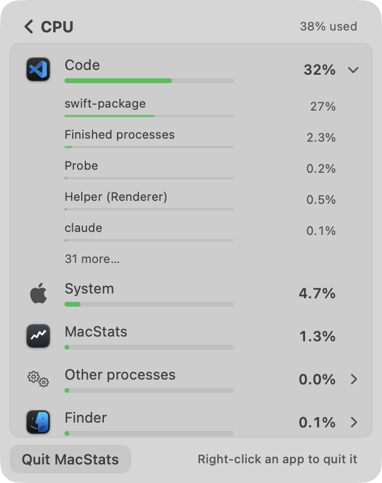

**Works well:**
- **Expand:** a synthetic click on the app row expanded Code (38 processes) in CPU, Memory and Battery, light and dark. It was still expanded, at the same row, after 3 more live scans (`breakdown-*-expanded-*.png`).
- **Freeze:** 0 moves in 48 frozen scans. A context menu also freezes the list (`BreakdownView.swift:126-132`), and so does a right-click without moving (`engaged`).
- **Ended rows:** an app that quits while frozen stays as a dimmed "Ended" row.
- **Back:** the chevron and Esc both go back (`BreakdownView.swift:95`). Settings has Esc too.
- **Accessibility:** VoiceOver actions are provided for Quit and Force Quit.
- **Safe quits:** Quit and Force Quit check the process start time before signalling, so a reused pid is never hit (`ProcessActions.swift:34-37`). Force Quit confirms first.

**Issues:**

| # | Severity | Where | Problem | Why it matters | Suggested fix |
|---|---|---|---|---|---|
| I1 | Low | `BreakdownDisplay.swift:107` (`moved` gate) | A pointer resting where the card was clicked does not freeze the list. In the "rest" phase, rows moved in 3 of 8 scans (run 1) and 1 of 6 (run 2). A click made without moving the mouse can land on a row that has just changed. | This is rare, because any 2 pt move freezes the list. | Treat a scroll-wheel event inside the list as "moved" too: today a trackpad scroll without pointer motion leaves the list unfrozen. |
| I2 | Low | `BreakdownView.swift:137` | An expanded app that drops to one process collapses by itself while the pointer is away. | A small surprise; no data is lost. | Keep it expanded showing its one process; collapse only when the app is gone. |
| I3 | n/a | Not verifiable here | The right-click menus (NSMenu), scrolling, and a click through the tour's hole could not be driven: synthetic clicks don't press the `CardButtonStyle` buttons even with the tour off. | Unchecked, not known to be broken. The code looks right: the even-odd `contentShape` leaves the hole hit-testable (`TourOverlay.swift:128-134`). | A human check: on tour step 1, click the CPU card and then the Memory card. |

**Why 8.0:** everything I could drive behaves as specified. There are two Low edge cases, and the three flows above could not be checked off-screen.

---

## Intuitiveness & discoverability — 8.0/10

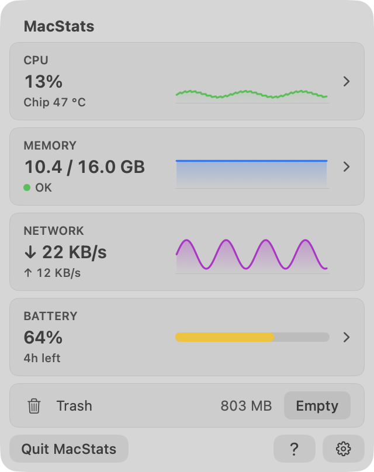
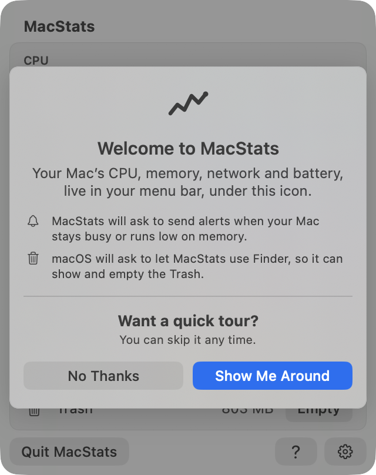

**Works well:**
- A new user's first launch opens the panel by itself with a welcome card (`MacStatsMain.swift:19-21`) that explains both coming permission prompts.
- Clickable cards have chevrons. The Network card is not clickable and has no chevron, but keeps the column so the graphs line up.
- Every card has a tooltip.
- The breakdown footer says "Right-click an app to quit it" until the menu has been used.
- Expandable rows have a chevron that rotates.
- `?` sits next to the gear and replays the tour.
- Existing users get a "Take the Tour" chip with ✕ on up to 3 opens (`chip-light.png`).

**Issues:**

| # | Severity | Where | Problem | Why it matters | Suggested fix |
|---|---|---|---|---|---|
| D1 | Low | Tour copy (`Tour.swift:38-50`) | The tour never mentions that apps expand into their processes or that rows can be right-clicked. The breakdown hint covers right-click only. | Expanding is found only through a small chevron and a tooltip. | One clause in step 1: "…click an app to see its processes." Or, in the breakdown hint: "Click an app for its processes · right-click to quit". |
| D2 | Low | Memory breakdown (`groupsLast`, `BreakdownDisplay.swift:131`) | "Other processes 3.0 GB", the largest row, is pinned below "MacStats 41 MB" (`breakdown-memory-expanded-light.png`, below the fold). | A first-timer looking for the biggest memory user reads the top. | Keep groups last, but show their size in the footnote or header, e.g. "Other processes 3.0 GB not shown above". |
| D3 | Low | Group rows "System", "Other processes", "Finished processes" | Their meaning is only in tooltips. | Non-technical users meet them on every CPU screen. | They are fine as they are. Optionally fold "Finished processes" into the app row when it is 0. |

**Why 8.0:** a first-time user is walked through every card in about 30 s and told how to drill in. The remaining gaps are second-level features (expanding, group rows).

---

## Text/copy clarity — 8.3/10

**Works well:**
- Tour bodies are 13–18 words each and fit exactly two lines at the callout width (probe: every body "lines≈2.0").
- Titles are plain: "How hard it's working", "Memory in use".
- Card meta lines are plain: "Chip 47 °C", "OK" / "running low" / "very low", "4h left".
- Footnotes say what the numbers are measured against: "Each app's share of the whole Mac".
- Battery labels are plain: "Power now", "Average", "Health", "Cycles".
- The Memory parts use plain names: "Apps", "Kept by macOS", "Compressed".
- Typographic apostrophes and Title Case buttons are used consistently.

**Issues:**

| # | Severity | Where | Problem | Why it matters | Suggested fix |
|---|---|---|---|---|---|
| T1 | Low | `BreakdownView.swift:295`; `BreakdownDisplay.swift:157` | "Finished processes 0.0%" stays in an expanded app once it has appeared, often in second place. | It reads like an error or a zombie row. | Hide it while its printed value is 0, or rank it last. |
| T2 | Low | Memory footnote (`BreakdownView.swift:116`) | "Each app's memory, as in Activity Monitor" needs 206 pt but has 182 pt, so it renders at 0.88× while the other screens use 1.0×. | It is a different text size from screen to screen. | Shorten it: "Memory per app, as in Activity Monitor" (about 185 pt), or "As in Activity Monitor". |
| T3 | Low | Process rows | Raw names ("claude", "zsh", "sleep", "swift-package", "Probe") with "Helper (Renderer)" after prefix-stripping. | This is inherent; the tooltip shows the full name and pid. | None needed. |

---

## Visual layout, alignment & centering — 8.5/10

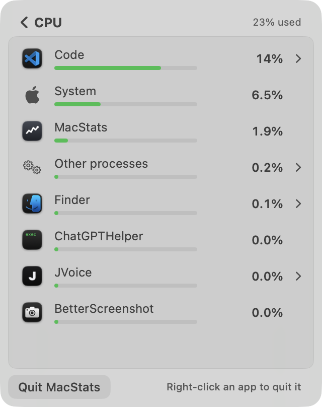
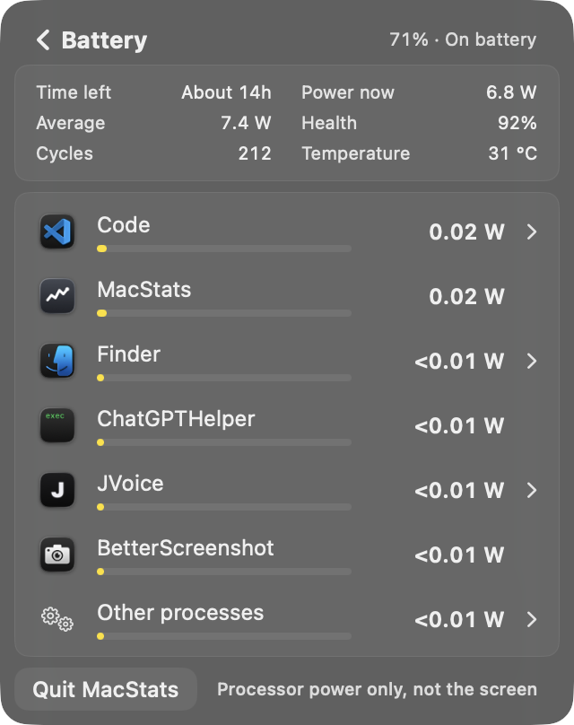
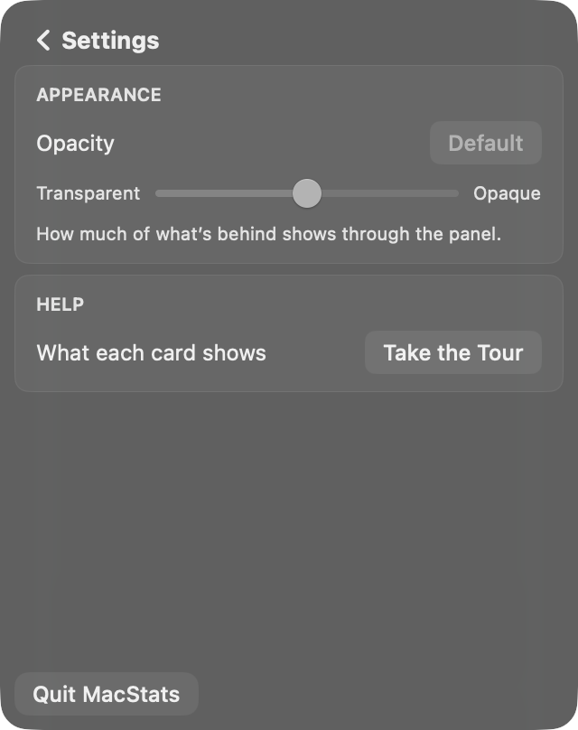

**Works well:**
- Corners are concentric and continuous throughout: panel 16, cards 8, footer buttons 8, row highlights 4, tour cutout 11.
- The value column is fixed (120 pt), so "—" placeholders and changing numbers never shift the graphs.
- Child rows indent to the name column, and the child values right-align with the app values (`breakdown-cpu-expanded-dark.png`).
- Group rows use SF Symbols.
- Light and dark both read cleanly. Bars use a sticky 1-2-5 scale (Code 14 % → a 20 % bar scale).
- "Measuring…" is a calm, centred state (`breakdown-cpu-measuring-light.png`).

**Issues:**

| # | Severity | Where | Problem | Suggested fix |
|---|---|---|---|---|
| V1 | Low | Expanded app (`breakdown-cpu-expanded-light.png`) | Process rows briefly out of order: 0.0 % / 0.2 % above 0.5 %. "Other processes 0.0 %" above "Finder 0.1 %". | See S3 / T1. |
| V2 | Low | Memory footnote | Text at 0.88× (T2). | Shorter copy. |
| V3 | Low | Settings (`settings-dark.png`) | Two cards, then about 55 % empty panel before Quit. | Acceptable while Milestone 4 is pending. Optionally anchor an "About / version" line at the bottom. |

---

## Intro & tour (incl. spotlight centering) — 9.0/10

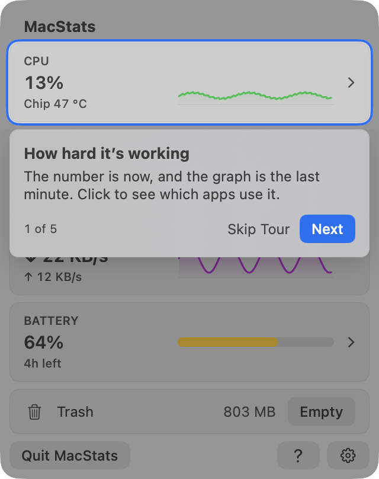
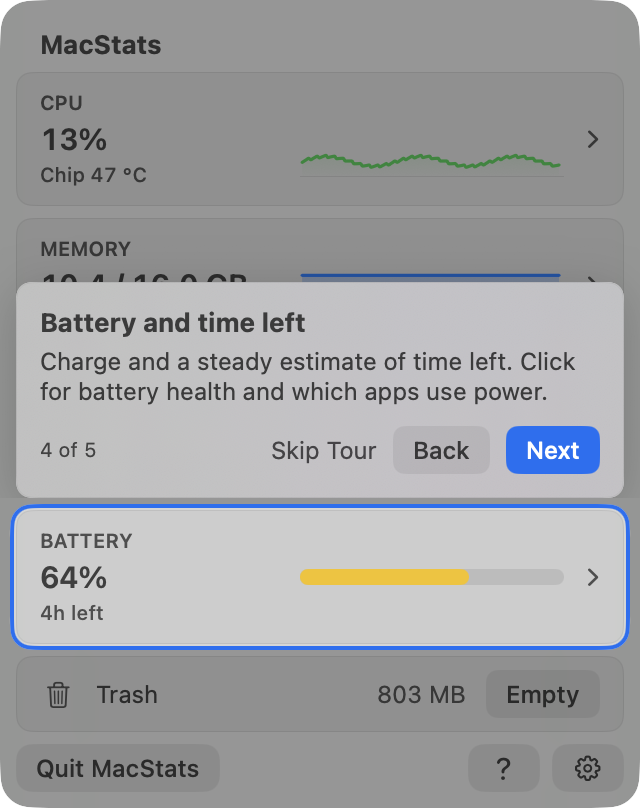
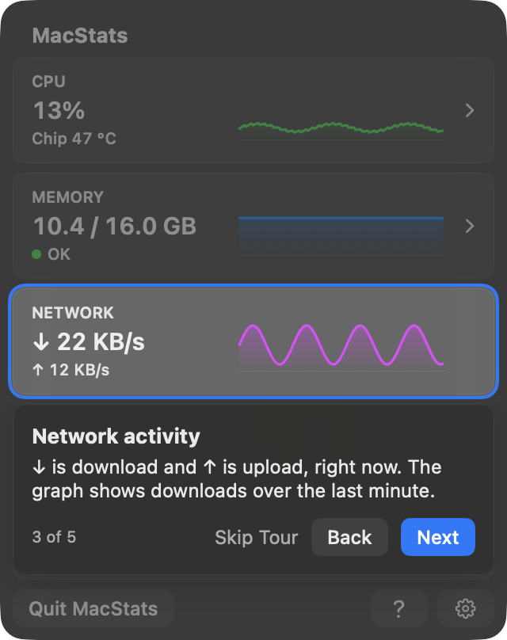
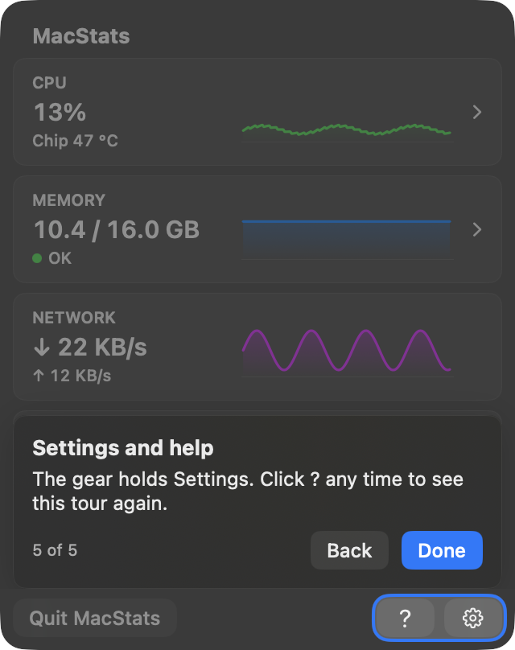
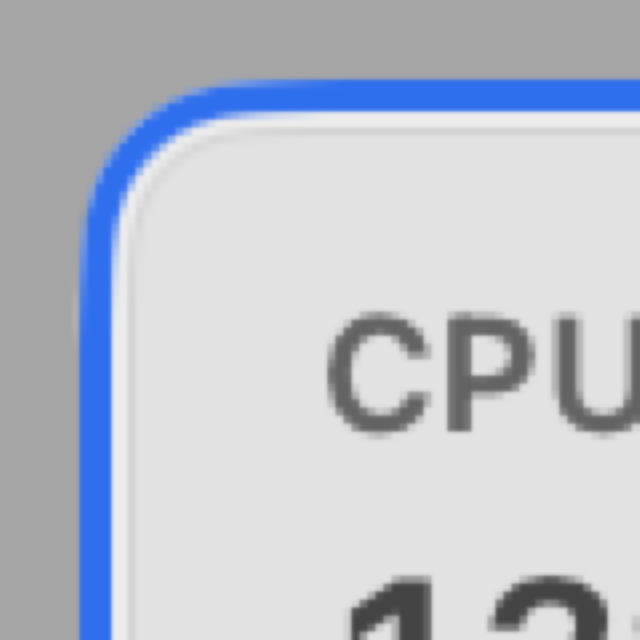

**Centering, measured.** I measured from the geometry the overlay itself resolves (`TourAnchorKey` rects into `TourLayout.cutout`). Separately, I measured from pixels: the same window was captured with and without the tour on a solid panel (Opacity 1) at 2×, and I walked from the card edge (its hairline) outward along each centre line.

| Step | Anchor (pt) | Cutout (pt) | Geometry insets L / R / T / B | Pixel insets L / R / T / B (card edge → cutout edge) | Callout |
|---|---|---|---|---|---|
| 1 CPU | 8,36 304×67 | 5,33 310×73, r 11 | 3.00 / 3.00 / 3.00 / 3.00 | 3.0 / 3.0 / 3.0 / 3.0 (1.0 gap + 2.0 ring) | below |
| 2 Memory | 8,109 304×67 | 5,106 310×73 | 3.00 ×4 | 3.0 ×4 | below |
| 3 Network | 8,182 304×67 | 5,179 310×73 | 3.00 ×4 | 3.0 ×4 | below |
| 4 Battery | 8,255 304×67 | 5,252 310×73 | 3.00 ×4 | 3.0 ×4 | above |
| 5 Footer (`?` + gear) | 234,372 78×24 | 231,369 84×30 | 3.00 ×4 | 3.0 ×4 (measured through the `?` button) | above |

The results are identical in light and dark. The cutout radius of 11 = card 8 + 3, and at the panel edge 11 + 5 = 16, the panel radius. So the ring is concentric with both the card and the panel.

At the 45° corner apex, the card-to-cutout distance measures about 3.5–3.9 pt against 3.0 on the sides. The pixel steps along the diagonal are 0.7 pt each, so this is coarse. It is the normal result of growing a continuous corner's radius, and it is invisible at 1× (see the 8× crop).

**Works well:**
- **Skippable 4 ways:** Skip Tour, Esc, No Thanks, and a second panel close.
- **Replayable 3 ways:** `?`, Settings → Take the Tour, and the existing-user chip.
- **Resumes after a close:** the first close pauses on the current step, and the next open resumes there.
- **No battery:** the Battery step is skipped and the counter reads "4 of 4" (`tour-nobattery-footer-light.png`).
- **Keyboard:** → / ← / Return / Esc.
- **VoiceOver:** each step is announced.
- **Calm transitions:** the callout fades and the hole glides; with Reduce Motion it cross-fades instead.
- **Clicks:** the dim swallows clicks and hovers, so nothing else opens by accident.
- **Placement:** callouts never overlap the cutout, and their shadows are masked off the gap.
- **Prompts:** permission prompts are deferred until the welcome card explains them.
- **Copy:** plain, two lines per step.

**Issues:**

| # | Severity | Where | Problem | Suggested fix |
|---|---|---|---|---|
| TR1 | Low (nit) | Cutout corners | About 0.5–0.9 pt wider at the 45° apex than on the sides (continuous-corner offset). | None needed. If wanted, draw the cutout as the card path stroked outward by 3 pt (a true offset curve) instead of a bigger-radius squircle. |
| TR2 | Low | Second close ends the tour (`Tour.swift:133-141`) | Two accidental closes mark the tour as seen. | Fine as designed, since `?` replays it. Optionally don't count a close that happens within 1 s of the open. |
| TR3 | n/a | Click-through of the hole | Not driven live (see I3). | A human check. |

**Why 9.0:** this meets the 9 anchor point by point: exactly centred, concentric, skippable at any time, replayable, plain short copy, light and dark. It is held below 10 only by the unverified click-through and the corner nit.

---

## Code quality of the new code — 7.5/10

The new code since 1ed61cf adds 3,849 lines and removes 317 across 38 files. 366 tests pass (`./Scripts/test.sh`, 6.7 s).

**Works well:**
- The pure decision code lives in MacStatsCore with tests: `TourState`, `TourRules`, `TourLayout` (including fractional-input centring tests), `stableRanking`, `HeldReading`, `heldValue`, `BreakdownDisplay` (26 store-level tests).
- `TourController` only persists state. The overlay only draws.
- Anchors report their rects only while the tour is active, so the overview pays nothing otherwise (`TourOverlay.swift:53-61`).
- The visibility model (`AppModel.updateVisibility`, `MacStatsApp.swift:160-172`) is explicit about "covered" versus "closed".
- Scans run off the main thread, with generation checks.

**Issues:**

| # | Severity | Where | Problem | Suggested fix |
|---|---|---|---|---|
| C1 | Medium | `BreakdownDisplay.swift` (whole file), `StableRanking.swift`, `ProcessScan.swift:448-563`, `RefreshScheduler.swift:38-89` | Stability comes from about 8 interacting mechanisms: two-scan text confirmation, relative and absolute hysteresis, a jump rule, lagging promotion, a reorder dwell, freeze plus unfreeze delay, ended placeholders, newcomers-below, a trailing window and a fast attack. They are driven by about a dozen tuned constants. Any change needs the replay probe to judge, and S1–S3 show how the rules interact. | Write one short design note listing each rule, its constant and its test. Replace the measurement-history prose in doc comments (e.g. "5.1 → 3.6 times a minute", "review round 2") with that link. Consider merging the dwell and lagging promotion into one "a reorder needs N s of consistent lead" rule. |
| C2 | Low | Comments citing `docs/research/...` and probe numbers (`DisplayHold.swift:6`, `RefreshScheduler.swift:42-46, 49-53`) | History in API docs goes stale as the constants are tuned. | Same as C1. |
| C3 | Low | `BreakdownView.swift:526` | `updateNSView` reallocates the probe closure on every render of the breakdown (each scan). | Assign it once in `makeNSView`. |
| C4 | Low | `ProcessScan.swift:543` | A process whose name can't be read (`nameOf` → nil) is re-queried on every scan, because nil isn't cached. | Cache a sentinel. |
| C5 | Low | `BreakdownView.swift` (636 lines) | The view, row types, list flattening, pointer probe and icon cache are all in one file. `BreakdownList` lives in the app target, so the probes have to copy it. | Move `BreakdownList` into MacStatsCore, where it can be tested and imported by probes. |

---

## Resource cost — 8.0/10

**Works well:**
- **Display logic:** `setBreakdown` (ranking, holds and freeze) took 0.29–0.42 ms on average per 2 s scan, 0.86 ms at most (probe).
- **Scanner memory:** the scanner's window keeps about 4 intervals of per-process dictionaries and is freed when the breakdown closes.
- **Tour:** no timers or observers. In an alternating 12 s off/on run with the overview ticking every 0.5 s, the tour on step 1 measured 11.6 % against 11.0 % off. That is within noise: the control run with the tour never started varied from 2.5 % to 10.8 %.
- **Closed panel:** I read the code for anything new running while the panel is closed and found nothing. `PanelWindowObserver` and the status-item hover are notification-driven. The open tick now refuses to run for an off-screen window (`MacStatsApp.swift:205-215`).

**Issues:**

| # | Severity | Where | Problem | Suggested fix |
|---|---|---|---|---|
| R1 | Medium (operational, not a HEAD code defect) | The installed `~/Applications/MacStats.app` (built 2026-10-06 17:49, before baseline 1ed61cf) | It is running now with its panel off screen (window 320×404, not on screen), yet uses 10–23 % of a core and 97 MB RSS. That is 92 CPU-minutes in 6 h 40 min, the exact "ticking while ordered out" failure the HEAD code addresses. | Install HEAD (not done by this review), then confirm with `ps -o %cpu,time -p $(pgrep -f MacStats.app/Contents/MacOS)` after an open and close. Closed, it should sit near 0 %. |
| R2 | Low | Not verified | HEAD's idle CPU and RAM were not measured live (it would need installing). | As in R1. |

---

## Cross-cutting issues

- **Steadiness against currency.** The breakdown leans towards steady: an 8 s fall, an indefinite freeze while hovered, and dwells. The cards are balanced well (2 s dwell, ≤ 3 pp gap). The breakdown should match the cards' "current within ~2 s" on falls too (S1, S2).
- **Synthetic group rows** ("System", "Other processes", "Finished processes") are explained only in tooltips. "Finished processes 0.0 %" is the one that reads as noise.
- **Consistency:** the type scale, the button styles (`SubtleButtonStyle`) and the radii are consistent across all screens and in light and dark. The one exception is the shrunk Memory footnote.

## Top fixes (ranked by impact ÷ effort)

1. **Install HEAD and confirm the closed-panel CPU (R1).** The installed pre-branch build is burning 10–23 % of a core right now.
2. **Fast release for the breakdown window (S1).** Restart an app's window when its latest interval falls by ≥ 0.75 core (`ProcessScan.swift:483-495`), so rows and header follow the card down in about 2 s.
3. **Freeze only at and above the hovered row, or cap the freeze for big inversions (S2).** Rows below the pointer can re-sort without moving anything under it.
4. **Hide or sink "Finished processes" at 0, and give process rows a longer dwell (S3, T1, V1).**
5. **Shorten the Memory footnote to fit at 1.0× (T2)**, and mention "click an app to see its processes" in the hint or tour (D1).
6. **A one-page note on the stabiliser's rules and constants, with history moved out of the API comments (C1, C2).**

## Method & limits

**Live-flow probe.** I wrote `stab/main.swift` in the session scratchpad. It was compiled against the current `Sources/MacStatsCore` (minus `AppleSensorReader`) with `swiftc -sdk …MacOSX26.5.sdk` and run under a kill timeout three times (150 s, 120 s, 90 s). It used the real `BreakdownScanner`, `MetricsStore`, `BreakdownDisplay`, holds and dwells, and a copy of `BreakdownScanSession` and `BreakdownList`. A pointer script was fed through `breakdownPointerProbe` and `setBreakdownPointerInside`, and a 25–30 s `/usr/bin/yes` load was started and stopped by the probe.

The Mac was in real use (VS Code, Claude, another session's builds). The probe and `yes` are themselves children of VS Code, which made "Code" the busiest and most turbulent expanded app: a worst case for S3. Unfrozen inversion counts include the frozen windows (run 3 lists them per scan, and only 1 of 14 happened while unfrozen). I checked the existing `docs/research/.../stability/main.swift` probe; it measures the top-8 order and the target app, but not the expanded block, the resting pointer or the load lag, so I wrote my own.

**Render probe.** I wrote `ui/` in the scratchpad: a SwiftPM package with the real `MacStatsCore` and the `MacStatsApp` views (minus the `@main`), built once in release mode. Windows were placed at desktop level + 1, ordered back, never activated, and closed after each capture with `CGWindowListCreateImage`. Tour state lived in throwaway defaults suites, which were deleted afterwards. The breakdowns use live scans of this Mac. The overview, tour and Settings captures use a fixed fake store.

**Not checked:**
- right-click menus (NSMenu);
- scrolling;
- clicking through the tour's hole (synthetic clicks don't press `CardButtonStyle` buttons in an inactive probe window);
- hover highlights;
- VoiceOver;
- the real `MenuBarExtra` panel (its Liquid Glass and shadow);
- HEAD's live idle cost.

A human should check these:
1. On tour step 1, clicking the CPU card opens the CPU breakdown and the tour resumes on Back.
2. Right-click → Quit acts on the clicked row while the list is updating.
3. After installing HEAD, the closed-panel CPU is about 0 %.

**Not touched:** no source edits, no install, nothing on the owner's menu bar. Every probe process and `yes` load was stopped.
