# MacStats stability + tour review, round 5, reviewer B (2026-10-07)

**Overall: 8.2/10.** This sits in the owner's "basically perfect" band, at its lower end. Every measured hard requirement holds:

- **Tour highlight:** exactly centred, 3.0 pt on all four sides. Checked at the centre line and at two off-centre lines, for all 5 steps, in light and dark.
- **Rows under the pointer:** never move. 29 frozen scans with an app expanded and hovered gave 0 changes.
- **Expanded app:** never collapsed or vanished.
- **Values:** steady (no A→B→A flips) and still current. A new 1-core load showed on the card in 1.5–2 s and in its row in 2 s.
- **Resource cost:** no worse than the 1ed61cf baseline, and lower in the breakdown.

What keeps the score from 9:
- Once the pointer is off the list, the visible processes of an expanded app swap places about 11–15 times a minute.
- A few Low interaction edges remain around "Ended" placeholders.
- Some copy is slightly clunky.
- The new core code is long and full of history in its comments.

**Standard:** Apple's own Battery / Control Center menu-bar panels, Activity Monitor-quality readings, and Apple-quality coach marks.
**Method:**
- Screenshots of the real views rendered off-screen, in light and dark.
- A headless live-flow simulation on real process data (270 s, plus a 150 s repeat).
- A same-input cost comparison against 1ed61cf.
- Reading the code in Sources/.

**Reviewer:** independent subagent B. It did not read the other reviewer's report, the plans, the research conclusions or the git messages.

## Calibration
- **Type and platform:** native macOS 26 menu-bar monitor (SwiftUI `MenuBarExtra(.window)`, fixed 320×404 popover).
- **Audience:** everyday Mac users, including non-technical ones. **Maturity:** shipping (v1.x).
- **Reference for a 10:** Apple's Battery / Control Center panels, Activity Monitor-quality readings and Apple-quality coach marks.
- **Platform conventions:** light and dark mode, continuous (squircle) concentric corners, hover feedback, Esc and Return, right-click menus, VoiceOver.
- **What a 3, a 6 and a 9 look like:**
  - **3:** numbers flicker; rows re-sort every tick so you can't click or expand; the tour is misaligned or traps you; jargon everywhere.
  - **6:** mostly steady, but rows still sometimes move under the pointer or an expanded app collapses; the tour highlight is a few points off-centre or the copy is wordy; some controls are hard to discover.
  - **9:**
    - Values are steady enough to read yet current within seconds.
    - Rows never move out from under the pointer, and an expanded app never vanishes.
    - A first-time user understands every card and how to drill in within about 30 s.
    - Every tour highlight is exactly centred with concentric continuous corners, in light and dark; the tour can be skipped at any time and replayed.
    - Text is plain and short.
    - MacStats's own CPU and RAM use is no worse than the baseline.

## Scoreboard
| Area | Score | Verdict |
|---|---|---|
| Stability of numbers & lists | 7.8 | Frozen list is perfect, cards are steady and current. An expanded app's process rows still reshuffle about every 6 s when not hovered. |
| Interaction reliability | 8.2 | Expand, freeze, menu and back all hold. Low edges: "N more…" vanishes on an ended app, placeholder names change, a resting pointer doesn't freeze. |
| Intuitiveness & discoverability | 8.4 | Chevrons, hover, tooltips, welcome, tour and the quit hint cover it. Quitting an app is right-click only. |
| Text/copy clarity | 8.2 | Plain and short almost everywhere. A few clunky phrases and a little "pid" jargon. |
| Visual layout, alignment & centering | 8.7 | Consistent squircle language and exact insets. Small nits: tight chip gap, empty Settings, half-covered text under callouts. |
| Intro & tour (incl. spotlight centring) | 8.9 | 3.0 / 3.0 / 3.0 / 3.0 pt on every step in both appearances; concentric 8 / 11 / 16 radii; skippable, resumable and replayable. |
| Code quality of the new code | 7.8 | Pure, well-tested core (366 tests pass). Long functions and history-laden comments. |
| Resource cost | 8.7 | Overview and breakdown cost at or below baseline (scans halved). The tour costs nothing unless it is on screen. |

---

## Evidence: how it was produced
**Render probe (scratchpad, not committed):**
- A SwiftPM executable compiling the current `Sources/MacStatsCore` and `Sources/MacStatsApp/*.swift` (all except `MacStatsMain.swift`).
- Windows sit at desktop level + 1 and are ordered back, never activated. Captured with `CGWindowListCreateImage(.optionIncludingWindow, .bestResolution)` at 2×, then closed.
- Overview and tour use a fake but realistic `MetricsStore`. The tour runs on a real `TourController` with throwaway defaults suites, deleted afterwards.
- Breakdowns use **real scans** of this Mac (the app's `BreakdownScanner` path including `isMacOSAgent`). An app is expanded with a synthetic click on its row.

**Spotlight measurement:**
- For each step, a capture without the tour (base) is compared with the tour capture.
- The probe walks outward from the card edge along three lines (centre, 25–30 %, 70–75 %) on all four sides. It records the "unchanged gap" pixels, then the accent-ring run. Gap plus ring is the cutout's inset in points.
- It also computes the same thing from the resolved anchor rect and `TourLayout.cutout`.

**Live-flow probe (headless, real data):** a real `MetricsStore` with:
- Overview samples every 0.5 s (snapshots plus `rateBaselineIndex`, as `AppModel.sample`).
- Real breakdown scans every 2 s (`breakdownScanInterval`).
- A simulated pointer via `store.breakdownPointerProbe` and `setBreakdownPointerInside` / `setBreakdownMenuOpen`, which are the same hooks the view uses.
- The view's flattened list (`BreakdownList.rows`) and its collapse rule (`expandedProcessCount <= 1`).

The CPU script ran like this:

| Time | What the simulated user does |
|---|---|
| 0–30 s | Pointer resting where the card was clicked (inside the list, not moved) |
| 30 s | Pointer moves onto the list |
| 32 s | Clicks to expand the app with the most processes in the top 8 (VS Code, 32–35 processes) and hovers its 3rd or 4th child row |
| 80–84 s | Right-click menu open |
| 90 s | Pointer leaves the list |
| 112–122 s | Synthetic one-core load (`/usr/bin/yes`, started by the probe and stopped by it) |

Memory and Battery (energy) breakdowns then ran 60 s each.

**Cost probe:** the same deterministic input on a 1ed61cf build (`git archive`) and on HEAD:
- The overview at 0.5 s for 20 s.
- Then the CPU breakdown with real scans at each build's own cadence (1 s before, 2 s now) for 30 s.
- Run 3 times, alternating the order.

The owner was using the Mac, so the numbers carry noise.

**Tests:** `./Scripts/test.sh` reports 366 tests in 45 suites passed.

---

## Stability of numbers & lists — 7.8/10
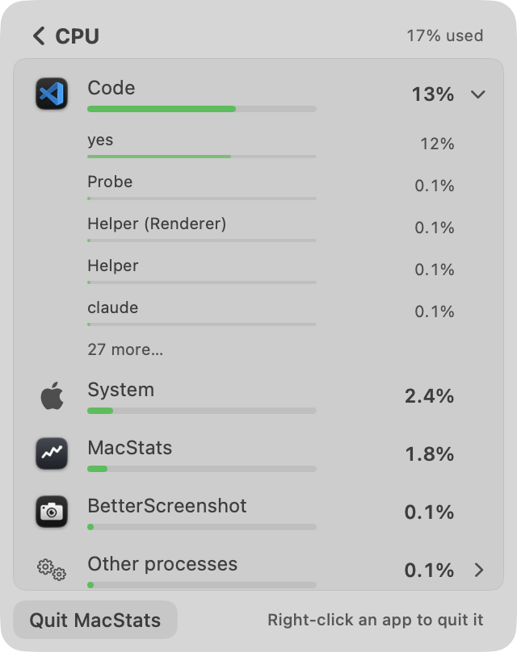

**Measured, live data. CPU breakdown, 150 s run, repeated:**

| Metric | Run 1 | Run 2 |
|---|---|---|
| Top-8 order changes, pointer away | 3.0 /min (6 pairwise swaps) | 3.0 /min (3 swaps) |
| Top-8 order changes, pointer resting from the click (unfrozen by design) | 3 in 28 s | 1 in 28 s |
| Top-8 order changes, **frozen (hovering an expanded app)** | **0 in 29 scans** | **0** |
| Hovered row, or any row above it, changed while frozen | **0** | **0** |
| Expanded app collapsed / vanished | **0** | **0** |
| **Expanded app's visible top-5 process order changes, pointer away (~60 s)** | **15** | **11** (t = 92, 98, 104, 110, 114, 116, 124, 130, 136, 142, 148 s) |
| Row-text changes per top-8 list | 32–34 /min (each row about every 15 s) | 21–25 /min |
| A→B→A text flips | 0 | 0 |
| Unfrozen scans showing a lower printed value above a higher one | 7 / 44 | 2 / 44 (e.g. "MacStats 1.9 % above Code 2.0 %", one scan) |
| 1-core load: card +8 pp after / its row ≥ 80 % of a core after | 1.5 s / 2.0 s | 2.0 s / 2.0 s |

The other breakdowns and the cards:
- **Memory breakdown:** 0 reorders in 60 s, text 3 /min, 0 inversions.
- **Battery (energy) breakdown:** 1 reorder in 60 s, text 5 /min, 1 inversion scan out of 29.
- **Cards (0.5 s ticks, 270 s):**
  - Text changes per minute: CPU 24.9, ↓ 5.3, ↑ 11.6, Memory 5.1.
  - The CPU card was never 3 pp or more off the live 2 s reading (0 of 539 ticks; maximum deviation 3.0 pp).
  - So it stays current while changing about every 2.4 s, within the 2 s dwell (`cardDwellSeconds`).

**Works well:**
- The freeze is airtight: every row, value placement and the expanded block held through hovering and a right-click.
- No flicker-flips anywhere.
- Cards are held but never stale.
- A real load still shows within one scan (fast attack, `ProcessScan.swift`, `breakdownFastAttackCores`).
- The Memory list is practically still.

**Issues:**
| # | Severity | Where | Problem | Why it matters | Suggested fix |
|---|---|---|---|---|---|
| S1 | Medium | `BreakdownDisplay.apply`, process ranking (`BreakdownDisplay.swift:171-176`, `rank` with `lagging`) | With the pointer off the list, an expanded app's visible 5 process rows reorder 11–15 times a minute. That is every allowed slot of the 5 s dwell (`breakdownReorderDwell`) plus big-jump moves. Causes: rows at 0.1–0.2 % pass each other through the inversion timeout (`promoted: lagging`), newcomers enter, and "Finished processes" spikes to the top after a burst (t = 124 s). | Someone reading an expanded app without pointing at it sees the block reshuffle every ~6 s, about 4× the app list's 3 /min. The visible steadiness falls short of the app rows. | Give child rows their own longer dwell (e.g. 10–15 s), or skip the inversion timeout when both values are under ~0.5 % (tiny values crossing are noise). Keep "Finished processes" out of the top slot unless it beats the leader by the jump margin. |
| S2 | Low | `BreakdownDisplay.isFrozen` / `stableRanking(frozen:)` (`StableRanking.swift:55`) | Order freezes for as long as the pointer stays on the list. A new app, even a heavy one, joins at the very bottom (after the group rows). An existing app that spikes stays where it is. There is no cue that sorting is paused. | A user watching the list with the pointer resting on it can see "2 %" above "40 %", or miss a new hog below the fold, until they move off. | Show a subtle "Sorting paused" cue while frozen. Or let a row with a "jump" lead climb only above the hovered row, never past it. |

**Why 7.8:** The 9-anchor's hard requirements are all met and measured. One Medium (S1, visible churn in the expanded block when the pointer is away) and one Low keep it out of the 8+ band of "no Medium a user would notice".

---

## Interaction reliability — 8.2/10
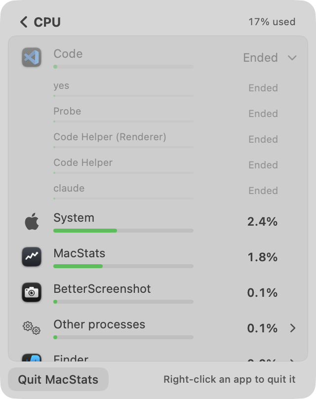

**Works well:**
- Clicking an app row expands it, one app at a time. It never collapsed on its own in 150 s, and the collapse rule only fires when the app has ≤ 1 process left.
- While frozen, an app that quits stays in place with all its process rows as dimmed "Ended" placeholders (screenshot above).
- The context menu freezes the order (NSMenu tracking notifications, `BreakdownView.swift:126-132`), so Quit acts on the row it was opened on.
- Back works by the chevron or by Esc.
- Tour keys: ← / → / Esc / Return.
- Rows expose VoiceOver actions (Quit / Force Quit…), and Force Quit confirms with an `NSAlert`.

**Issues:**
| # | Severity | Where | Problem | Why it matters | Suggested fix |
|---|---|---|---|---|---|
| I1 | Low | `BreakdownList.rows` (`BreakdownView.swift:395`: `!ended(app.appPID)`) | When an expanded app ends while the list is frozen, its "27 more…" row is removed. Every row below the block jumps up one row: System moved from y ≈ 245 pt to 220 pt between the two screenshots. | It breaks "nothing moves under the pointer" for a pointer below the block. That is rare (the app usually ends from its own row's menu, above). | Keep the "N more…" row as a disabled placeholder while frozen, and drop it at the unfreeze like the other placeholders. |
| I2 | Low | Ended process placeholder (`BreakdownView.swift:284`) | The placeholder prints the full name ("Code Helper (Renderer)") where the live row printed `processDisplayName` ("Helper (Renderer)"). The text changes in place, and gets longer, at the moment a row ends. | A small jump in the one place built to stay still. | Pass the name through `processDisplayName(_, inApp:)` as `liveProcessRow` does. |
| I3 | Low | `BreakdownDisplay.isFrozen` (`BreakdownDisplay.swift:107`), by design | A pointer that hasn't moved since the card click doesn't freeze the list. The live run saw 1–3 reorders in the first 28 s under such a pointer. | A user who reads, then clicks a row without moving the mouse, can hit a row that has just slid under the pointer. | Acceptable trade-off. Optionally treat the first ~5 s after appearing as frozen if the pointer is over a row. |
| I4 | Low | Not verified | The real `NSMenu` right-click, trackpad scrolling inside the list, and hover enter/exit events in a live `MenuBarExtra` window were driven only through the store's hooks, not through the real panel (the owner was working). | — | A 1-minute manual check on the installed build. |

**Why 8.2:** Everything that matters holds, and the remaining issues are Low edges around placeholders and one by-design choice.

---

## Intuitiveness & discoverability — 8.4/10
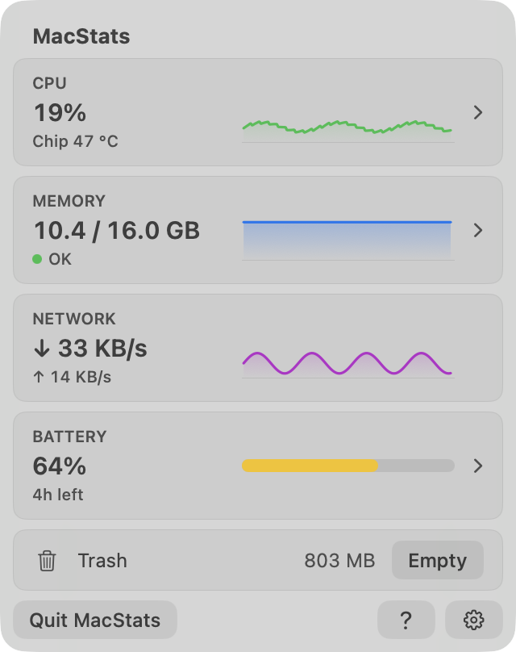 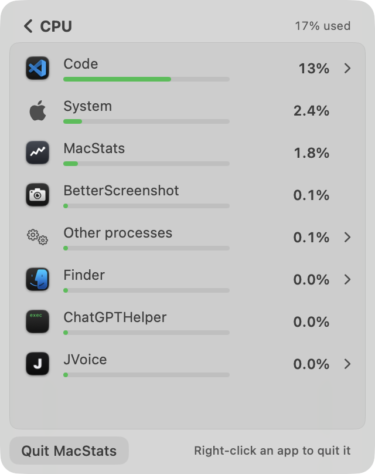

**Works well:**
- Cards that open have a chevron; Network, which doesn't, has none, so the affordance is honest. They also show hover and press feedback and a tooltip ("Click to see which apps use the CPU").
- In the breakdown, expandable rows get a chevron and a hover highlight. Rows that can't expand get neither.
- The first 10 drill-ins replace the footnote with "Right-click an app to quit it" (`TourRules.breakdownHintLimit`).
- The welcome card and the tour teach clicking a card; the tour can be replayed from `?`, from Settings → Help, and from the existing-user chip.
- The "Measuring…" state says how long it takes.

**Issues:**
| # | Severity | Where | Problem | Why it matters | Suggested fix |
|---|---|---|---|---|---|
| D1 | Low | Breakdown rows | Quit / Force Quit live only in the right-click menu (and VoiceOver actions). There is no visible control; the hint goes after 10 drill-ins or the first menu use. | Activity Monitor has a visible ✕. A user who never right-clicks never finds Quit. | Fine as is; optionally show a small quit button on row hover. |
| D2 | Low | Settings screen | Two small cards and about 60 % of the panel left empty. | It reads as unfinished next to the dense overview. | Fine until Milestone 4 adds settings; or vertically group the cards with a short About line. |

**Why 8.4:** A new user gets everything explained within 30 s, and both drill-in affordances are visible.

---

## Text/copy clarity — 8.2/10
**Works well:**
- Plain words: "Kept by macOS" for wired memory; "OK / running low / very low" for memory pressure; "Chip 47 °C".
- Footnotes say what a number is measured against, with tooltips for the detail.
- Placeholders read honestly: "Ended", "Finished processes", "<0.01 W".
- Tour bodies stay within 2 lines and 20 words (lint test plus render).

**Issues:**
| # | Severity | Where | Problem | Suggested fix |
|---|---|---|---|---|
| T1 | Low | Tour step 1 body (`Tour.swift:40`) | "The number is now, and the graph is the last minute." is clunky. | "The number is right now; the graph shows the last minute." |
| T2 | Low | Welcome body (`Tour.swift:54`) | "…live in your menu bar, under this icon." The glyph is inside the card, while the real icon is in the menu bar above, so "this icon" is ambiguous. The card has 7 lines of text before the question. | "…live in your menu bar. Click its icon any time." |
| T3 | Low | Process row tooltip and menu header (`BreakdownView.swift:318, 328`) | "pid 58377" is jargon for the stated audience. | Keep it in the menu header only, or label it "Process ID". |
| T4 | Low | Battery card meta | "4h left" for 245 min is fine; "About 4h left" would signal it's an estimate (the details card does say "steady estimate"). | Optional. |

**Why 8.2:** Only Low nits; the copy is short and plain.

---

## Visual layout, alignment & centering — 8.7/10
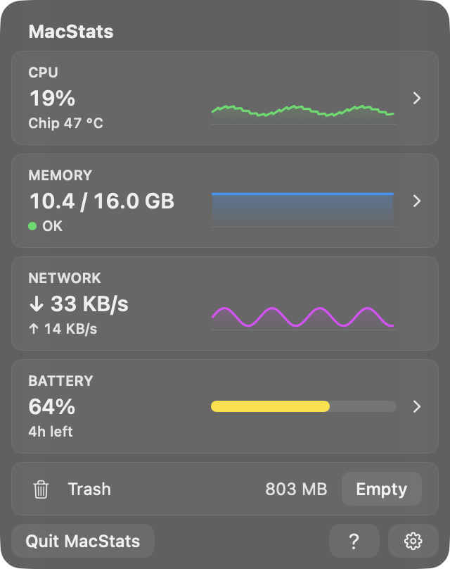 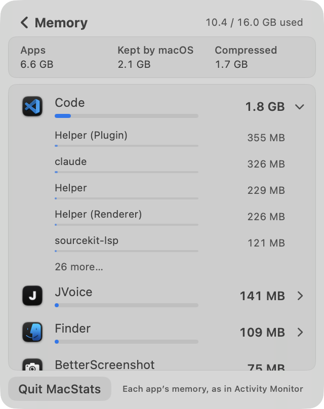 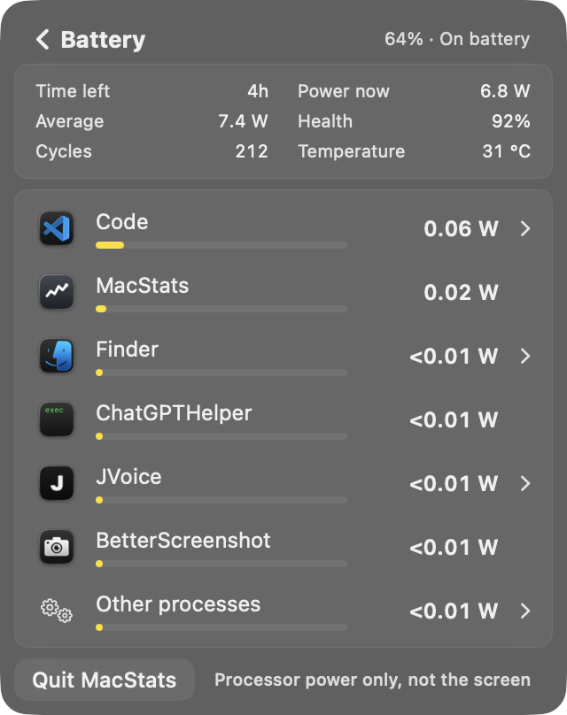

**Works well:**
- One card language throughout: continuous corners at 8 pt, concentric with the 16 pt panel at the 8 pt inset.
- Row highlights are 4 pt inside 4 pt list padding.
- Child rows are indented to the name column, and value columns are fixed-width and right-aligned.
- Dark and light are both correct.
- Placeholders keep their row height.

**Issues:**
| # | Severity | Where | Problem | Suggested fix |
|---|---|---|---|---|
| V1 | Low | Existing-user chip (`OverviewView.swift:21`) | The 20 pt chip ends about 3 pt above the CPU card ([chip](2026-10-06-stability-tour/r5-B/chip-light.png)), which looks cramped next to the 6 pt card rhythm. | Use a height of 18, or align it to the header's centre. |
| V2 | Low | Tour callouts over neighbouring cards | Half-covered text of the next card peeks out under the dim, e.g. the top of "↓ 33 KB/s" under step 1. | Acceptable for coach marks; a slightly stronger dim (0.35 / 0.45) would quiet it. |
| V3 | Low | Settings | Large empty area (D2). | — |

**Why 8.7:** Polished and consistent; only nitpicks.

---

## Intro & tour (incl. spotlight centring) — 8.9/10
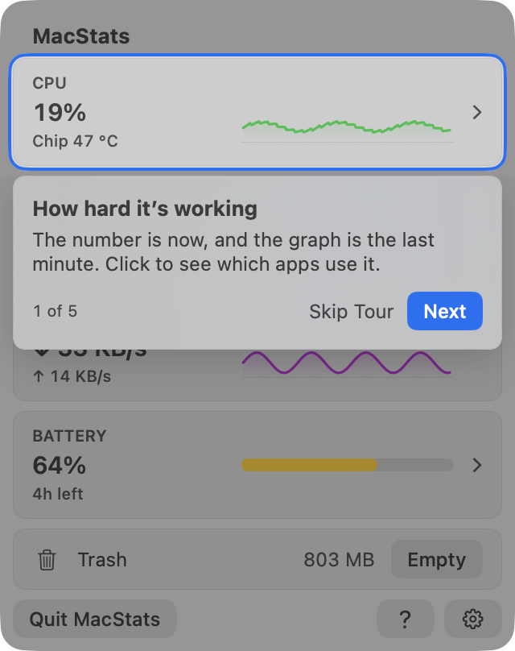 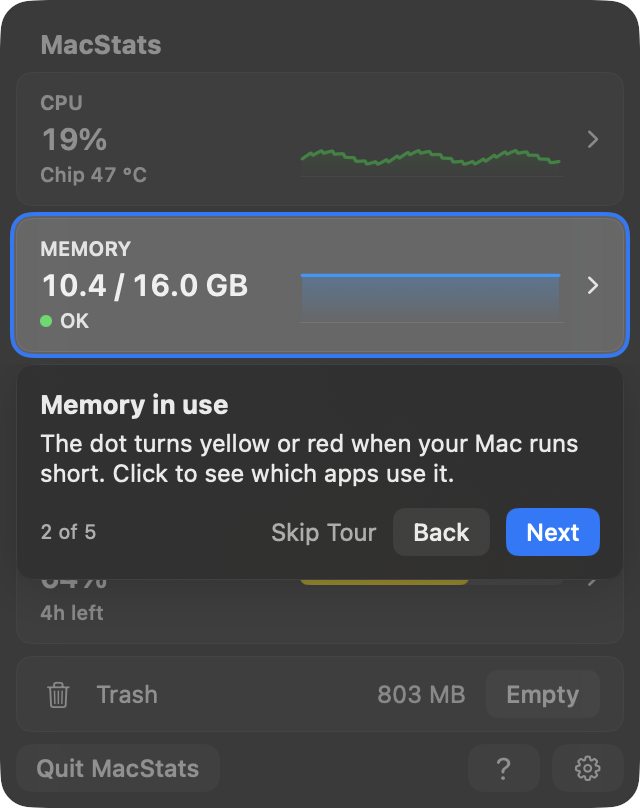 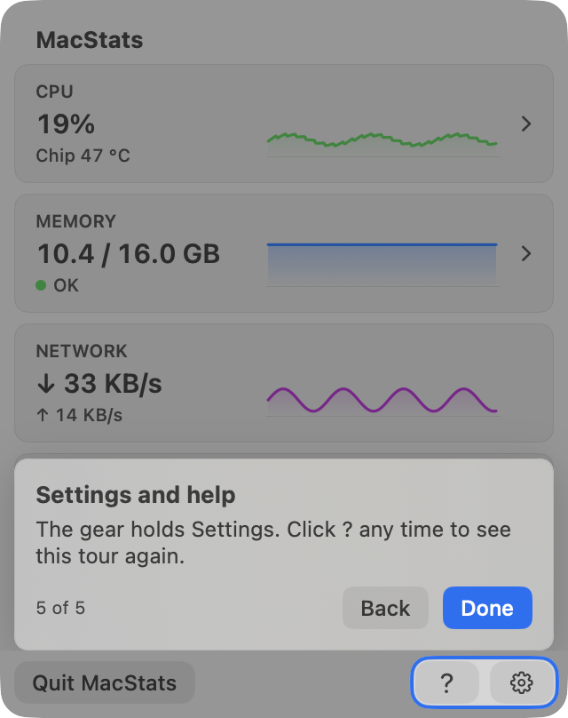
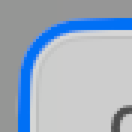 

**Cutout vs card, the four insets in points.** Each figure is the pixel walk (clear gap + ring = outer edge), the same at the centre line and at the off-centre lines:

| Step | Card rect (pt) | Light L / R / T / B | Dark L / R / T / B | Geometry (`TourLayout.cutout`) | Radius |
|---|---|---|---|---|---|
| 1 CPU | (8, 36, 304, 67) | 3.0 / 3.0 / 3.0 / 3.0 | 3.0 / 3.0 / 3.0 / 3.0 | 3.00 ×4 | 11 (card 8) |
| 2 Memory | (8, 109, 304, 67) | 3.0 ×4 | 3.0 ×4 | 3.00 ×4 | 11 |
| 3 Network | (8, 182, 304, 67) | 3.0 ×4 | 3.0 ×4 | 3.00 ×4 | 11 |
| 4 Battery | (8, 255, 304, 67) | 3.0 ×4 | 3.0 ×4 | 3.00 ×4 | 11 |
| 5 Footer (? + gear) | (234, 372, 78, 24) | 3.0 ×4 | 3.0 ×4 | 3.00 ×4 | 11, 5 pt from the panel edge, so concentric with the panel's 16 too |

In every case the clear gap is 1.0 pt and the ring 2.0 pt. At the footer's off-centre rows the button's own corner shifts the split to 0.5 + 2.5, with the same 3.0 outer edge. The 6× corner zooms show the ring's continuous corner parallel to the card's.

**Works well:**
- **Skipping:** Skip Tour on every step but the last; Esc skips; No Thanks on the welcome.
- **Navigation:** Back from step 2 on, also ←; Next is the default button, also → and Return.
- **Closing mid-tour:** the first panel close pauses and the tour resumes on the same step; the second close ends it. Verified: close → `resume = 0`, reopen → "1/5", close → seen = 1.
- **Replay:** from `?` (footer), Settings → Take the Tour, or the existing-user chip.
- **No battery:** the tour drops to 4 steps ([screenshot](2026-10-06-stability-tour/r5-B/tour-nobattery-last-light.png)).
- **Click-through:** the dim swallows clicks, but the hole lets the highlighted card be clicked; the tour waits hidden until the overview is back.
- **Accessibility:** Reduce Motion gets a cross-fade, Reduce Transparency a solid surface, Increase Contrast a 3 pt ring, and VoiceOver hears an announcement per step.
- **Permissions:** the welcome explains the two macOS prompts before they appear, and the prompts wait for its answer.

**Issues:** T2 (welcome wording), V2 (half-covered text under callouts). Not verified live: the auto-open on first launch (`StatusItemHover.openPanelWhenFound`), the hole's glide animation in the real panel, and hover over the highlighted card through the hole.

**Why 8.9:** Meets every 9-anchor point measured. The remaining points are copy and polish nits.

---

## Code quality of the new code — 7.8/10
**Works well:**
- The decisions are pure and testable in MacStatsCore: `DisplayHold`, `StableRanking`, `BreakdownDisplay`, `TourState` / `TourRules`, `TourLayout`.
- They are covered by focused tests: frozen prefix property test, menu-without-move, ended app keeps its processes, cutout margins at fractional scales. `./Scripts/test.sh` reports 366 tests passing.
- Clean separation:
  - `TourController` only reads and writes defaults around the pure model, with no timers.
  - Anchors report only while the tour is active.
  - The pointer probe is read once per scan, with no timer.
- `MetricsStore` publishes only on change.

**Issues:**
| # | Severity | Where | Problem | Suggested fix |
|---|---|---|---|---|
| C1 | Medium | `BreakdownDisplay.apply` (`BreakdownDisplay.swift:116-205`) | About 90 lines doing six jobs in one pass: ended-app synthesis, held text, app ranking, child filtering while frozen, newcomer ranking, placeholders and bar scale. Plus a separate `rank` wrapper with two `inout` parameters. Behaviour depends on ordering subtleties (e.g. `settled` vs `childTexts`). | Split into `rankApps`, `childRows(for:)` and `placeholders(...)` helpers on value types. |
| C2 | Low | Comments across `RefreshScheduler.swift`, `TourLayout.swift`, `BreakdownDisplay.swift` | Comments carry measurement history ("5.1 → 3.6 times a minute", "Stretched to the next card's edge it left ~20 pt…", "review round 2"). They are useful today but rot as the code changes. | Keep the *why* in one line and move the numbers to the research docs they already cite. |
| C3 | Low | `BreakdownDisplay.held` (`BreakdownDisplay.swift:258-264`) | Bands and caps (0.75, 0.10 / 0.03, 2 pp / 0.2 W) are inline literals, while the ranking margins are named in `RankHysteresis`. | Name them alongside `RankHysteresis`. |
| C4 | Low | `TourController.noThanks()` duplicates `skip()`; `BreakdownDisplay.engaged` is never cleared | Minor redundancy and state that lasts for the whole session. | Fold or document. |
| C5 | Low | `docs/research/2026-10-06-probes/stability/main.swift` (the existing stability probe) | It doesn't measure all of the right things (details below). | Fix the probe so it matches the app. |

The existing stability probe has five gaps:
- Its scan copy omits `isMacOSAgent` (`main.swift:50`), so macOS agents become row anchors, unlike the app.
- It never sets `breakdownPointerProbe`, so the "moved" rule is untested.
- It counts the expanded app's children as a **Set** (`main.swift:213`), so it cannot see the 11–15 /min child reorders found here (S1).
- It checks top-8 app slots rather than the flattened rows under the pointer.
- It doesn't count inversions.

**Why 7.8:** Good, well-tested code with one Medium maintainability hotspot and Low nits.

---

## Resource cost — 8.7/10
**Measured:** the same deterministic input, CPU in % of one core, three runs in alternating order.

| | Run 1 | Run 2 | Run 3 | Median | Footprint |
|---|---|---|---|---|---|
| Overview, 0.5 s, baseline 1ed61cf | 11.3 | 8.0 | 11.9 | **11.3** | 16.3 MB |
| Overview, 0.5 s, HEAD | 5.0 | 8.9 | 8.8 | **8.8** | 16.5 MB |
| CPU breakdown, baseline (1 s scans) | 16.7 | 9.0 | 16.6 | **16.6** | 27.7–28.6 MB |
| CPU breakdown, HEAD (2 s scans) | 10.3 | 10.1 | 10.4 | **10.3** | 25.2–25.3 MB |

Other measurements:
- **The tour on screen** (overview window, 15 s each): 9.6 % (off), 11.3 % (step 1), then 10.9 % (off again). That is at most about +1 pp, and only while the tour shows.
- **Headless pipeline:** a scan takes 14.5–19.9 ms every 2 s, off the main thread in the app; `setBreakdown` takes 0.3–0.4 ms.
- **Code check:** nothing new runs while the panel is closed. There are no new timers. `TourController` has no observers. Tour anchors are compiled out of the preference pass when inactive. NSMenu observers exist only while a breakdown is shown.

**Issues:**
- Low: the probe hosts aren't the real `MenuBarExtra` window, and the Mac was busy (±3 pp noise).
- Side note, not HEAD: the installed `~/Applications/MacStats.app` is v1.1.0, built before the baseline. It read 14 % of a core (`top`) with a 41 MB footprint during this review, which looks like that build's known hidden-panel timer behaviour. The current branch's window-visibility handling (`AppModel.updateVisibility`) addresses this, but I didn't verify it live.

**Why 8.7:** No worse than baseline anywhere, and clearly lower in the breakdown.

---

## Cross-cutting issues
- **Consistency:** corner radii, card fill and hairline, button styles (`SubtleButtonStyle`) and type sizes are uniform across overview, breakdowns, Settings and tour surfaces, in both appearances.
- **Placeholder states:** "Ended" placeholder naming (I2) and the vanishing "more" row (I1) are the only places where the "nothing moves" rule is applied unevenly.
- **Two kinds of freeze:**
  - App rows have hysteresis plus a 5 s dwell.
  - Process rows reuse the same rules, but their tiny values make them churn about 4× more (S1).

## Top fixes (ranked by impact ÷ effort)
1. **S1:** calm the expanded app's process rows when the pointer is away. Give children a longer dwell, or no inversion-timeout promotion below ~0.5 %, and keep "Finished processes" from jumping to the top. Where: `BreakdownDisplay.swift:165-176` and `breakdownReorderDwell`.
2. **I2:** apply `processDisplayName` to ended placeholders (`BreakdownView.swift:284`). One line.
3. **I1:** keep a disabled "N more…" row while an ended app is frozen (`BreakdownView.swift:395`).
4. **S2:** add a tiny "Sorting paused" cue while frozen, or let a jump-lead climb only above the hovered row.
5. **T1 / T2:** rewrite step 1's body and the welcome's "under this icon" line (`Tour.swift:40, 54`).
6. **C1:** split `BreakdownDisplay.apply` into helpers.
7. **C5:** fix the stability probe (add `isMacOSAgent`, measure child **order** not set, use the pointer probe, measure the flattened rows).

## Method & limits
**Real views:** the views were the real SwiftUI views from `Sources/MacStatsApp`, hosted in plain borderless windows with an `NSVisualEffectView(.popover)` backdrop. This is not the real `MenuBarExtraWindow`, so the system Liquid Glass and the window shadow differ slightly. Windows stayed behind the owner's windows and were closed after capture; no real menu bar or installed popover was touched.

**Live flow:** the live flow is headless. The view's pointer hooks, flattened rows and collapse rule were reproduced from the real code (`BreakdownList` was compiled in), but the real hover and NSMenu events in a live panel were not driven.

**Synthetic load:** one `/usr/bin/yes` for 10 s, started and stopped by the probe.

**Cleanup:** all probe processes and throwaway defaults suites were removed afterwards (`pgrep` shows none running). The probes live in the scratchpad and are not committed.

**A human should still check, on the installed HEAD build (about 2 min):**
- Right-click → Quit on an expanded app.
- Scroll the list with a trackpad while values update.
- First-launch auto-open with the welcome card.
- The hole gliding between steps.
