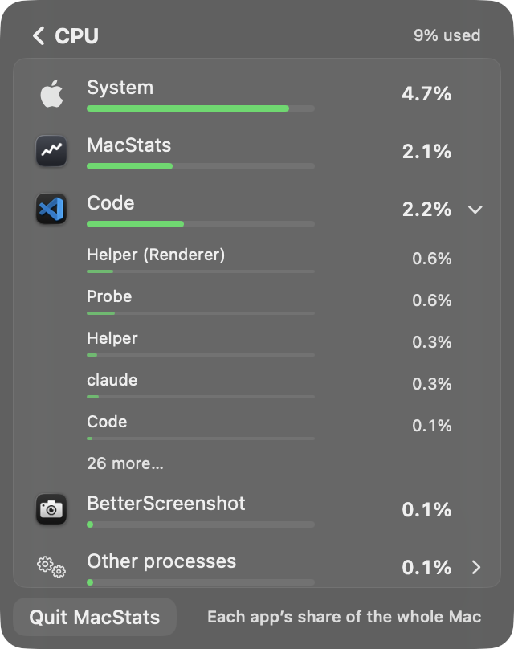
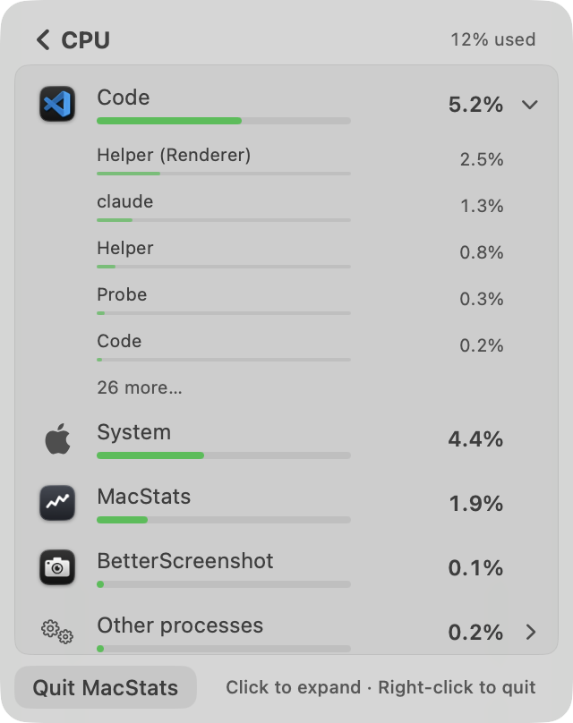
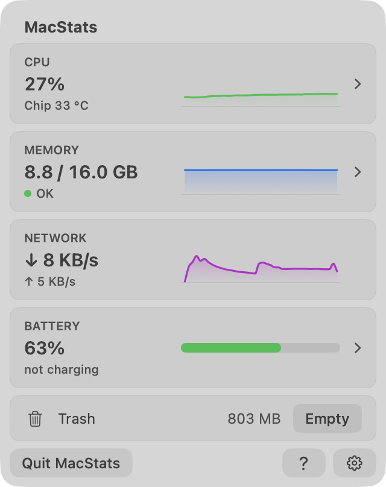
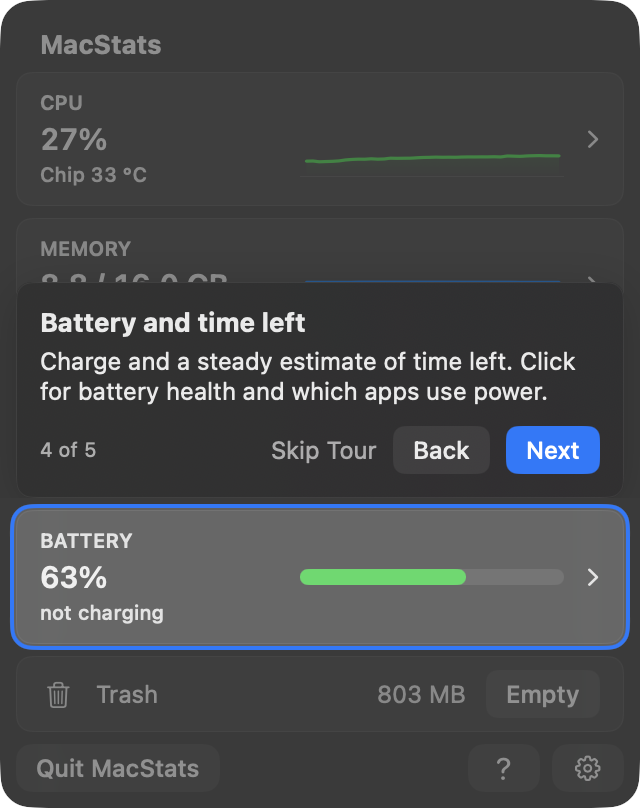
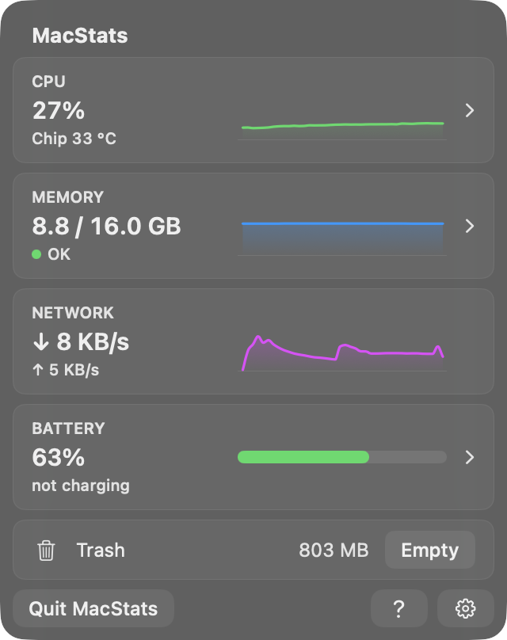
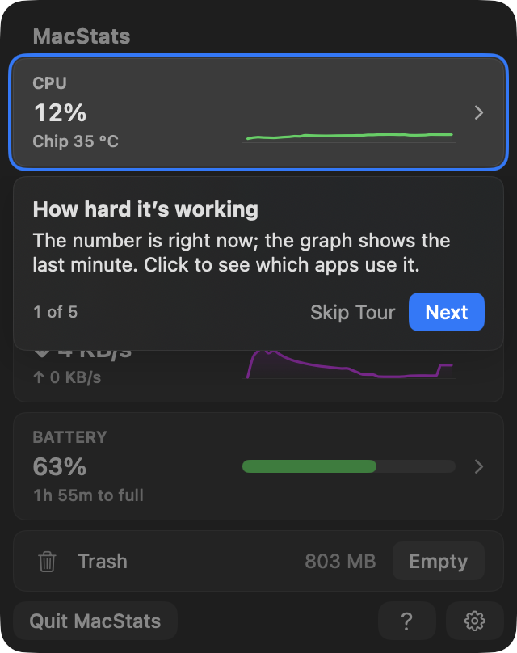

# MacStats stability + tour review, round 6, reviewer B (2026-10-07)

**Overall: 8.4/10.** This is in the owner's "basically perfect" band, with a handful of Low issues and two Medium ones. Every steadiness claim I could measure held up in a 150 s live run on this Mac's real processes:

- **Pointer safety.** With the pointer resting on a row or on an expanded app, no row at or above it moved in 159 scans across CPU, Memory and Battery. The expanded app never disappeared or collapsed.
- **Card steadiness.** The CPU card text changes about every 3 s (20.8 per minute, against 54.8 per minute without the hold), with zero A→B→A flips. It still showed a one-core burst within 1.5 s and its end within 1 s.
- **Tour centring.** The spotlight is exactly centred. Measured from pixels it is 3.0 pt on all four sides of every target, in light and dark, with concentric corners.

What keeps the score off 9:

- **Medium:** a list that is frozen under a resting pointer can show a lower number above a higher one for up to about a minute.
- **Medium:** the breakdown's moving parts (holds, hysteresis, dwell, inversion timeout, promotion floor, fast attack, partial freeze) are hard to reason about as a whole.
- **Low:** a few copy and polish nitpicks.

**Standard:** Apple's Battery / Control Center menu-bar panels, Activity Monitor-quality readings, Apple-quality coach marks. **Method:** screenshots of the real views rendered off-screen, a live headless flow on this Mac's processes, and code reading. **Reviewer:** independent subagent (B). I did not read plans, research conclusions, git messages or earlier reviews before scoring.

## Calibration
- **Type:** native macOS 26 menu-bar app (SwiftUI `MenuBarExtra(.window)`, fixed 320×404 popover).
- **Audience:** everyday Mac users, including non-technical ones. **Maturity:** shipping, v1.x.
- **A 10:** Apple's Battery / Control Center panels; Activity Monitor-parity readings; Apple-quality coach marks.
- **Platform conventions that apply:** light and dark appearance, continuous-corner squircles with concentric radii, Esc to go back or skip, right-click context menus, tooltips.
- **3:** numbers flicker and rows re-sort every tick, so you can't click or expand; the tour is misaligned or traps you; jargon everywhere.
- **6:** mostly steady, but rows sometimes move under the pointer or an expanded app collapses; the tour works but is a few points off-centre or wordy; some controls are hard to find.
- **9:** values steady enough to read yet current within a few seconds; rows never move out from under the pointer; a first-time user gets it in about 30 s; every spotlight exactly centred and concentric in light and dark; the tour can be skipped any time and replayed; plain, short text; MacStats's own CPU/RAM no worse than before.

## Scoreboard
| Area | Score | Verdict |
|---|---|---|
| Stability of numbers & lists | **8.6** | Measured: nothing moves under the pointer, cards change about every 3 s with no flip-flops, bursts show within 1.5 s. A frozen list can read unsorted for up to about 1 min. |
| Interaction reliability | **8.2** | Expand, hover-freeze and back work in the real views. Uncovering the panel (screen unlock) resets an open breakdown to "Measuring…". Right-click menus could not be driven off-screen. |
| Intuitiveness & discoverability | **8.3** | Chevrons, tooltips, the first-drill-in hint and the tour make drilling in obvious. Some "<0.01 W" rows and the "Other processes" chevron need a second look. |
| Text / copy clarity | **7.8** | Mostly plain and short. A few awkward or cryptic lines (tour step 1, "Processor power, not the screen", "Chip 33 °C"); mixed case on the cards' secondary lines. |
| Visual layout, alignment & centring | **8.6** | Squircles, concentric radii and alignment hold in light and dark. Settings is mostly empty space; the scroll list's last row is clipped with no cue. |
| Intro & tour (incl. spotlight centring) | **8.8** | Exactly centred (3.0 pt on all sides, every step, both modes) and concentric; skippable 4 ways; replayable 3 ways. The welcome card is text-heavy. |
| Code quality of the new code | **7.8** | Pure logic in Core, 373 tests pass, well commented. The ranking/hold system has many interacting rules and constants. |
| Resource cost | **8.7** | Display logic 0.26 ms per scan; scan 2.5 ms median; nothing runs while closed; tour inert when off. About +3–4 % of a core while the tour is on screen (noisy probe). |

---

## Stability of numbers & lists: 8.6/10

Evidence: [`r6-B/live.txt`](2026-10-06-stability-tour/r6-B/live.txt). The run used the real `MetricsStore`, `BreakdownDisplay` and `BreakdownScanner`, fed by a copy of `BreakdownScanSession.scan`. It took card samples every 0.5 s and breakdown scans every 2 s for 150 s on 8 cores, with a one-core `yes` burst from t=50 s to t=65 s. Each scan went into three stores per metric: pointer **away**, pointer **resting on row 3**, and pointer **on the expanded app** (the app with the most processes among the first five; it was VS Code, with 31–35 processes).

**Works well (measured):**
- **Cards.** CPU text changed 52 times in 150 s (20.8 per minute; raw rounded readings would change 54.8 per minute with 16 A→B→A flips). It had **0 flips**. The gap between the printed and exact value was 0.50 pp median, 2.34 pp p95 and 2.74 pp max. Memory changed 2.0 times per minute, ↓ 6.4 per minute and ↑ 12.8 per minute, all with **0 flips**.
- **Freshness.** The burst went 4 % → 14 % on the card 1.5 s after it started, and back down 1 s after it ended. In the breakdown, the burst's app jumped from row 3 to row 1 (13 %) on the next scan. Two scans after the end, the header was back from 17 % to 8 %.
- **Pointer away, CPU.** Top-8 order changed 12 times (6.8 per minute, about one every 9 s), and **0** of those changes were undone within 2 scans. Printed values changed 3.96 times per row per minute, with 1 A→B→A flip in 53 scans. 7 of 53 scans showed an unsorted pair, and the longest lasted 3 scans (6 s).
- **Pointer away, Memory:** 0 order changes, 0.14 value changes per row per minute. **Battery:** 2.3 order changes per minute, 0 undone.
- **Pointer on a row or on the expanded app, all three metrics.** Rows down to the pointer moved in **0 of 159 scans**, and the pointed app was never missing. The expanded app was never missing and never fell to ≤1 process (which would collapse it). Its first five process rows changed order 0 times while hovered.
- **The same check in the real view.** In the render probe, two scans with the pointer on the expanded app left every row down to it and all its process rows unchanged, in all 6 cases (3 metrics × light/dark): [`render.txt`](2026-10-06-stability-tour/r6-B/render.txt).

**Issues:**
| # | Severity | Where | Problem | Why it matters | Suggested fix |
|---|---|---|---|---|---|
| S1 | Medium | Any breakdown, pointer resting on the list | Because the order freezes, rows above the pointer can print a lower value than the row below them. With the pointer on row 3, an unsorted pair stayed visible for up to **29 scans (58 s)** in CPU and 24 scans in Battery (48 of 53 CPU scans had one). Screenshot: MacStats 2.1 % above Code 2.2 %. | It reads as "the sort is broken" to someone who rests the pointer while reading. | Keep the freeze (it's what makes clicking safe), but let a frozen list re-sort the rows *above the pointer's row* only if the pointer has not moved for a long time (e.g. ≥ 10 s); or fade an "Updating paused" cue into the footnote while frozen > 5 s. `BreakdownDisplay.freeze` (`Sources/MacStatsCore/BreakdownDisplay.swift:109`). |
| S2 | Low | Expanded app, pointer away | "Finished processes" appears and disappears from scan to scan at 0.2 % (live log t=70–76 s), so the rows below it in the flattened list shift by one row. The first 9 visible rows changed 18 times in 53 scans with an app expanded, against 1 time when hovered. | Small layout jumps while you're reading but not pointing. | Hide "Finished processes" under the 0.5 % promotion floor, or keep it for a dwell once shown. `processRows`, `BreakdownDisplay.swift:213`. |
| S3 | Low | CPU breakdown entry | The header starts at the card's 2 s value and then switches to the 8 s window. In the probe it opened at "27% used" ("Measuring…" screenshot) and then read 12 %. | A visible jump right after the click that opened it. | Seed the header hold with `breakdownTotalCPU` once measured, without the extra two-scan confirmation, and only print it then; or keep the card's number until the first measured header is within the hold band. |
| S4 | Low | Card ↑ line | Upload text changes 12.8 times per minute at a few KB/s of background chatter (twice as often as ↓). | Mild busyness on the secondary line. | relBand 0.25 or a 3 KB/s band for ↑ (`MetricsStore.updateCards`, `MetricsStore.swift:177`). |

**Why 8.6:** this meets the "9" anchor's hard requirements, measured: rows never move from under the pointer, an expanded app never vanishes, and values are current within about 2 s. S1 is the only thing a typical user would notice, and it is a side effect of the safety feature. That puts the area at 8.5–9; S2–S4 hold it below 9.

## Interaction reliability: 8.2/10

**Works well:**
- Expand works: a synthetic click on the row in the probe's own window expanded Code in all 6 renders.
- The accordion is one app at a time, and "26 more…" adds 25 rows.
- Esc / chevron go back (`BreakdownView.swift:97`).
- A context menu freezes the order while it is open, so Quit acts on the row it was opened on (`BreakdownView.swift:128-134`).
- A pointer that hasn't moved since the click on the card doesn't freeze the list (`PointerProbe`, `BreakdownView.swift:566`).
- Quitting a process checks its start time, so a reused pid is never hit (`ProcessActions.swift:34`).
- Force Quit confirms with an `NSAlert` that doesn't close the panel.
- `loginwindow` offers no Quit ("Part of macOS: quitting it would log you out").

**Issues:**
| # | Severity | Where | Problem | Why it matters | Suggested fix |
|---|---|---|---|---|---|
| I1 | Medium | Breakdown open, screen locked or display slept, then uncovered | `setVisibility(.popoverOpen)` calls `enterBreakdown(metric)` (`MacStatsApp.swift:191`), which runs `beginBreakdown`. That clears the rows, shows "Measuring…" (CPU and Battery) and ranks from scratch, so the list the user left is re-sorted under the pointer when they come back. | Breaks "nothing moves under the pointer" in one real path. | On uncover, restart only the scan session (`scanSession = BreakdownScanSession()`) and keep `store.display`; or keep publishing the old rows until the second scan. |
| I2 | Low | Tour step 5 | `?` sits inside the cutout and is clickable, and clicking it restarts the tour from step 1 (`RootView.startTour`) instead of acting as Done. | Mildly surprising loop. | While the tour is active, make `?` finish the tour (or do nothing). |
| I3 | Low | Long lists (Memory screenshot) | The last visible row is cut by the card edge, and the scroll view shows no indicator until scrolled. | Discoverability of more rows. | Acceptable as a cue; or show `.scrollIndicators(.visible)` briefly on appear. |

**Why 8.2:** the main flows are solid. I1 is a real, if uncommon, case where the list resets under the user. Right-click menus could not be exercised off-screen (they need a real `NSMenu` session), so they are judged from code only.

## Intuitiveness & discoverability: 8.3/10

**Works well:**
- Drillable cards (CPU, Memory, Battery) carry a chevron and hover/press feedback; Network keeps the chevron's space empty, so the graphs line up.
- Every card has a tooltip saying what clicking does.
- The breakdown footnote reads "Click to expand · Right-click to quit" until a menu has been used once (or for 10 drill-ins).
- Expandable rows have a chevron; process rows aren't highlighted, because clicking them does nothing.
- New users get the welcome card; existing users get the "Take the Tour" chip ([chip](2026-10-06-stability-tour/r6-B/chip-light.png)).
- `?` and Settings → Help replay the tour.

**Issues:**
| # | Severity | Where | Problem | Suggested fix |
|---|---|---|---|---|
| D1 | Low | Battery breakdown ([dark](2026-10-06-stability-tour/r6-B/breakdown-energy-dark.png)) | Five of seven rows read "<0.01 W", which doesn't help pick the culprit at idle. | Rank them by energy, but print "Idle" (or "—"), with the exact figure in the tooltip. |
| D2 | Low | "Other processes" row | It carries an expand chevron, but what it contains isn't clear before clicking (the tooltip helps). | Fine; maybe add a count ("Other processes · 214"). |
| D3 | Low | Right-click as the only way to quit | Right-click is inherently hidden; the hint mitigates this but disappears after the first menu. | Acceptable; Activity Monitor has the same model. |

**Why 8.3:** a first-time user is walked to the cards and told to click within about 30 s. The rest is polish.

## Text / copy clarity: 7.8/10

**Works well:** short, plain sentences with no units jargon. Memory parts are named "Apps / Kept by macOS / Compressed", with Activity Monitor's terms in the tooltips. Activity Monitor's "% of one core" is kept to the right-click menu. Button titles are Title Case and there are no live numbers in the tour.

**Issues:**
| # | Severity | Where | Problem | Suggested fix |
|---|---|---|---|---|
| T1 | Low | Tour step 1 ([light](2026-10-06-stability-tour/r6-B/tour1-cpu-light.png)) | "The number is right now; the graph shows the last minute." reads awkwardly. | "The number is now; the graph is the last minute. Click to see which apps use it." or "Shows how busy your Mac is now and over the last minute." (`Tour.swift:40`) |
| T2 | Low | Battery footnote | "Processor power, not the screen" is cryptic out of context (the tooltip explains). | "Apps' processor power only". |
| T3 | Low | CPU card | "Chip 33 °C": "Chip" alone is ambiguous for non-technical users. | "Chip temp 33 °C" or "33 °C chip". |
| T4 | Low | Card secondary lines | Mixed case: "OK", "not charging", "running low", "Chip 33 °C". | Sentence case throughout ("Not charging", "Running low"). |
| T5 | Low | Welcome card ([dark](2026-10-06-stability-tour/r6-B/welcome-dark.png)) | Four text blocks before the question; the two permission lines are about 18 words each. | Trim them to "Will ask to send alerts" / "Will ask to use Finder for the Trash". |

**Why 7.8:** no Medium issue, but five small ones across the most-read surfaces.

## Visual layout, alignment & centring: 8.6/10

**Works well:**
- Panel 16 pt, cards 8 pt, row highlights 4 pt: all continuous corners and concentric.
- One 6 pt card rhythm, with headers aligned across the push between screens.
- The fixed 320×404 size means no resizing.
- The footer's Quit / `?` / gear match each other.
- Light and dark both have good contrast.
- The tour callout is the cards' width at the 8 pt margin and starts exactly at the neighbouring card's edge.

**Issues:**
| # | Severity | Where | Problem | Suggested fix |
|---|---|---|---|---|
| V1 | Low | Settings ([dark](2026-10-06-stability-tour/r6-B/settings-dark.png)) | About 45 % of the panel is empty below two cards. | Expected until Milestone 4 adds settings; or centre the content vertically. |
| V2 | Low | Tour step 5 ([light](2026-10-06-stability-tour/r6-B/tour5-footer-light.png)) | One ring encloses two separate buttons, gap included. It is centred and concentric, but it reads as a pill around two objects. | Acceptable; alternatively spotlight only `?` and mention the gear in the copy. |
| V3 | Low | Breakdown lists | The row cut at the card's bottom edge (I3). | — |

**Why 8.6:** pixel-level alignment is excellent; only nitpicks remain.

## Intro & tour (incl. spotlight centring): 8.8/10

**Spotlight centring.** Measured from pixels, independently of the code ([`measure.txt`](2026-10-06-stability-tour/r6-B/measure.txt)). Method:
- I rendered the real `OverviewView` + `.tourHost` over an opaque backdrop, without the tour (base) and with it (each step).
- From the target's centre, I walked outward in the tour image to the accent ring; the end of the ring is the cutout edge.
- From the ring's inner edge, I walked back inward in the base image to the first pixel that differs from the panel background; that is the target's edge.
- I did this along the centre row and column and also at the ¼ and ¾ lines.
- Corners: along each 45° diagonal. With concentric corners, the diagonal gap equals the edge gap.

| Step | Target (pt) | Left | Right | Top | Bottom | Corner diagonals | Light/Dark |
|---|---|---|---|---|---|---|---|
| 1 CPU | 8,36 304×67 | 3.0 | 3.0 | 3.0 | 3.0 | 2.8 ×4 | same |
| 2 Memory | 8,109 304×67 | 3.0 | 3.0 | 3.0 | 3.0 | 2.8 ×4 | same |
| 3 Network | 8,182 304×67 | 3.0 | 3.0 | 3.0 | 3.0 | 2.8 ×4 | same |
| 4 Battery | 8,255 304×67 | 3.0 | 3.0 | 3.0 | 3.0 | 2.8 ×4 | same |
| 5 `?` + gear | 234,372 78×24 | 3.0 | 3.0 | 3.0* | 3.0* | 2.8 ×4 | same (one ¾-row reads 3.5 in dark: glyph anti-aliasing) |

\*At the ¼ and ¾ columns. The centre column falls in the 6 pt gap between the two buttons, so the walk there measures the ring's distance to nothing (35 pt). That is a probe artefact.

The cutout is target ± 3 pt with radius 11 = 8 + 3, and the panel is 16 pt, so it is concentric by construction (`TourLayout.cutout`, `TourLayout.swift:23`). The 2.8 pt diagonal is 3 pt minus one device pixel of rounding. The ring is 2.0 pt.

**Works well:**
- The callout never covers the target: below it when there's room, above for Battery and the footer.
- It is skippable at every point: "Skip Tour", Esc, "No Thanks", and a second panel close. Done finishes the tour and records the version seen (`render.txt`: tour inactive, `seenVersion = 1` after the last Next).
- It is replayable from `?`, Settings → Help, and the existing-user chip.
- → / ← / Return work.
- Reduce Motion gets a cross-fade; Increase Contrast gets a thicker ring; Reduce Transparency gets a solid callout.
- The dim swallows stray clicks, while the highlighted card stays clickable.
- Macs without a battery skip step 4 and count "n of 4".
- New users' permission prompts wait until the welcome has explained them.

**Issues:**
| # | Severity | Where | Problem | Suggested fix |
|---|---|---|---|---|
| R1 | Low | Welcome card | Text-heavy (see T5). | Trim the permission lines. |
| R2 | Low | Step 1 copy | T1. | — |
| R3 | Low | Step 5 | I2: `?` inside the cutout restarts the tour. | — |

**Why 8.8:** the centring is exact and the tour can be skipped and replayed every way the 9 anchor asks for. Copy nitpicks keep it from a clean 9.

## Code quality of the new code: 7.8/10

**Works well:**
- Decisions are pure and testable in MacStatsCore: `TourState` / `TourRules` / `TourLayout`; `BreakdownDisplay` / `stableRanking` / `HeldReading`.
- The app layer only wires those decisions to SwiftUI and defaults (`TourController.swift:1-10`).
- Every constant is named, with its reason next to it (`RefreshScheduler.swift:38-80`).
- `./Scripts/test.sh`: **373 tests in 46 suites pass**, including ranking, holds, freeze, tour state, layout and copy-lint suites.
- The tour writes only its own keys (`TourKey.all`) and classifies new vs existing users before `AppModel` writes anything.
- The freeze is checked against scan timestamps, with no timer.

**Issues:**
| # | Severity | Where | Problem | Suggested fix |
|---|---|---|---|---|
| C1 | Medium | `BreakdownDisplay.swift`, `StableRanking.swift`, `DisplayHold.swift`, `ProcessScan.swift:492-509` | Steadiness comes from many interacting mechanisms: per-row two-scan hold with band/relBand/cap; rank hysteresis with rel/abs/jump; an inversion timeout via `lagging`; a 5 s / 10 s reorder dwell with a jumps-only bypass; `promotionFloor`; newcomer-below-for-one-scan; partial freeze `.through`; ended placeholders; and the fast-attack window restart. Each is tested, but their combination is hard to predict, and S1/S2 come from exactly these interactions. | Write a one-page invariant list as code-level assertions (e.g. a replay test asserting "order changes ≤ X per minute; no row at or above the pointer moves; inversions ≤ N scans") and consider merging the hold + hysteresis + inversion timeout into one rule. |
| C2 | Low | `stableRanking(… frozen:, fixed:)` | Two ways to express "all fixed" (`frozen` and `fixed: .max`). | Keep one. |
| C3 | Low | `MetricsStore.breakdownPointerProbe` | A public mutable closure that the view sets and the store calls on every scan: an implicit view→model dependency. | Acceptable; document it as the one exception or pass the pointer into `setBreakdown`. |
| C4 | Low | Comments point to `docs/research/…` notes | Links from source into research notes will go stale. | Point to `docs/design/` only. |
| C5 | Low | `CLAUDE.md` | Still says "255 tests"; the suite has 373. | Update the status line. |

**Why 7.8:** good, tested code with a maintainability cost in the stability core (C1).

## Resource cost: 8.7/10

**Measured** ([`live.txt`](2026-10-06-stability-tour/r6-B/live.txt), [`cost.txt`](2026-10-06-stability-tour/r6-B/cost.txt)):
- `MetricsStore.setBreakdown`, i.e. all the new display logic: 259 µs median, 460 µs p95 per scan.
- A full scan: 2.5 ms median, 22.5 ms p95, off the main thread in the app.
- The installed MacStats at idle (closed): 0.0 % CPU, 71 MB RSS.

**From the code:**
- No new timers while closed: the tour has no timers or observers (`TourController.swift:9-10`).
- Anchors report geometry only while the tour is active (`TourOverlay.swift:53`).
- The breakdown's event monitor exists only while a breakdown is shown.
- The panel-window observer is two notifications, nothing polled.
- The new scheduler check makes the 0.5 s tick stop when the window is ordered out without `onDisappear` (`MacStatsApp.swift:210`), which saves CPU.

**Issues:**
| # | Severity | Where | Problem | Suggested fix |
|---|---|---|---|---|
| P1 | Low | Tour on screen | In the probe, the overview with the tour on used about 3–4 % of a core more than the run before it with the tour off. The runs were noisy (tour off: 5.8 % then 13.4 %, tour on: 9.9 % then 16.4 %). It costs something only while the tour is shown. | If worth it, avoid recomputing the overlay on every 0.5 s card tick: the anchors are static, so cache the cutout per step. |

**Why 8.7:** cheap per scan, nothing added while closed, and the tour is inert unless on screen. The probe-window CPU figure is too noisy to call a regression.

---

## Cross-cutting issues
- **Consistency of secondary text case** (T4) across cards, the battery header ("Plugged in, not charging") and the details.
- **The freeze trade-off** (S1, I1): the design rightly favours "nothing moves under the pointer". The two remaining places where the list surprises the user are a long-frozen list reading unsorted, and a reset after the panel is uncovered.

## Top fixes (ranked by impact ÷ effort)
1. **I1:** on uncover, restart only the scan session and keep the shown order, so the list isn't reset under the user (`MacStatsApp.swift:191`).
2. **S1:** after the pointer has rested for 10 s or more, re-sort the rows above it (or show a subtle "paused" cue), so a resting pointer doesn't leave the list unsorted for a minute (`BreakdownDisplay.freeze`).
3. **S2:** don't show "Finished processes" under the 0.5 % floor (or dwell it), so expanded lists stop shifting by one row.
4. **T1–T5:** copy pass. Tour step 1 sentence, the battery footnote, "Chip" → "Chip temp", sentence-case secondary lines, shorter permission lines.
5. **I2:** make `?` finish (not restart) the tour while the tour is showing.

## Method & limits
- **Probe:** an independent SwiftPM executable in the scratchpad, copied into [`r6-B/probe-main.swift`](2026-10-06-stability-tour/r6-B/probe-main.swift). It compiles the current `Sources/MacStatsCore`, `CAppleSensors` and `Sources/MacStatsApp/*.swift` (minus `MacStatsMain.swift`).
  - Windows sit at desktop level + 1, ordered back, never activated, and are closed after capture.
  - Tour state lives in throwaway defaults suites, deleted at the end.
  - Modes: `render`, `live <seconds>`, `cost`, `measure`.
- **Data:** this Mac's live processes, battery, temperature and readings (63 %, plugged in, not charging; 8 cores; 16 GB).
- **Gotcha for future probes:** without `ProcessInfo.beginActivity(.userInitiated…)` the probe gets App Napped (an accessory app with only background windows). Run-loop waits then stretch to minutes, and the first two render runs stalled.
- **Probe bug, fixed:** the first dark measurement used a light backdrop colour, giving bogus insets. It was fixed by resolving `windowBackgroundColor` under the current appearance; the numbers above come from the corrected run.
- **Not checked:**
  - Right-click `NSMenu` sessions and Force Quit dialogs (they need a real menu session; judged from code).
  - The real `MenuBarExtraWindow` Liquid Glass (renders use an `NSVisualEffectView`).
  - Scrolling, and VoiceOver.
  - The `.through(app)` freeze with a pointer moving between rows (simulated as a fixed app id).
- **What a human should still verify:**
  - Lock and unlock with a breakdown open (I1).
  - Right-click → Quit on an expanded process row.
  - The tour once in the real panel, to confirm the spotlight over Liquid Glass.
- The installed `~/Applications/MacStats.app` was not touched. No source was edited.
